<!-- 来源: https://zhuanlan.zhihu.com/p/4672231592 | 分类: 03_装备与器材 | 发布: 2024-11-05 | 赞同: 198 -->

# 如何选择滑雪双板 2025——贴地飞行新时代

> 原文：[知乎 · 阿拉布](https://zhuanlan.zhihu.com/p/4672231592)　·　发布于 2024-11-05　·　本文仅供学习交流，版权归原作者所有

距离上一次更新双板分类图已经过去4年，是时候再次发布一期双板的选择指导了。下图根据24-25雪季主要厂商的手册编制。

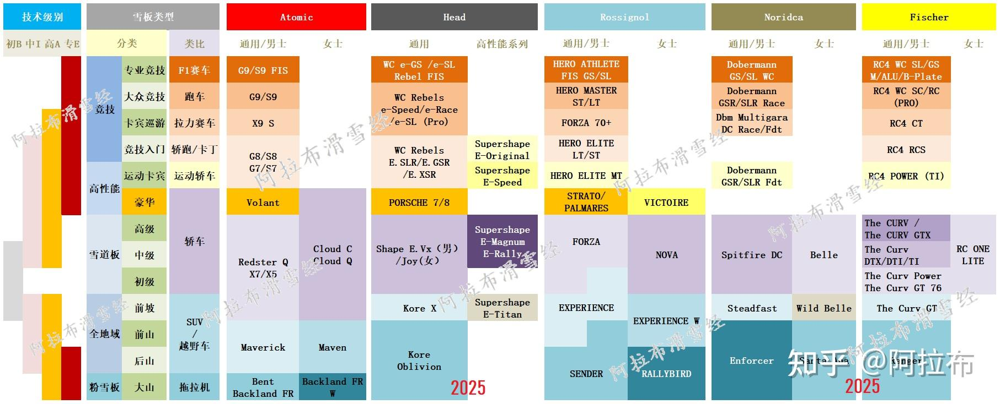

*双板雪板分类图 2025版*

主要厂商产品更新

4年来各家产品线都有不小的调整，尤其是初中级产品，大部分面目全非，大家都把最成功的中高级系列的名字“扩展”到初中级，这样显得初中级也更高大上了。调整的结果看起来是产品线全面高端化，但实际的感受可能会是：物美价廉的中高级雪板越来越少。

Atomic

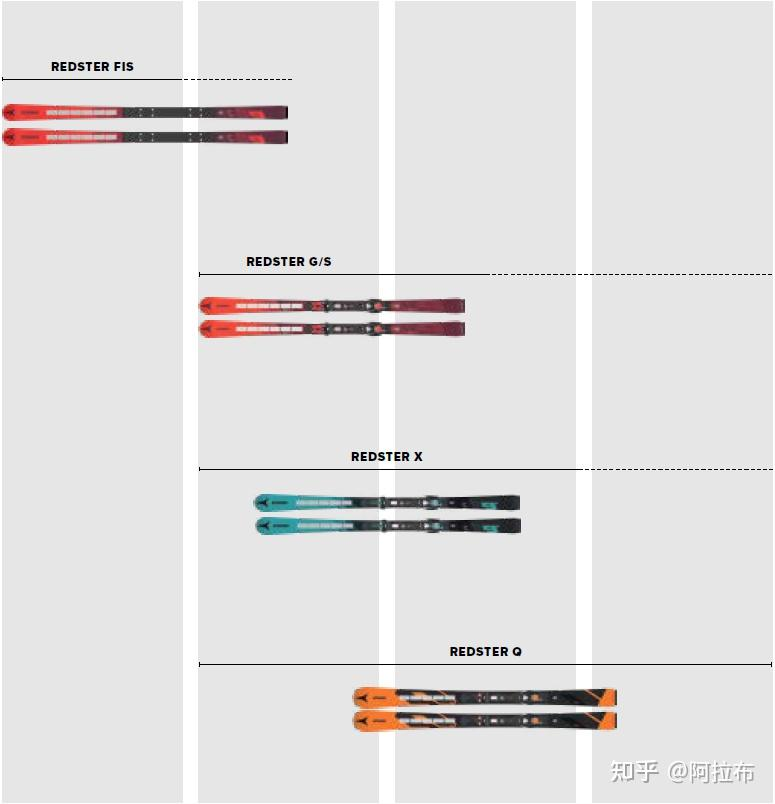

初中级雪道板系列已经被2年前推出的Redster Q系列全民替代，全地域板和道外板全面换代，跟风推出豪华板Volant。竞技和高端型号变化不大，但实际上，S9/G9 FIS在这几年中硬度是逐步下降的，换句话说，越来越“容易上手”，越来越“滑着舒服”。

Head

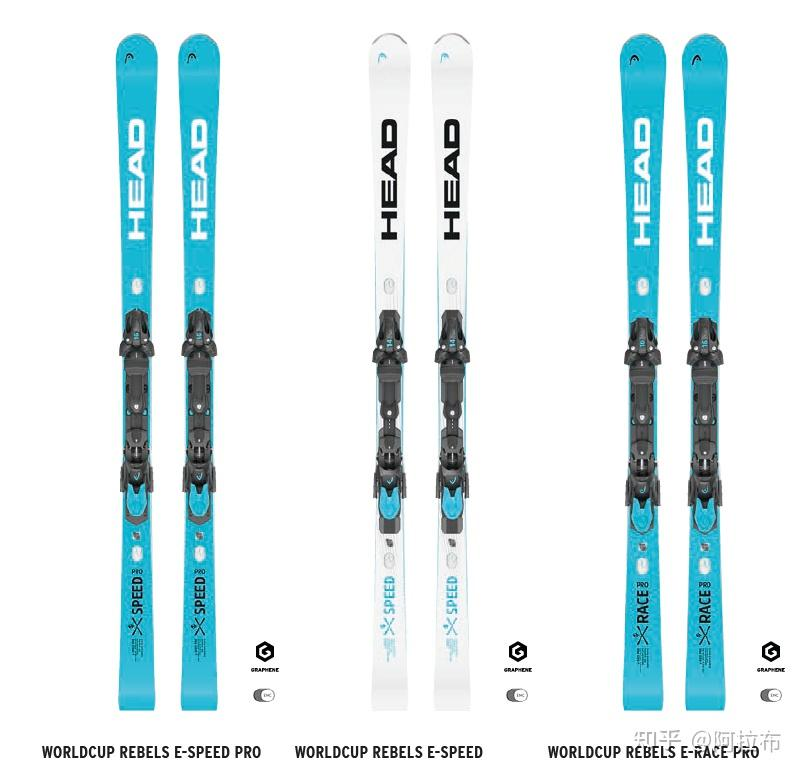

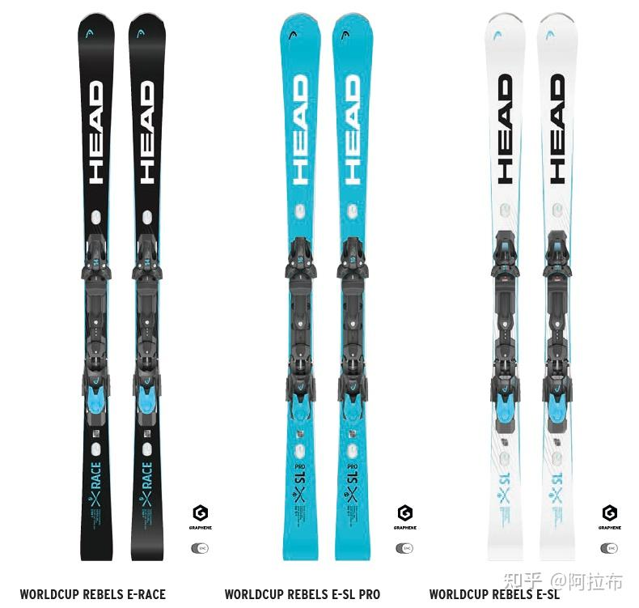

对民顶系列略微进行简化，停产芯片王，以保时捷联名板取而代之。其实在我看来，HEAD最主要变化是产品颜色更加丰富，也更敢于使用高饱和度荧光色涂装。

Rossignol

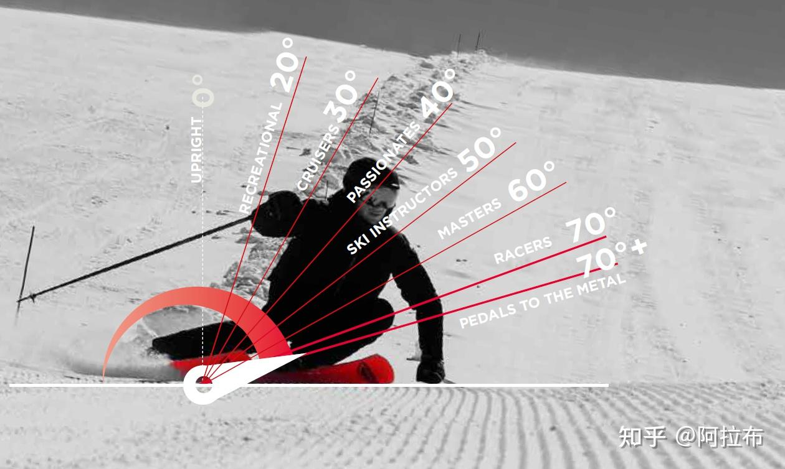

变化非常大，2024雪季Rossignol的全系列雪道板Forza给整个业界带来新的分级定义，将立刃角度与滑雪能力相结合，并用与级别匹配的立刃角度直接进行产品命名，可称为革命性的产品结构变更。遗憾的是，市场推广力度偏小，并未在滑雪板世界引发太多话题。

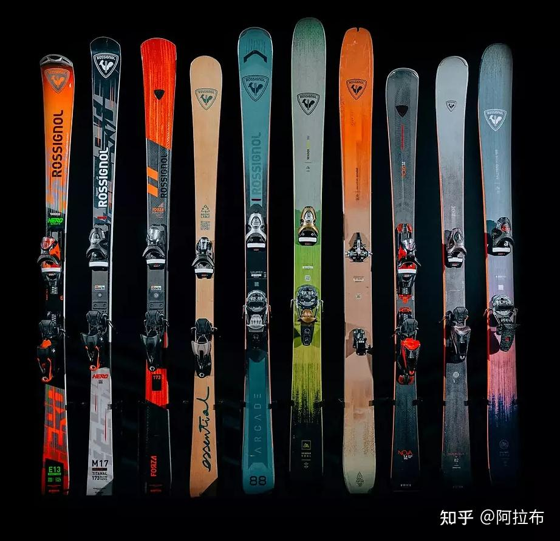

另外，Master系列的商业成功，使其从高端竞技/巡游重新定位到大众竞技（即民用顶级），原来闻名遐迩的红英雄Elite ST/LT挤落到次民顶的位置（占据竞技入门这一档）。当红英雄成为竞技产品线最低档，那么相当于竞技板的入门价格已经升至之前的民顶级别。或者从侧面说明，原本价格稍低的竞技入门板其实无人问津？

Nordica

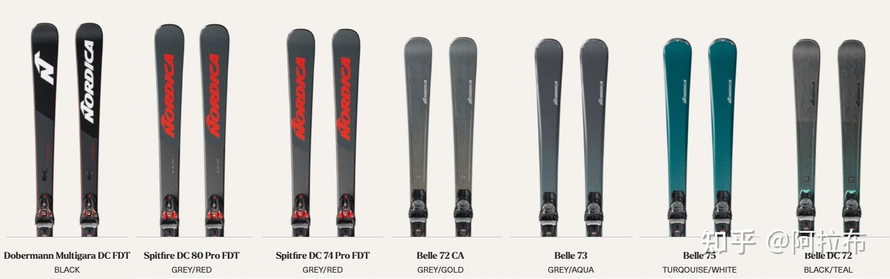

产品线一直保持简洁。今年的明星产品是Dobermann Mulitgara，民顶级别的多功能中弯板，采用双木芯双钛层，表现力强劲。高端以下的各级雪道板仍然由两块Spitfire执掌，但新的女士雪板Belle产品线非常丰富。

Fischer

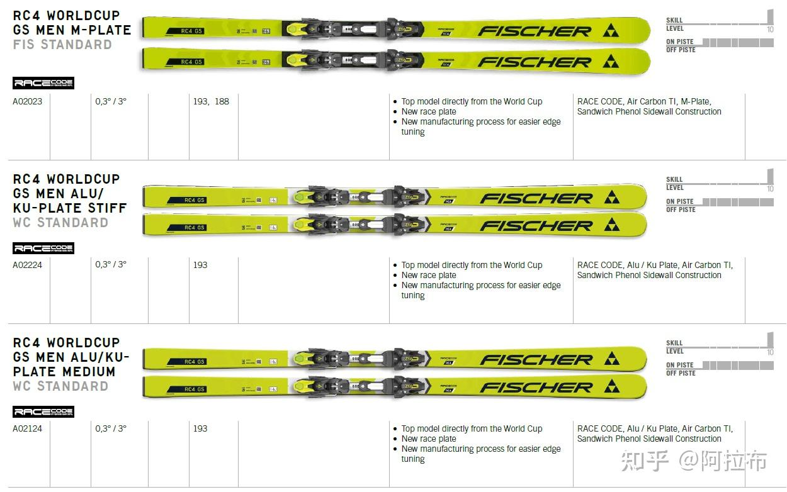

高端产品中推出ALU/KU-Plate铝合金强化垫板（有点单板那味儿了）和M/B-Plate回转强化垫板，并冠以世界杯标准。初中级RC One系列停产，前几年风头强劲的高端系列The Curv系列和DTX/DTI/TI系列填补进入高级和中级板，价格也相应向下调整了一点。竞技系列RC4向下延伸出新的RC4 Power占据了他们原来的位置。另外，原来高端系列的The Curv GT这个型号名，被赋予价格只有一半的全地域前坡系列。

FIS回转板（FIS SL）好贴地？大错特错

众所周知，竞技板都是追求69mm以下的窄板腰，有些厂家甚至把板腰做极限的65mm。竞技板的目的当然是追求在比赛中尽可能快，那大家想过没有，为什么窄板腰会快？快在哪里？

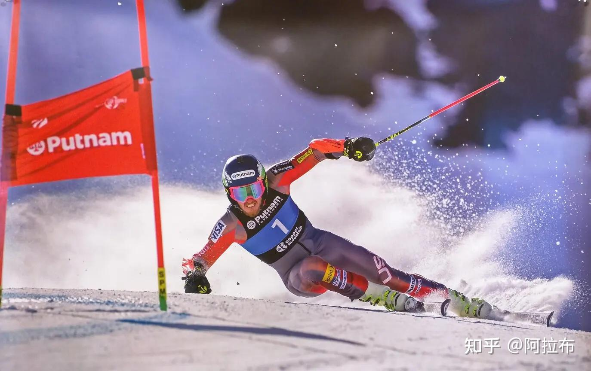

答案是快在换弯。因为板腰越窄，出弯和入弯时翻转雪板的行程（以板刃为支点翻转，雪板中心的运动轨迹）就越短，滑雪者所需的动作幅度就越小，动作时间就越短。所以，窄板腰在激烈的比赛中，转换节奏时更快速。

但是并非所有的人都需要极快的转换节奏。比如休闲巡游滑行，以及水平不够高的滑行者——试想，如果你的雪板已经入弯抓雪，而你的身体还没有准备好，会发生什么事情？使用竞技窄腰板的初中级雪友，尽管刚开始会有转弯和滑雪变得容易的欣喜感受，但实际上都是被动的被雪板拖着走。看起来使用高端板会让滑行有个快速提高，但这是对“人+板”整体而言的，系统中人的水平不仅没有提高，而且还会下降，并可能会产生伴随终生的不良动作习惯。不夸张的估计，在初中级使用民顶雪板的雪友，其进步速度会慢至少3~10倍。这也是我一直反对初中级滑雪者使用高级别雪板的原因之一，为什么要花更多的钱来耽误自己进步呢？

这几年在双板雪圈，非常流行一种高表现滑行风格——贴地卡宾。为了获得卡宾时更大的立刃角，各派人士无所不用其极。比如某人为博眼球极力推崇内脚卡宾（内脚卡宾确实是更容易更高立刃，但是也会带来极大的危险性，如果学的人因此发生事故甚至受伤，教的人赔吗？），还有某些人推广大约源自日本的奇葩的轴锁技术（可简单体验，站直后上身扭转90°，然后尝试弯腰——弯不了对吧？因此身体轴向锁死后再立刃，只能身体直直往下倒，确实有可能会获得更高立刃角。然而，不出弯了吗？不看路了吗？要风格还是要命？）。

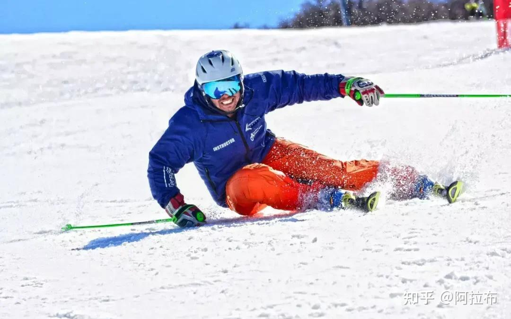

但是这些追求屁股贴地而不得的“大神”们有没有想过，恰恰是他们所推崇的FIS回转板，耽误了他们的表现力呢？

- FIS回转板的板腰极窄，入弯极快，对动作速度要求很高。而贴地卡宾恰恰需要比较大的动作幅度，能在FIS板上极短时间内完成这个幅度，怎么也得是中级水平的运动员了吧？
- 板腰窄，对立刃的精确度要求就高，容错性差。所以水平不够强行贴地时，脚感其实很模糊。
- 回转板的半径小，在纯粹的卡宾弯中很快就得出弯，根本没多少贴地的时间。现在很多的贴地卡宾视频中，出现的都是接近中弯的半径，实际上并没纯卡，而是踩着刃带一点反向搓雪——板头向卡宾轨迹外侧搓雪。这就是为什么这些人一定要用FIS回转板，民顶小弯板对于这种高速反向搓雪确实不够硬。

所以，这些“大神”们带着搓雪，压着内脚，扭曲着身体，含含糊糊的走着刃，摆出屁股贴地的姿态，自我感觉棒极了。其实呢？知道为什么国外同行们看了视频，只会笑笑不说话了吧？

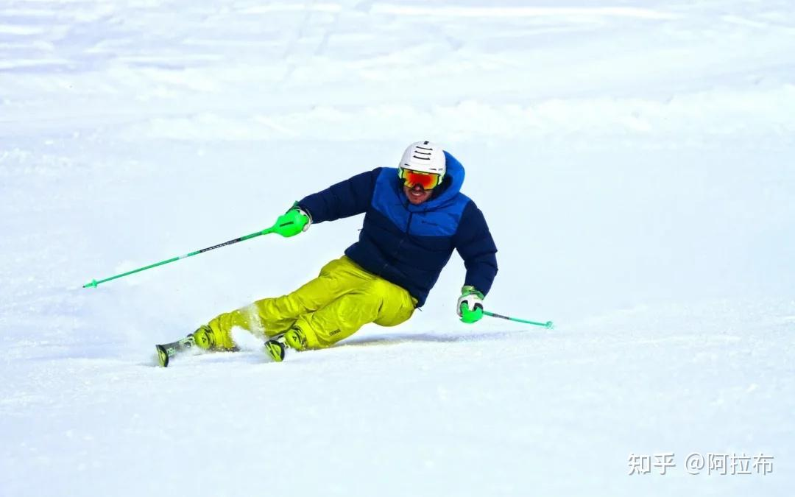

要识别真正的大神，有个简单的办法：滑行节奏和幅度与雪板要匹配，比如用小弯板一定是快节奏的，大弯板则要看弯型，但一般来说节奏越快水平越高。

中弯新时代：宽腰中弯板的崛起

中弯卡宾板一直是一个小众领域，适合水平比较高、喜欢稍快速度、但不喜欢过于激烈运动方式的专家级滑雪者。水平低于专家级，滑不明白中弯板；水平够高但喜欢运动感觉，会更倾向于节奏更快的竞技回转板、或者速度更快的竞技大回转板。当然，随着中弯产品的丰富，也有一些高级滑雪者拿来当做大回转入门板，也是一种不错的应用。

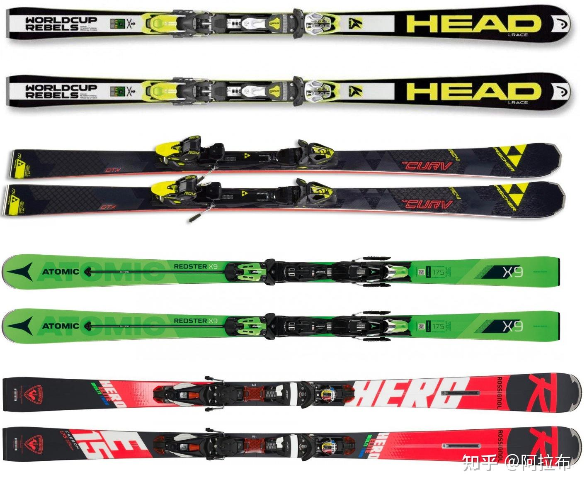

HEAD从2015年就开始推出著名的中弯板I.Race；2016年Fishcer上市以三半径为主推特色的高端中高级板The Curv DTX，本质上也属于中弯板；2017年Atomic一口气推出3块不同级别的中弯板X5/X7/X9；2018年Rossignol跟风上市中弯卡宾板Hero MT。但引发市场关注的爆款是2020年Fischer推出的RC4 CT中弯卡宾板，犀利的滑行特性+高颜值亮色板面，迅速向雪圈展现了中弯卡宾滑行的魅力。

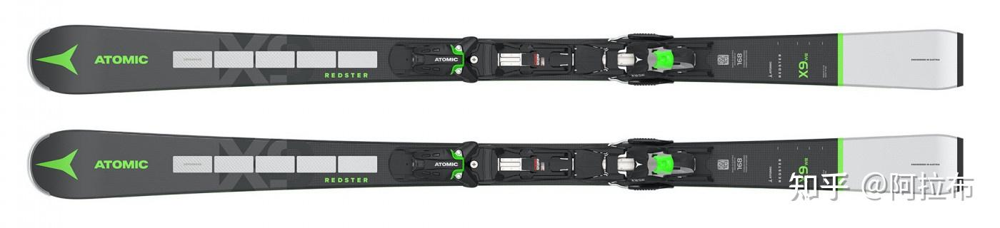

2021年Atomic推出一款非常特殊的产品X9WB，三维128-75-122半径14.2@176。这是一块为世人忽视的宽腰中弯卡宾板。板腰宽，就可以入弯从容；容错强，极限滑行更容易实现；半径中等，有充分的时间贴地，并且速度不会过快：这种宽腰中弯卡宾雪板完美解决了贴地卡宾滑行的痛点。但可能生不逢时，X9WB只推出一年就寂然落幕。

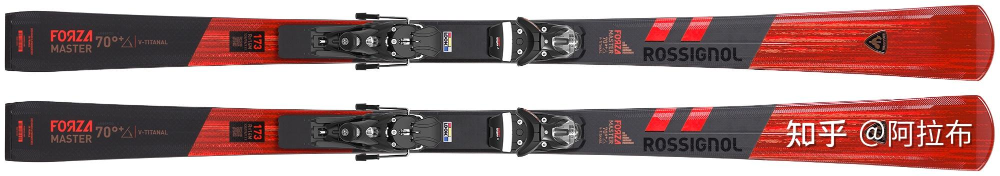

2023年，Rossignol的雪板技术取得突破性进展，推出一款史无前例的宽腰卡宾板 Forza 70D+，三维数据为136-78-112，半径13/14/15米。它的板腰为78mm，大大高于一般的卡宾板。继承所有宽腰中弯卡宾板优点的同时，板头宽度更是达到惊人的136mm，更加容易入弯，但是对雪板抗扭转能力要求极为苛刻。感谢Rossignol中国的支持，去年我们第一时间对这块雪板进行了测试，其性能非常优秀，是不可多得的卡宾贴地利器。测评后一位雪友迅速入手，不到10天功夫就实现了那些“大神”引以为傲的贴地姿态（但需要巩固基础哦）。

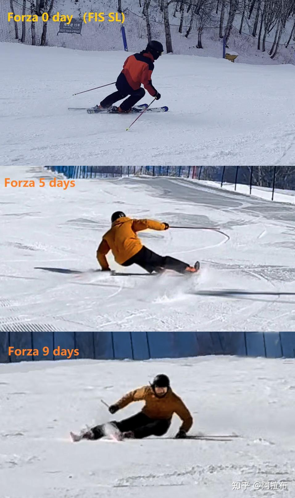

Forza 70D+的优秀之处在于，给予滑行者充分的入弯时间去实现高立刃，在弯中也有充分的时间稳定姿态，同时出弯也更从容，从而实现柔和顺畅的换弯。宽板腰的另一个好处是能够更好抓雪，板刃切入雪面形成的平台更加稳定，可以大大减少贴地飞行时常见的侧滑事故。《SKI》杂志对Forza 70+ 描述是：放低臀部，立起板刃，然后爆发到下一个转弯，这就是在雪上最好的感觉……精心设计只为释放最大潜力。

> It's best feeling on snow: dropping your hips, setting your edge, and exploding into the next turn……Rossignol’s new carving ski si meticulously designed to unlock your maximum potential.

需要注意的是，尽管Forza 70+的板腰宽达78mm，并有5% Rocker，但它真的不是一块全地域板。作为一款中弯板，Forza 70+本身硬度不如同级小弯板，需要一定的长度才能实现稳定性，因此应该选择接近身高的板长。可千万别把163R13的型号当成小弯板，否则等于是花顶级板的价钱买来当中级板用。在去年的评测中就已经能看出来，163的长度对评测滑手而言太短，因此高速稳定性有所不足。我和朋友做的雪板硬度实验性静态测试结果也显示，Fora 70+的硬度略逊于常见的民顶小弯板。

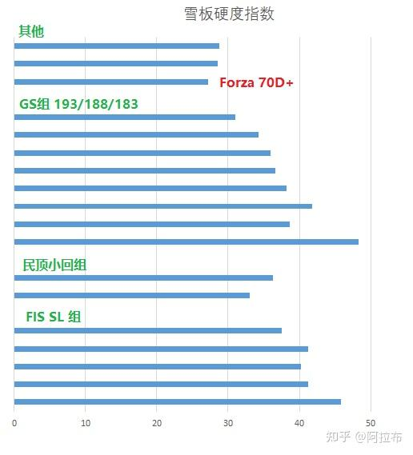

2024-25雪板中，同类型的优秀中弯卡宾板还有：

- Blizzard Thunderbird R15 WB，三维126-76-107，半径15米@174。TrueBlend Piste变密度木芯使得柔和的板头板尾与高硬度板身神奇的出现在同一块雪板上并完美平衡，使其滑行随和性感又不失充沛反弹，获得多项推荐大奖。
- Salomon S/MAX 10 XT，三维128-76-106，半径15米@170。活波却不激进的全能卡宾板，适合在中等速度下寻找转弯的乐趣。可能是最具性价比的同类产品。
- Salomon Addikt Pro 76，三维123-76-107，半径14米@170。在原畅销款Addikt（在中国几乎无人问津？）的基础上加宽而成，提供了更加柔和、更有乐趣、和更加自信的滑行。
- Fischer The Curv GTX，三维125-76-109，半径16米@175。在不同雪况和地形下都有犀利的表现，非常灵活，不适合大弯，需要小心应对速度（高速稳定性不足）。

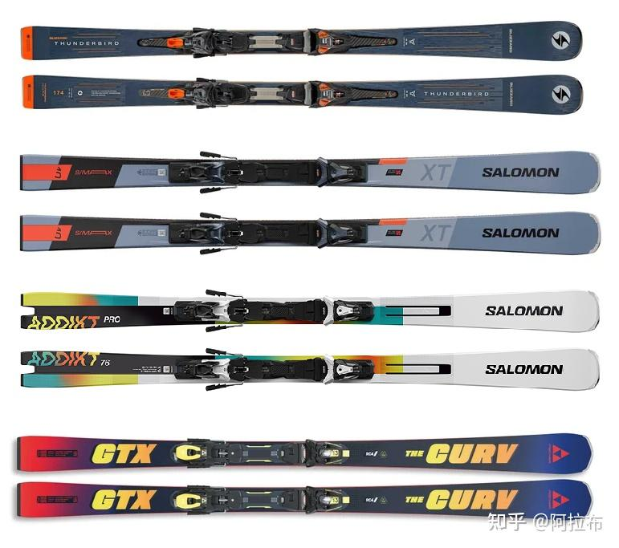

针对不同的身体素质、技术特点、个人偏好、以及价格渠道等，贴地卡宾爱好者可以选择最适合自己的产品。

结束语

选择雪板还是要基于科学的理解、客观详实的产品分析，远离各种一惊一乍、不可思议的传言。尤其一些莫名其妙突然出现的名词，往往是瞄准大家钱包的噱头。最后祝大家都能拥有自己满意的雪板，安全、健康、快乐地享受雪季。

【全文完】
