<!-- 来源: https://zhuanlan.zhihu.com/p/2003521954745968257 | 分类: 03_装备与器材 | 发布: 2026-02-07 | 赞同: 10 -->

# 力线不正的你，真的需要一双定制鞋垫吗？（以侧倾不足/外八脚/内扣膝为例）

随着中国滑雪者对技术和装备的精益求精（后者更容易），越来越多的雪友开始关注雪鞋调整和定制鞋垫，国内从业者也特别真挚热情的希望为大家服务，以至于希望人手一副定制鞋垫。推荐定制鞋垫的理由，除了贴合的鞋垫能更好发力、更稳定、更舒适（其实鞋垫过硬未必舒适）之外，还有两个硬指标： 足弓异常 和 力线不正 。

毫无疑问，足弓异常（以及脚底不贴合）的人需要定制矫正鞋垫才能免除脚和下肢在大运动量时的疼痛（反过来，如果大量运动或长时间站立行走，脚和膝没有疼痛，可以认为足弓没问题）。但是对于仅力线不正的人们，定制鞋垫真的是必须的吗？

一、何为（下肢）力线

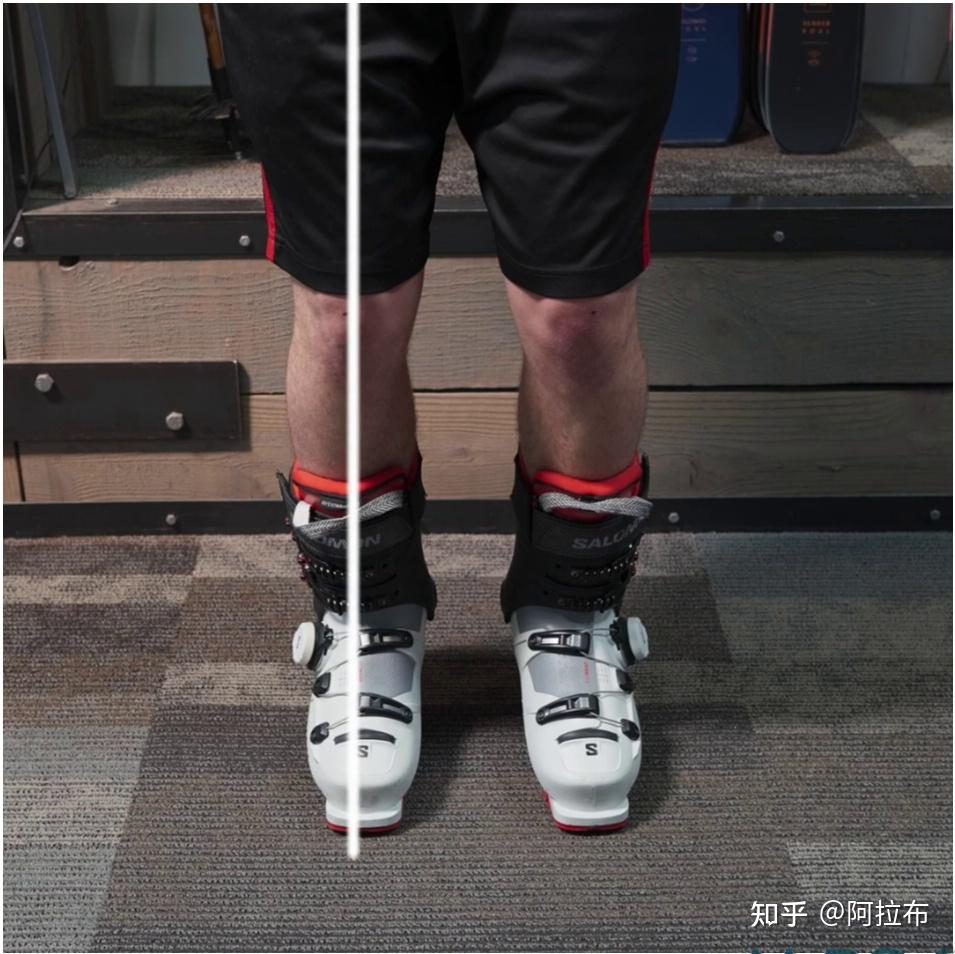

当滑雪者在平地正常站立时，膝盖的中心应当位于脚的正上方，这样力的传导最准确，也最有利于膝关节的健康。

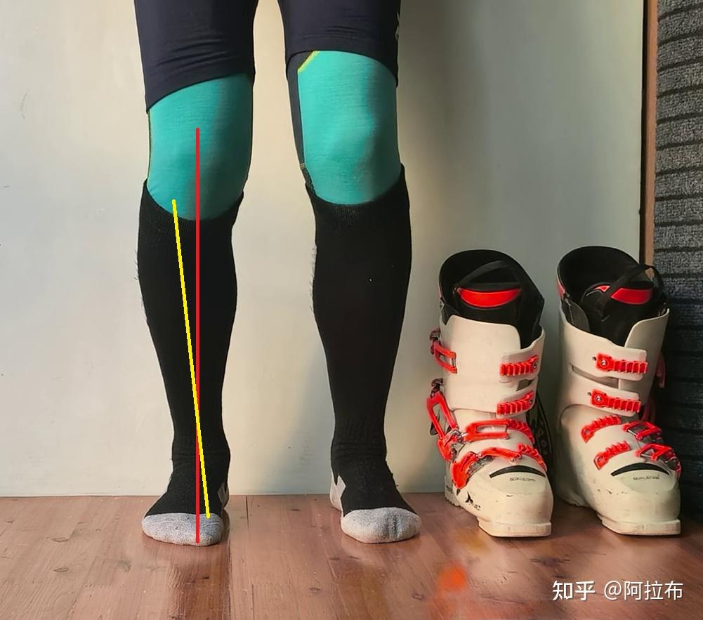

注意，下肢力线不能看小腿骨（胫骨，上图黄线），因为人的小腿骨通常是略向外倾斜的。

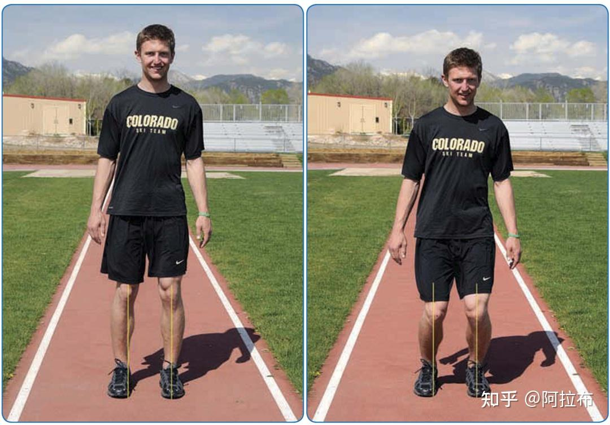

但是人体不是工厂制造出来的机器，个体差异比较大，很多人的力线多少会有一点偏移。是不是只要力线偏离就必须要调整呢？当然不是。

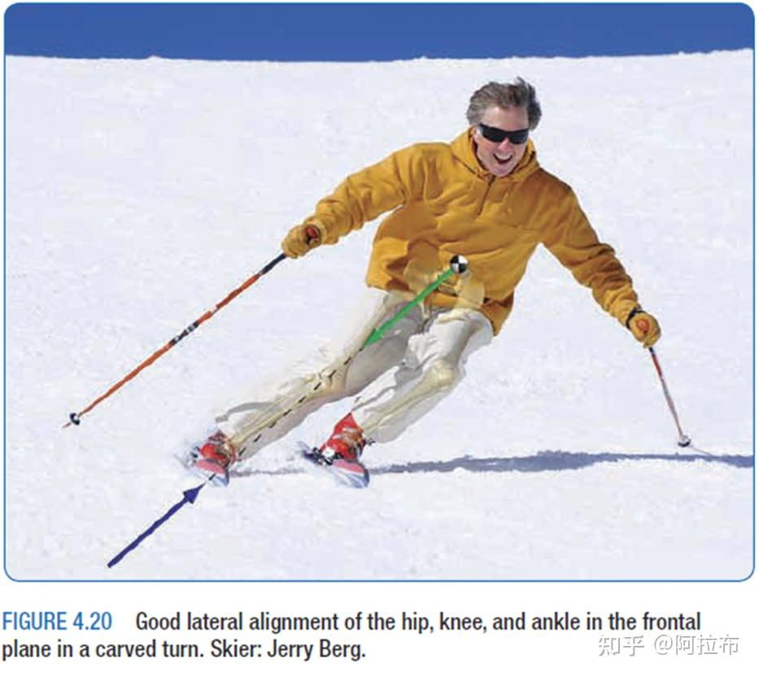

我们采用平行式滑雪时，为了最好的对抗离心力，身体会采用内倾的姿态，滑雪者所受作用力的合力会作用于外板与雪面的交界处，这就是实际滑行时的动态力线，与静态站立时会略有不同。按照Ultimate Skiing书中的原文，滑行中的力线，尽量靠近膝盖即可，而不是必须穿过膝盖中心。

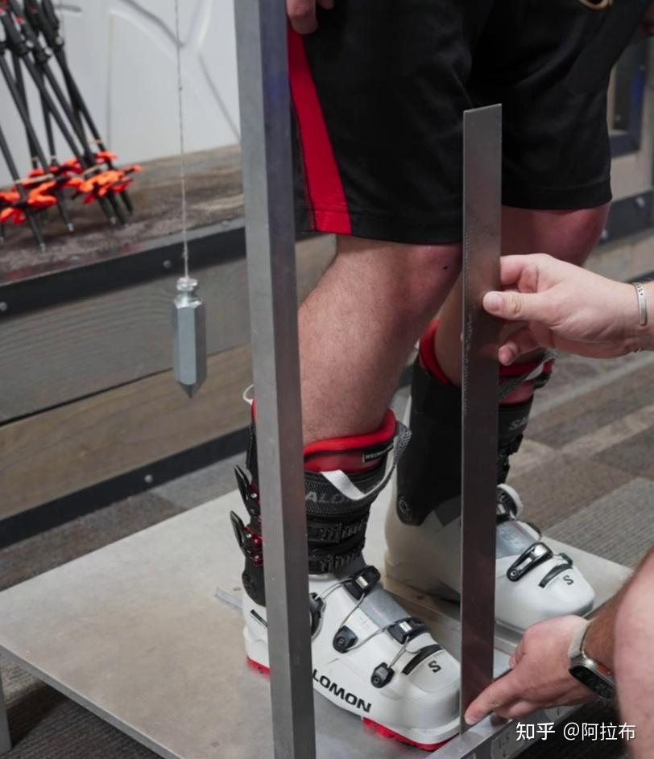

所以，对于大多数人而言，下肢力线仅仅是一个参考，本身我们滑雪时的真正力线也并非是必须严格的通过脚的正上方。对于日常能够正常运动的多数人，少许的力线偏移并不会引起什么问题（但可以被引发焦虑并进一步伤害钱包），产生膝盖疼痛或者动作变形更多的是源于错误的发力模式或者滑行动作。

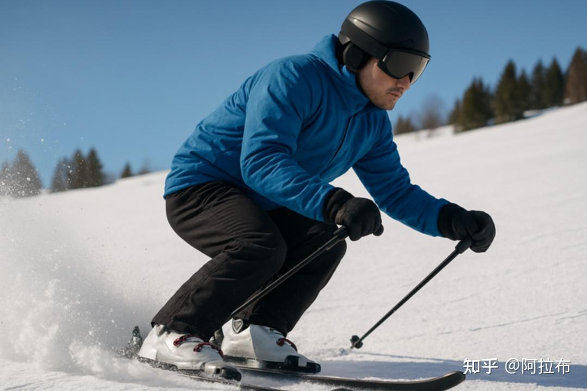

中等程度的力线偏移其实也可以通过整体姿态的调整来弥补，只有严重影响滑行或者健康的偏移、以及需要高度准确动作的高端滑雪者，才必须进行装备调整以消除偏移。但是：

力线不正的调整必须基于正确的诊断，大多数的力量不正可通过调整雪鞋（含鞋垫托）完成，只有很少一些足弓异常引起的力线不正才需要定制鞋垫。

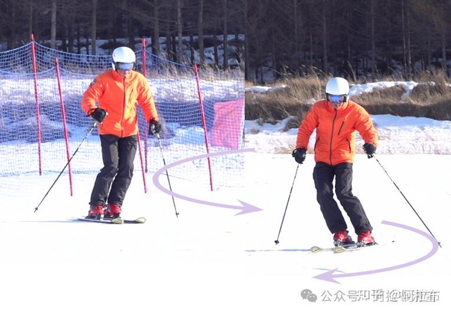

本文讲解两种最常见的力线不正，如何测试，以及如何调整。

二、雪鞋导致的力线不正与鞋筒调整

如果滑雪者赤脚时正常，但穿上雪鞋后出现力线不正，那么很大可能是胫骨外倾与雪鞋的鞋筒倾角不匹配，需要做鞋筒侧倾调整 Cuff Alignment。

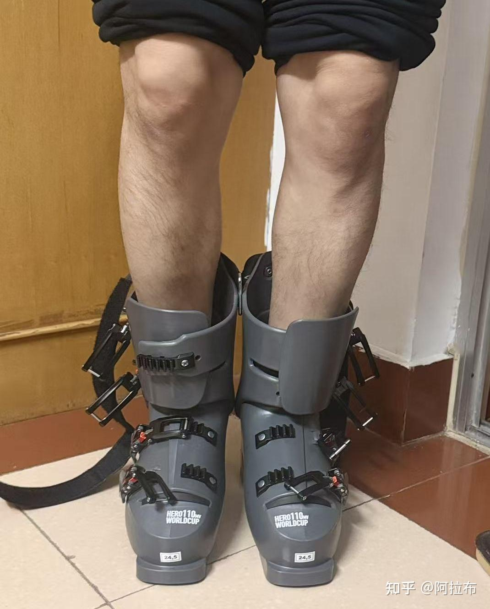

如上图这位朋友（注意：正规的测量应当按照滑行的松紧度扣好鞋扣），雪鞋的鞋筒显然不够外倾，两腿内侧与鞋筒直接的空隙远大于外侧。

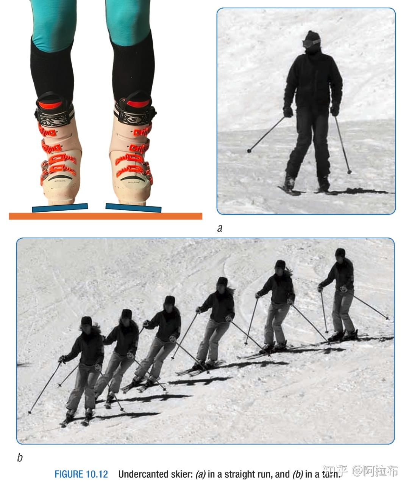

这种情况在穿上雪鞋后，鞋筒会强迫整个雪鞋外倾，雪鞋内侧难以落地，滑行中需要扣膝或者更多向内旋转大腿才能立刃滑行。这种情况称为侧倾不足Undercanted，如上图。

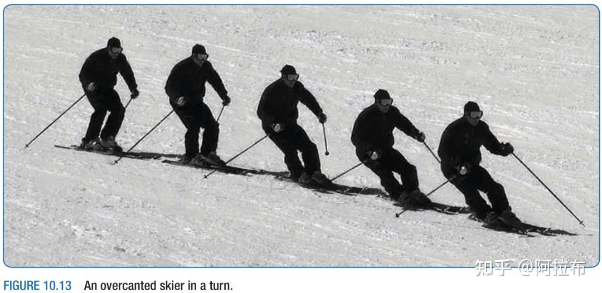

相反的情况下，如果是X腿型穿正常侧倾角度的雪鞋、或者正常腿型穿上鞋筒过于外倾的雪鞋，就会出现侧倾过度Overcanted，滑行中太容易抓雪和卡宾，搓雪变得很难。

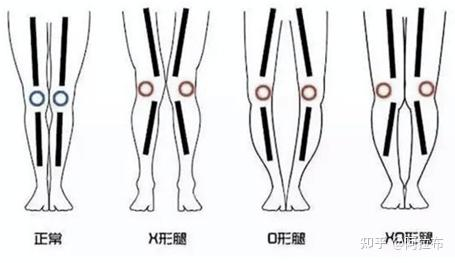

这里有两点提示：

- 大部分看起来像XO腿型的，其实是正常人，小腿之间的空隙是胫骨弯曲的结果，不要被制造焦虑（并进一步伤害钱包）。
- 专注于卡宾的滑手可以选择多一点侧倾，如多0.5°，在不伤害膝盖的情况下可更快抓雪。

每个厂家的鞋筒侧倾出厂设置会略有不同。很多雪鞋的两侧螺丝带有侧倾调整功能，可以根据自己的小腿骨形状进行调整。如果雪鞋的调整范围不够，可以考虑更换调整范围更大的雪鞋，或寻找高手魔改雪鞋变为更倾斜的鞋筒（这种情况很少见，小腿骨倾斜角非常大时，通常会伴随力线不正）。

三、“足偏角”导致的力线不正

足偏角（FPA—Foot Progression Angle）是指我们走路时脚尖方向与行进方向的夹角，又翻译成足行进角。大多数人的足尖偏外5°左右，偏外太多或是偏内称为外八脚或者内八脚。

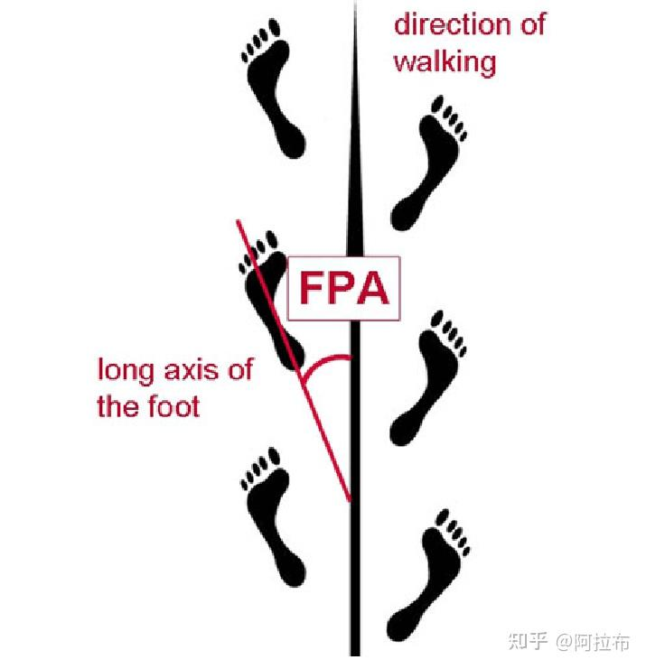

不过足偏角并不直接影响下肢力线，因为这是一个下肢结构和运动习惯的综合结果。在足偏角的驱动因素中，主要影响滑雪下肢力线的是股足角TFA（Thigh Foot Angle），大家可以理解为膝盖朝向正前方时，足尖指向的偏角。注意不要与胫骨外旋混淆，正常人的胫骨扭转角TTA为15°~20°（外旋为正），大于30°才会被视为异常。

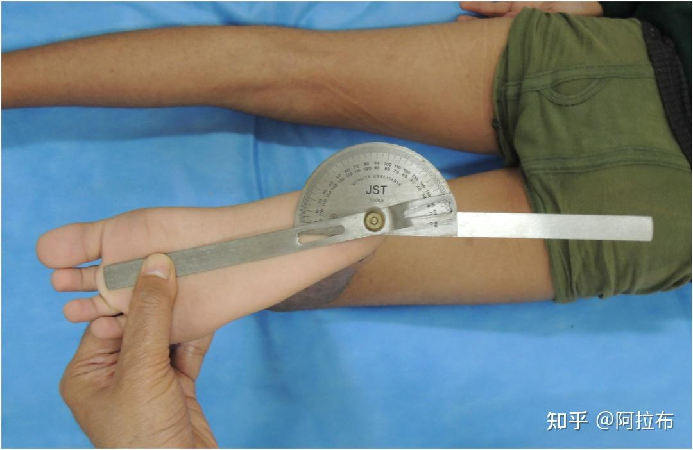

对于足尖外偏的情况，当我们穿上雪鞋和雪板、面向板头方向时，足尖朝向被强制朝前，膝盖不可避免的会产生内旋（膝关节不能旋转，因此这是由大腿旋转产生的）。这个时候检查下肢力线，会发现膝盖中心向内侧移动，从而出现力线不正。

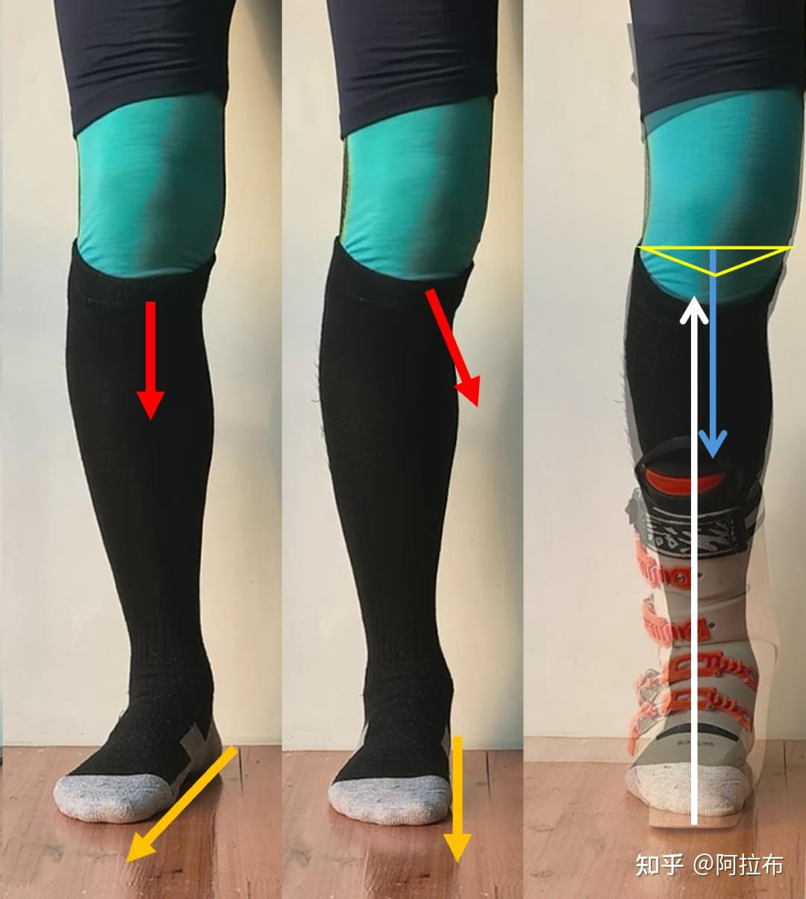

对于这种力线不正，改变鞋垫的曲面贴合度是没什么用处的，但是可以在脚下面增加一个向外倾斜的楔子，来抬高脚内侧、向外倾斜小腿，从而使膝盖中心回到脚的正上方。上图看起来比较严重的力线不正，需要2°的楔状三角形来进行修正，虽然看起来很微小，但对应100mm脚宽的话，脚内侧需要抬高3.5mm，对于鞋内空间而言其实是有挑战的。

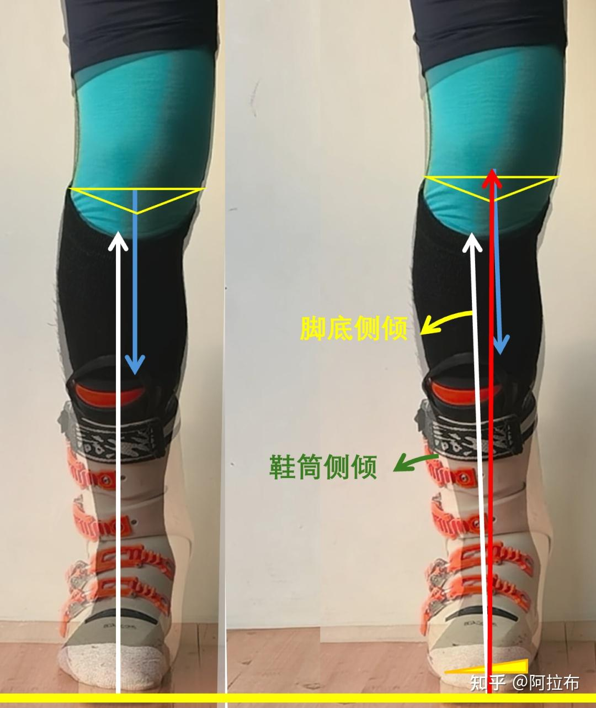

这个修正用的“楔子”有多种实现方式，比如 铣削鞋底 ， 鞋底安装侧倾垫片 、 鞋内侧倾垫片 、以及 为定制鞋垫加底托 ，各有自己的优点和限制条件。其中定制鞋垫增加底托的方式最为灵活，而且有可能实现“定做一次、使用一生”，尤其适合大众水平（竞技鞋内没有空间去增加鞋垫底托，所以主要采用削鞋底+增高片的方式）。这也是为什么在国内力线不正经常与定制鞋垫关联，不过要明白，定不定制鞋垫与这种力线不正没关系，让脚底倾斜的底托才是关键，鞋垫不过是这个底托的载体。

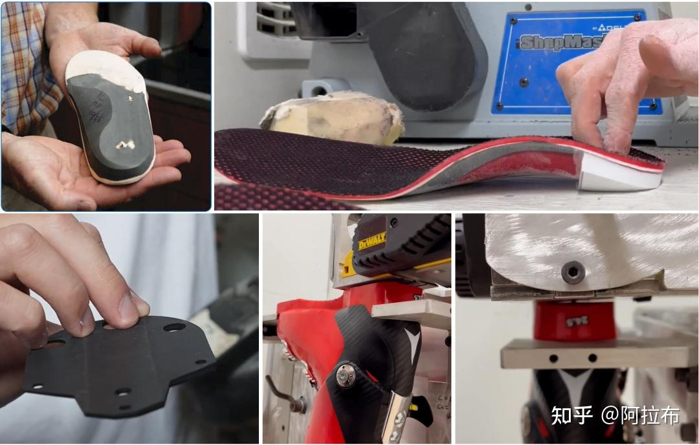

注意：

- 在雪鞋外部的改造不会影响鞋筒侧倾，但是在雪鞋内部增加楔子会导致鞋筒与小腿倾角不匹配，需要重新调整鞋筒。
- 侧倾的修正可能会影响脚踝闭合灵活度，导致前倾不足，如有发生可尝试垫高脚后跟，让小腿的前倾更容易。

四，力线不正的静态和模拟动态自我检测

我们走路通常存在足偏角，但是真正负重发力时却还是会让膝盖与脚尖指向相同，最典型的比如深蹲。

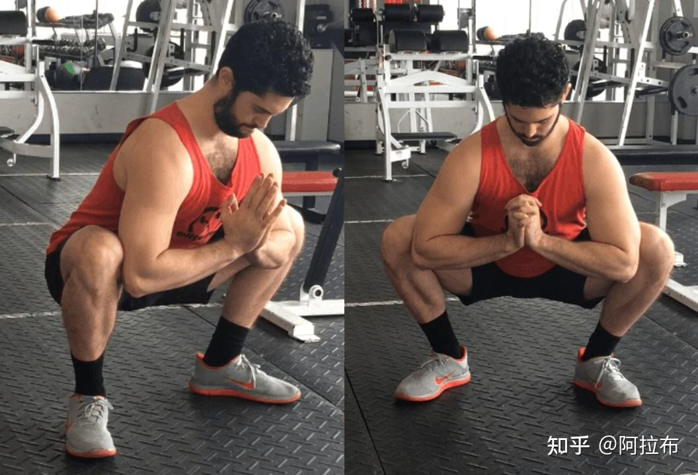

简单的静态测试可以帮自己判断是否存在力线不正，脚尖正对墙面，向脚尖屈膝，过程中膝盖始终轻松自如的保持在脚的正上方是最好的。如果稍微偏向内，可尝试收紧臀肌，或骨盆略后旋，让膝盖向外张开。

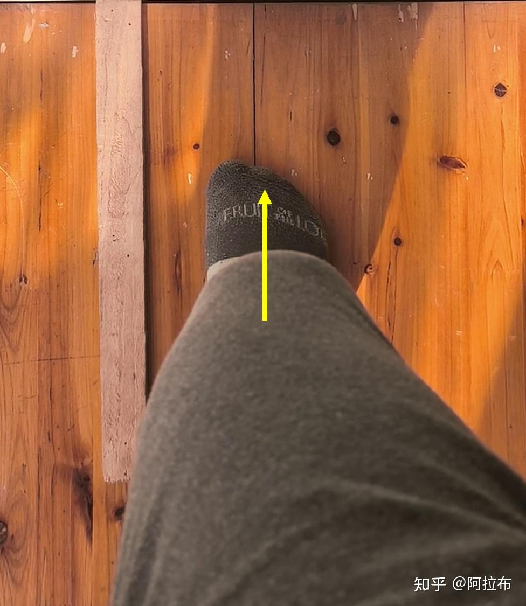

很多人静态测试没有问题，但是一旦上雪进行平行式转弯，就会出现膝盖内扣等现象，这种情况下有些人可能会寻求更加昂贵的动态测试设备。其实我们自己也可以很简单的模拟动态测试，只需要一块宽于5公分的木条，甚至一本书，都可以进行动态模拟测试。

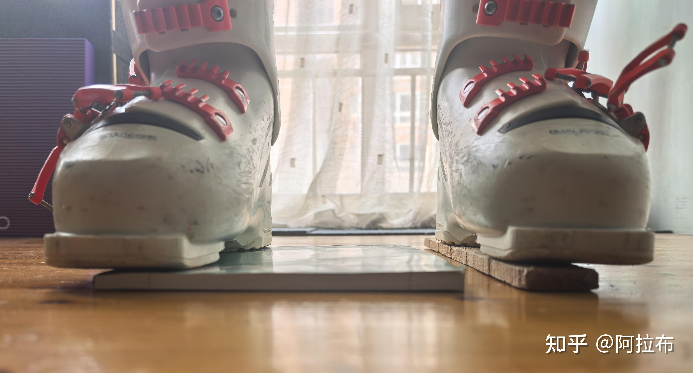

如下图，将木条放在测试脚的内侧一半，再进行相同的测试，如果有动态问题就会暴漏出来。测试的原理也很简单，我们转弯滑行时力线是在脚内侧，而不是静态测试以脚的中线为基准。当力线通过脚内侧时，膝盖也会相应地向内侧移动一点。

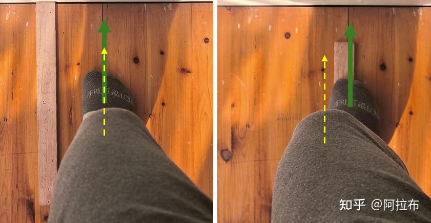

下一步是穿上雪鞋进行测试，检查比赤脚时更好还是更差。更差的情况下，先检查鞋筒侧倾角是否合适，然后检查鞋垫和鞋底是否有变形或不匹配的设置等。

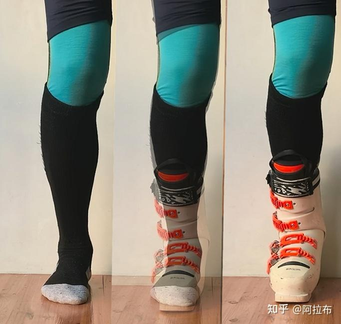

五，通过姿态调整克服力线不正

力线不正是否一定要通过调整雪鞋纠正？其实不必紧张，人的身体有很大的宽容度，对于不追求极限的普通人而言，通过姿态的调整完全可以克服轻微乃至一般程度的力线不正，对非极限状态的滑行几乎没有影响（少许视觉上的K腿虽难以避免但并不会伤膝）。

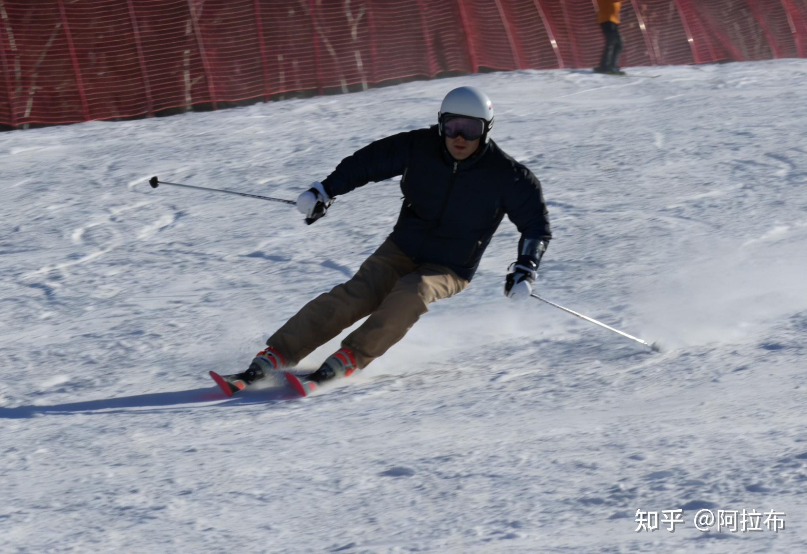

对于足尖偏外的下肢骨骼结构，在右脚单脚站立、强制脚尖向前时，我们身体的自然朝向是向左偏斜的。

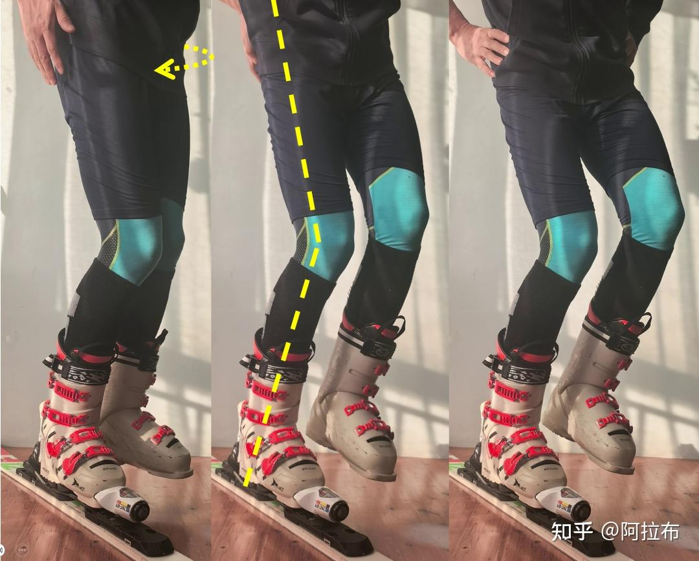

这时候只要向右侧旋转躯干，并进行适当的内腿管理，就能够获得正确的平行滑行姿态。其实这个调整动作，就是Ultimate Skiing书中8.2节讲到的【 膝反弓 】，只是变成脚部固定而移动上半身的方式。不过，正常人使用膝反弓可以让立刃更快或者更多一点，这里是为了弥补下肢骨骼结构导致的侧倾不足，因此结果上可能会比别人少一点立刃高度。

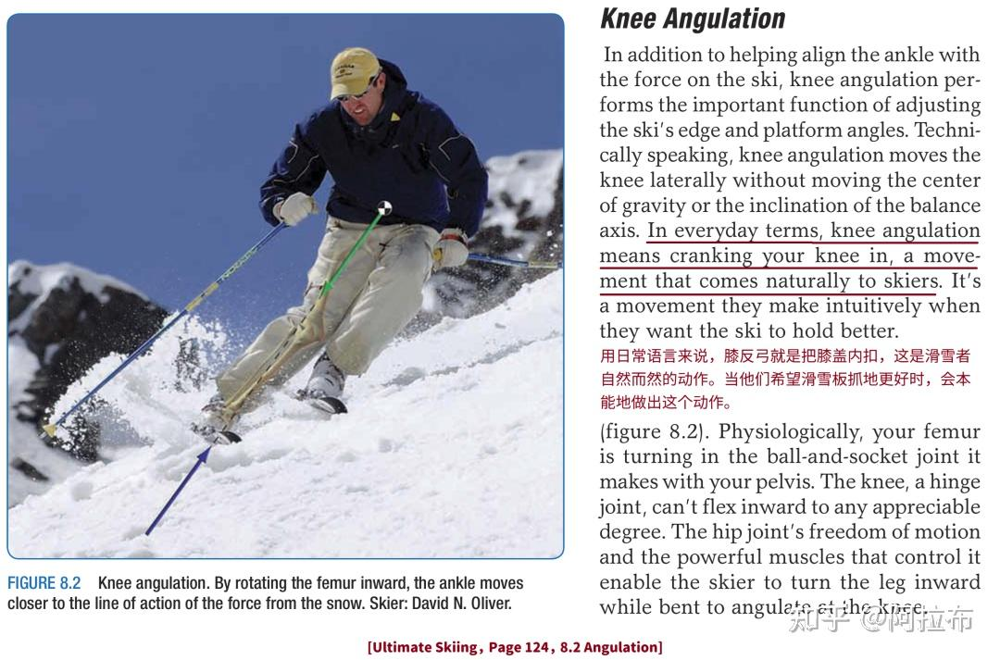

六，通过整篇文章，我们可以得到如下结论：

一、雪鞋和人体骨骼结构都可能导致力线不正。鞋筒调整是匹配现有姿态，而脚底调整是产生新的姿态，不能混为一谈。（在这个问题上，中国有没有称职的专家？）

二、骨骼结构导致的力线不正可以通过姿态、鞋垫底托、鞋底修调等方式克服或者纠正。

三、 力线不正不需要定制鞋垫，但是可能会采用定制鞋垫作为调整的载体 。足弓异常和脚底不贴合才是定制鞋垫要解决的问题。

四、适当的膝反弓可以弥补/克服侧倾不足。

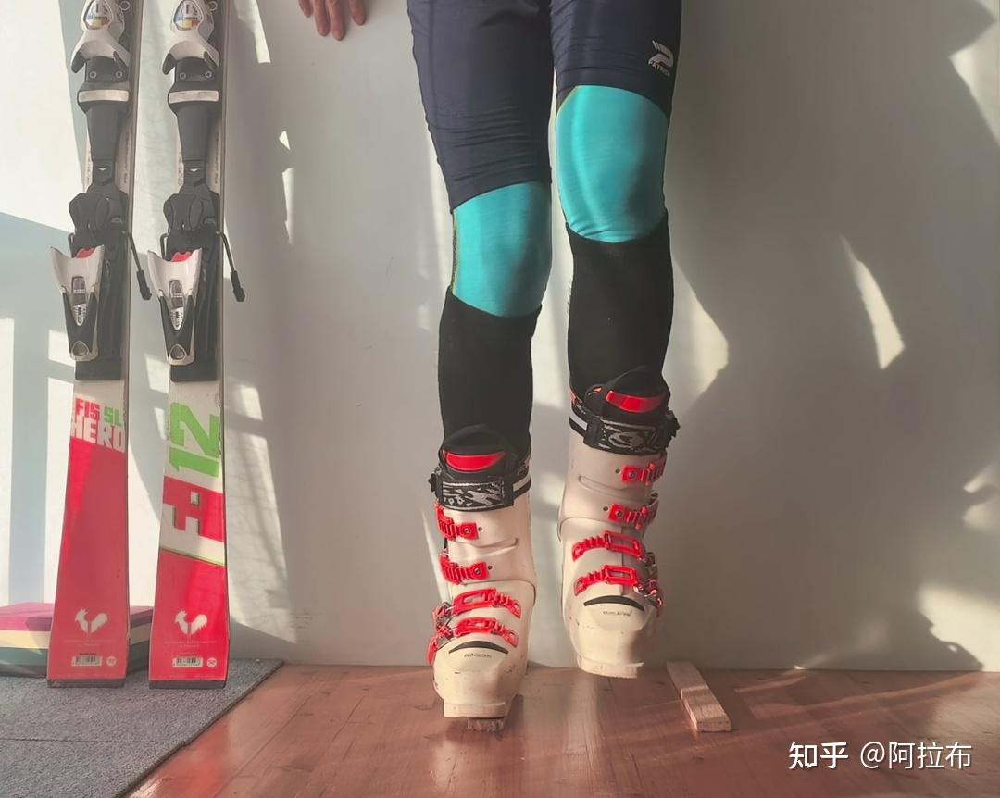
