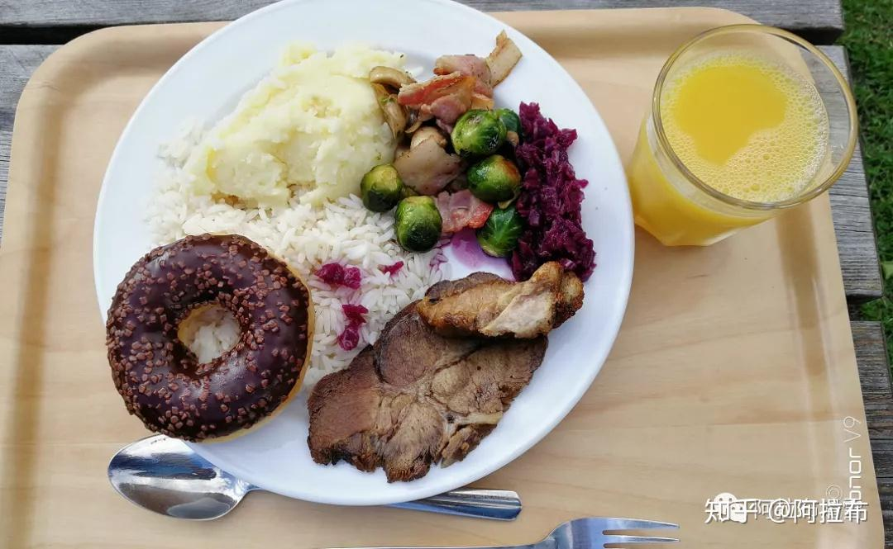
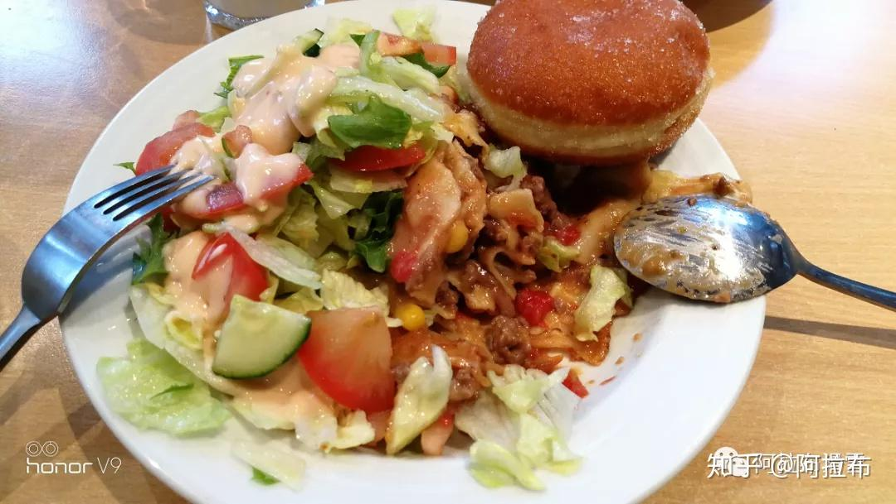
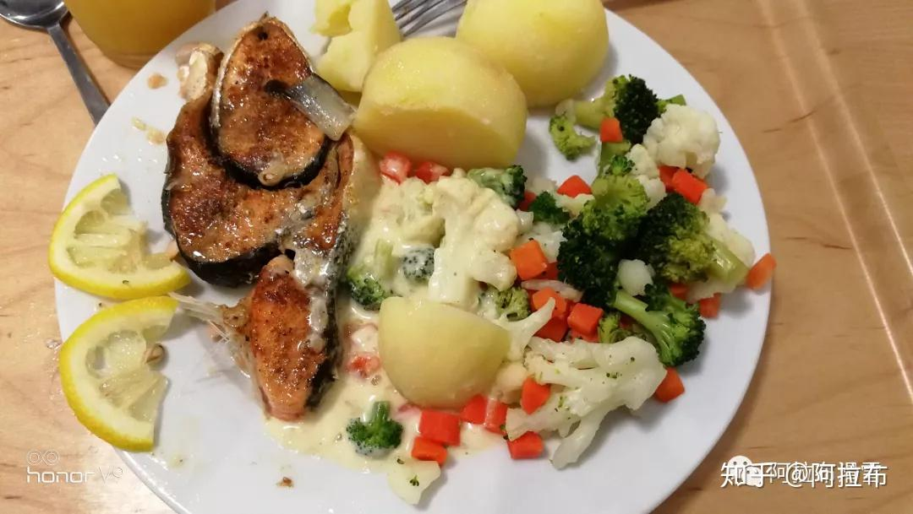
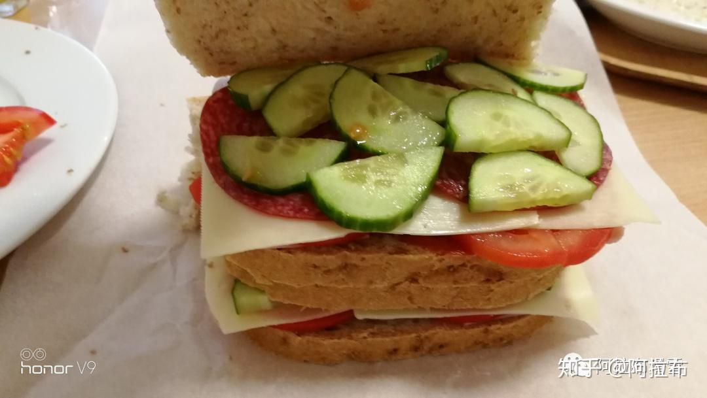
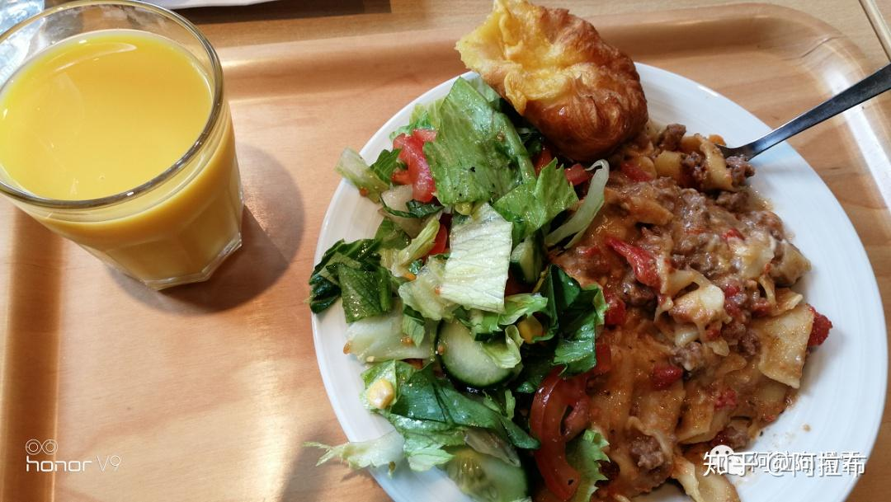
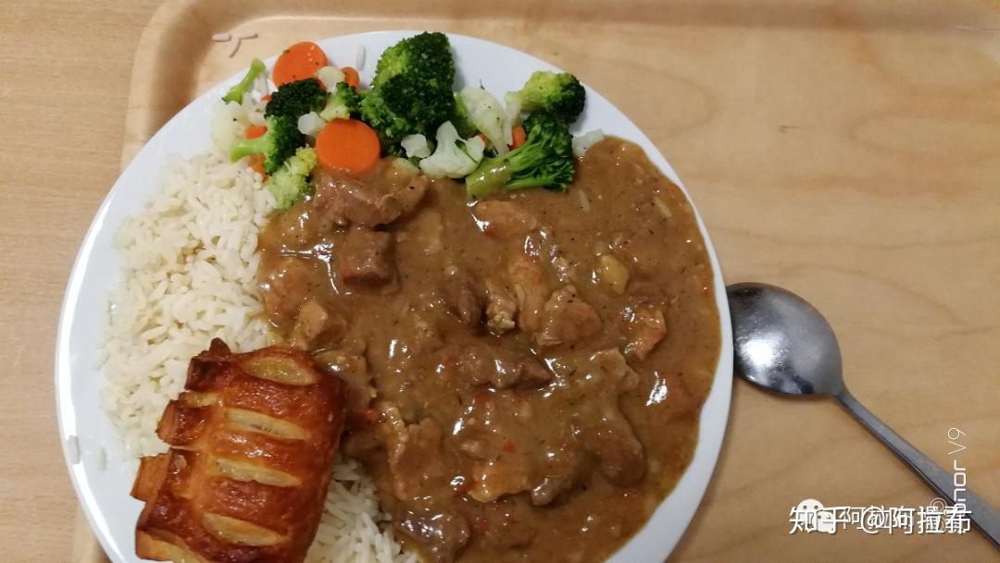

<!-- 来源: https://zhuanlan.zhihu.com/p/340837694 | 分类: 04_安全与体能 | 发布: 2020-12-31 | 赞同: 42 -->

# 【翻译】为了能量——滑雪应该怎么吃

“ 能量，才是支撑我们克服寒冷和疲劳的关键。—— 阿拉布 ”

本文作者Laurie Tarkan，由阿拉布翻译，Ski Mag 网站授权。

配图：阿拉布 摄于挪威 Jondal

原文地址： https://www. skimag.com/adventure/ea ting-for-energy

01

你是一架滑雪机器：请用正确的燃料填满油箱。你在营地旅馆的餐厅排着队, 留着口水走近堆着芝士汉堡，热狗，花式炸薯条的铝柜台。在与雪包搏斗的上午之后，你渴望着富含蛋白质、油脂的食物。但这不是你需要的。吃掉这些蛋白质和脂肪, 你的腿会在缆车关闭之前就早早罢工。

02

“对于滑雪者来说，主要的燃料来源是碳水化合物，它们以糖原的形式储存在肌肉和肝脏中”，匹兹堡大学医学中心运动营养学主任Leslie Bonci说。滑雪是短时间，高强度的运动。为了满足这种高能量的需求，身体会使用糖原，因为它的转化速度比脂肪快得多。如果你没摄入足够的碳水化合物，到了下午晚些时候糖原就会耗尽，导致肌肉疲劳和困倦 (技术上说：湿面条腿)。

03

要增加你的糖原储备，在去滑雪几天前就开始增加你的碳水化合物摄入量，每顿饭多吃一点碳水化合物。早餐有额外的麦片粥，午餐时要吃一大片三明治，晚餐加一份意大利面，多喝果汁。你不需要消减蛋白质和脂肪；你只需要增加碳水化合物成分。在你滑雪的前一天晚上，跳过超大号的上等腰肉牛排。“在第二天的雪坡上，这种蛋白质不会给你用的”，Bonci说。因为它是作为脂肪储存的，而不是糖原。

04

第二天早上，起床后尽早吃饭。碳水化合物需要餐后两到三小时才能作为燃料。并且早餐量大一点，燕麦粥加上面包圈配花生酱或一叠煎饼，或者鸡蛋三明治 (夹香肠) 和松饼。如果你在午餐前滑雪超过三小时，带上一点像软燕麦饼干棒或无花果棒之类的零食，然后在缆车上补充能量。

05

现在的挑战是：午餐。大多数滑雪胜地的套票餐都富含蛋白质和脂肪。但你不需要那些。相反，去吃些烤土豆、意大利面、比萨，或面包配汤。如果你坚持吃汉堡包或辣椒，至少跳过油腻的薯条，多吃点碳水化合物，如烤土豆 (用黄油煎)，卷饼，薄脆饼干，或椒盐饼干。

05

最后一趟之后，就是小酒时间了，对吧？（Miller Time，指劳累一天之后，回家打开冰箱，拿出一瓶Miller Lite轻啤，开始享受）。别这么快。“滑雪后半小时，我们需要为身体补充些东西，但不是啤酒”，Bonci说。原因：运动后肌肉吸收燃料的效率更高。“你等待的时间越长，身体补充糖原供应的效率就越低” ，Bonci说。啤酒，尽管含有碳水化合物，但会减缓吸收的过程。像墨西哥烤干酪玉米片和鸡翅这样的酒吧食物只是装满了脂肪。所以在啤酒之前，喝点运动饮料、果汁或吃点能量棒 (目标是100克碳水化合物)。不吃碳水化合物而直接享受酒精的快乐时光，可能会延迟48小时才为你的肌肉加油，让你的腿在第二天空着运转。

更多精彩内容，线上咨询与线下教学信息，请关注微信公众号《阿拉布滑雪》。
