<!-- 来源: https://zhuanlan.zhihu.com/p/703035268 | 分类: 04_安全与体能 | 发布: 2024-06-23 | 赞同: 17 -->

# 高山滑雪青少年运动员发展规划

> “天赋很重要，但努力为其双倍 Talent counts, effort counts twice. — Angela Duckworth ”

总有人说，“在天赋面前努力一文不值”，这话有一点道理，但也只有那么一点道理。每项运动的金字塔尖确实都是天赋者，但是金字塔中间也不乏天赋不错的垫脚石——天赋遇到天赋，必然是更努力者胜出。

其实两者的关系更像这个公式： ，天赋禀异会扩大努力的成果，而更多的努力也可以在一定程度上弥补天赋的不足。

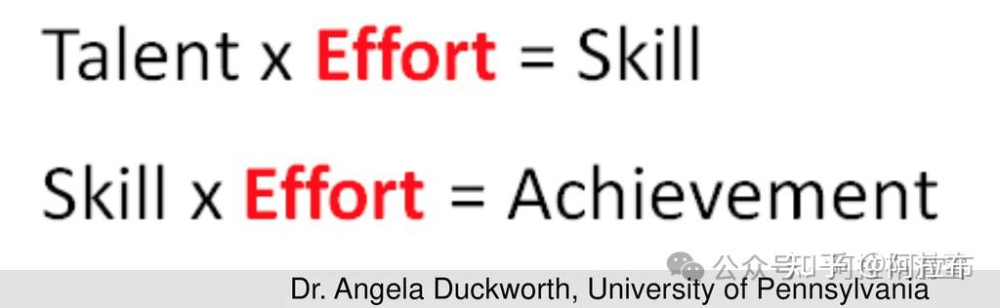

然而， 天赋没有上限，但努力是有极限的 ，其中最大的限制是个人资源的投入，比如时间、体力、精力、财力。所以，如何努力同样很重要。

高效的训练计划可以达到事半功倍的效果，节省出来的时间就会有更多提升的可能，而合理的运动生涯规划则会让孩子每一步恰好踩在点上，最大化运动能力和技术水平的发展效率。

## 01 长期运动发展模型LTAD

天赋≠天生，很多运动天赋是后天发展起来的。即使家族的运动基因非常强大，孩子自身的 天资 （ Gifts ）也需要在各个发展窗口期通过各种运动才能形成 天赋 （ Talents ）。

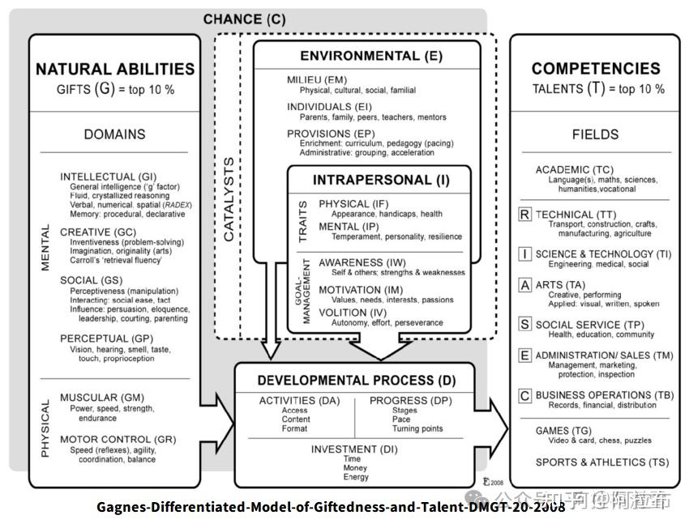

目前主流的运动发展理论包括LTAD（长期运动发展）、YPD（青少年身体发育）、DMSP（体育参与发展模式）等模型，在实践中普遍以LTAD为主干，以YPD等为补充。

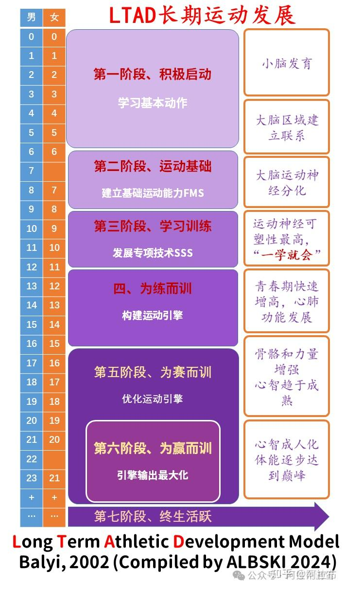

LTAD 模型由加拿大体育科学家 Istvan Balyi 于 1990 年开发，他受英国业余游泳协会 （ASA） 委托，制定一个教练可以遵循的计划来培养精英游泳运动员。该模型在多项运动中被接受和实施，随着对体育运动中青少年发展的理解不断加深，LTAD模型发展成为一个七阶段框架，以促进体育和体育活动的长期进步和成功。

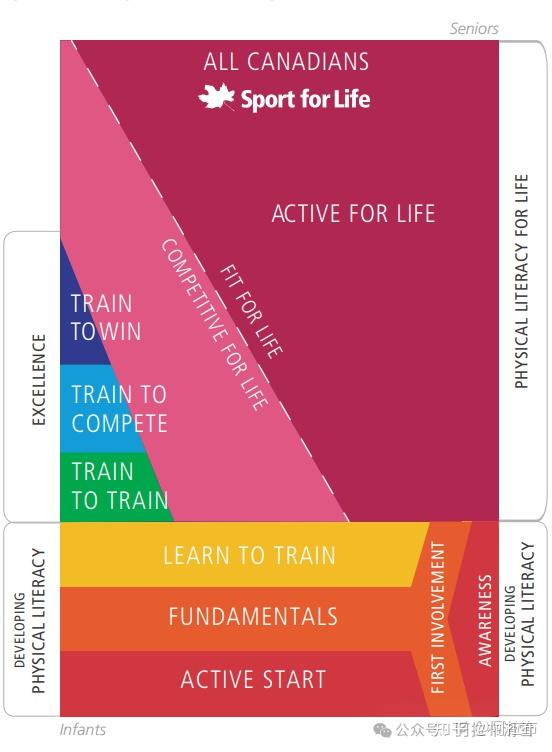

LTAD模型指导高山滑雪运动的一个典型例子是美国滑雪与单板竞技协会所使用的ATS模型（下载链接在文末）。我们在2017年参照这个模型对基础滑行能力进行了训练并达标，但2018年在挪威开始竞技训练后，发现ATS的技能虽然非常有用，但要求过于简单（也可能是相对于达标，还有更高的优秀级标准）。而后按照欧洲训练体系走下去，就没有必要再用这个模型。另外ATS只有专项能力的发展，可能对青少年而言不够全面。

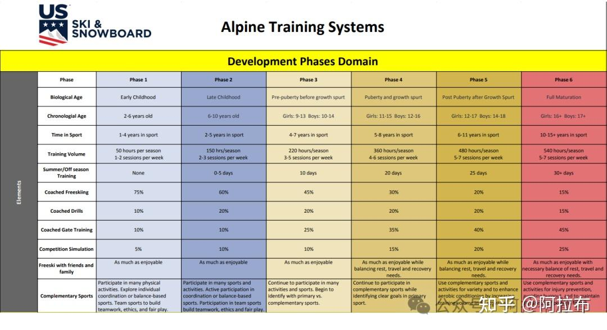

## 02 Fundamental，基础运动技能发展——儿童期

很多运动会有童子功的说法，比如武术、体操等，那么对照LTAD模型我们可以发现，对协调、柔韧、反应速度等因素在这些运动中更加重要一些，而这几种运动能力的窗口期都在9岁以前。

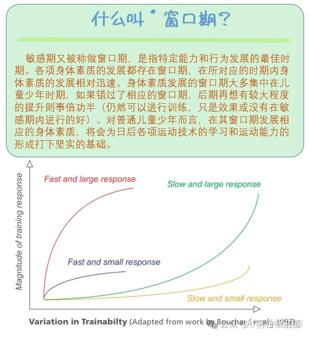

滑雪同样是童子功项目，但有意思的是， 滑雪所需的童子功，不用滑雪也可以获得 。国外对滑雪运动几十年的研究表明，滑雪要求的是综合运动能力，而非几个特定的体能要素或者运动技能，因此滑雪的孩子在儿童期最好也要多多参与各种运动，不能局限在滑雪。

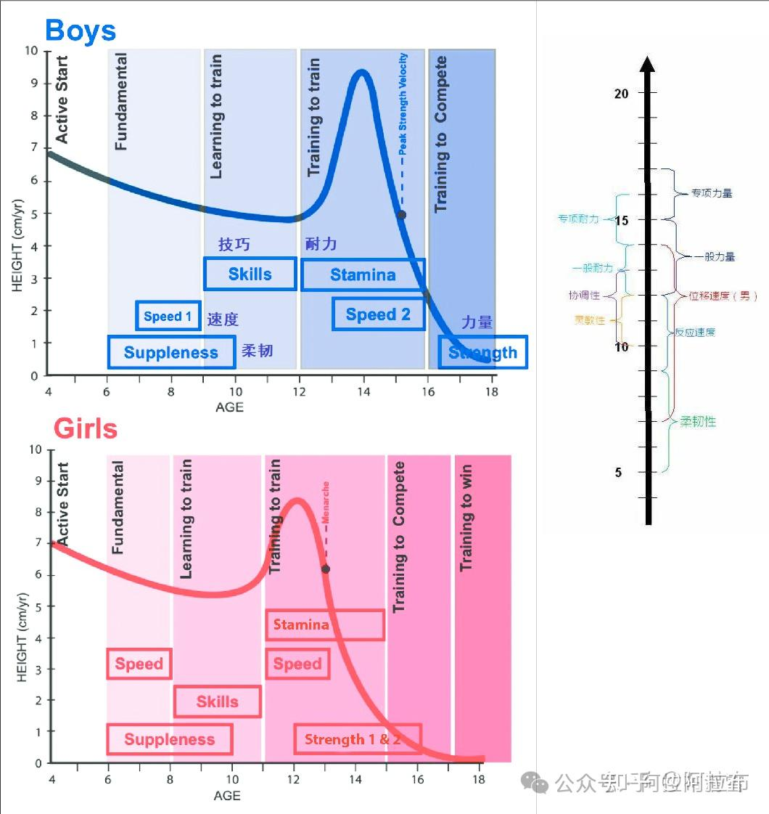

LTAD模型前两个阶段可以统称为儿童期，是孩子发展身体运动能力的主要过程，“如果在生命早期没有掌握基础运动技能，孩子在面对更复杂运动时会遇到更多困难，甚至不再追求运动的进步或者参与运动”。

基础运动技能FMS包括ABCs（敏捷性、平衡性、协调性、速度）、RJT（跑步、跳跃、投掷）、KGBs（动觉、滑行、漂浮、用身体击打）和 CPKs（接、传、踢、挥打）。在第一阶段（6岁以前）主要发展ABCs，其他技能的窗口期都在第二阶段。这里有如下三个建议。

- 协调性的窗口期是8个月到3岁左右，也就是爬行阶段。文献和实例表明，如果孩子爬的少，长大后不仅运动协调性差，而且有可能出现认知、表达等方面的劣势，最严重的甚至会引起感统失调（多动、涣散、暴躁等）。
- 速度不仅仅指位移速度，还包括反应速度、动作速度（频率），这两项的发展主要在儿童期，尤其与人体的神经和肌肉系统发育过程严格相关，错过窗口期再发展就真的很费劲。要鼓励孩子们参与更多灵敏性和更高动作频率的游戏，这是儿童期发展速度技能的最佳方式。其实很多常见的游戏如丢沙包、跳皮筋，追逐躲闪等，也都非常有益。
- 这一阶段的运动能力发展要以娱乐为主，尽可能多的参与各种运动，而非大量的特定专项训练。但高水平运动技能的发展也会受熟练度等影响，因此对于有能力的孩子，适当的给予高水平的专业引导是非常有益的。简单而言， 只要去玩就能发展FMS，但是玩得好的孩子才能发展出高水平的基础运动能力 。孩子在各种运动的尝试中，一旦发现特别有兴趣或者特别有优势的项目，可以马上转入专业指导模式（小班课、一对一等）进行学习。我们从5岁开始有过专业指导的运动有轮滑（4年）、游泳（1年）、跳绳（1年）、乒乓球（4年）、篮球（2年）、蹦床（1.5年）等等，但这些运动的目的只是为了能够促进孩子运动能力的全面发展，而并非为了什么成就（但也有跳绳两次校冠，篮球一年校队）。后来这些项目在中学后都逐步放弃，目前只保留主项滑雪和业余爱好如羽毛球。

## 03 Learn To Train，专项技能发展——青春期前

青春期前的2~3年是青少年运动神经定型阶段，经过前期的神经分化，此时运动神经发育完全，并具有最高的可塑性。因为与青春期发育时间相关，不同孩子发育早晚相差比较大，所以不要太卡年龄。

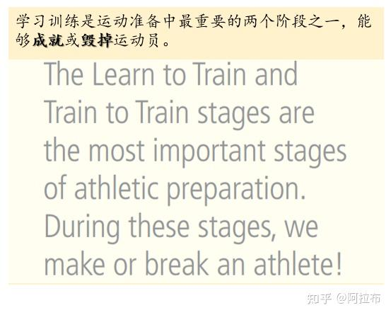

这个阶段孩子们已经准备好获得作为所有运动发展基石的整体运动技能，目标是能够在各种环境下（地面、空中、水中、雪面和冰面）自由运用它们——即发展体育素养。

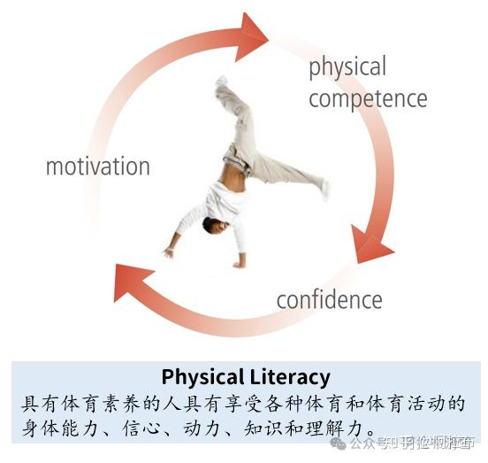

这也是发展专项技能的最佳阶段，学习运动技能效率高，“一学就会”，但是也容易忘记或者突然改变动作，应当注重“学习—重复练习—复习”的循环并注意经常规范动作。此外柔韧性和敏捷性也应给予重视。在这个阶段，还应该建立热身、放松、伸展和恢复等有益终生的运动习惯，可通过参加规范的运动训练营来获得。

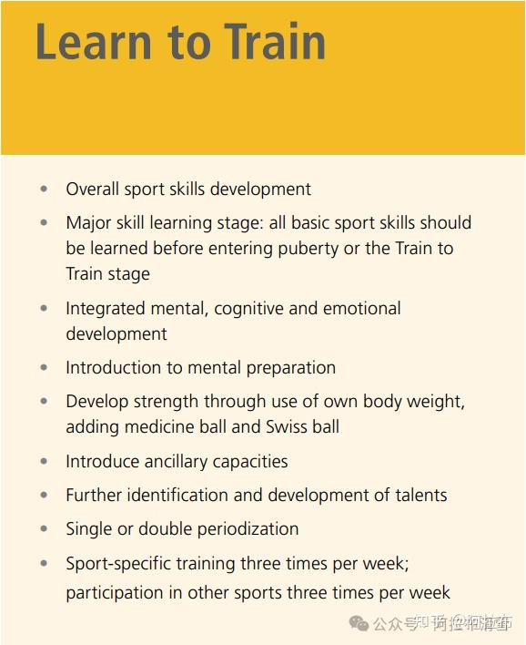

对于高山滑雪而言，这个阶段建议如下：

- 在青春期之前建立完整的技术框架是重中之重，否则经过三年青春期，与优秀运动员的差距会被拉开到巨大甚至绝望。这就是 为什么很多中国雪娃在十岁左右与国外孩子差距并不大，但是到十四五却难望其项背 的原因。
- 适当参加一些比赛，但不要给予压力，可将比赛看作训练的一部分。
- 周末训练和集中训练都会有效，但是不建议超过10天的集中训练。尤其是上学期间，没有必要请假超过5天，请更多的假也不会有太多效果，还会显著影响学业。
- 除非上雪时间比别人多几十天，否则青春期结束之前都不要碰滑雪机。滑雪机可以对训练有帮助，但绝对不是用来学习和练习竞技滑行技术的。（具体分析可参考回答 《室内滑雪机怎么样?》 ）

## 04 Train To Train，为练而训——“青春期”

青春期最大的问题是身体快速发育，肢体长度的快速增加会导致运动控制能力的下降，导致“ 青春期笨拙(adolescent awkwardness) ”。在这个阶段，许多以前获得的运动模式需要重新完善，所以需要不断的训练，不断的适应新的身体结构，尤其是协调性、平衡性、敏捷性等能力相关较多的动作。另外，随着心肺功能逐渐成熟，耐力训练也必须在11/12岁后加入日程（按年龄），但必须控制好强度，比如避免负重有氧练习。

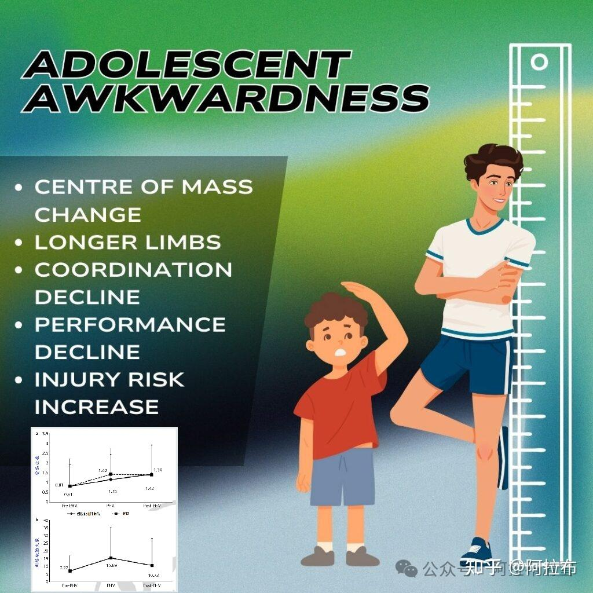

本阶段的建议包括：

- 通过持续的训练，将运动员的身体逐渐构筑成为一台运动机器。制定和执行个性化计划，选择适合的分组或训练机构以保持训练水平与个人能力匹配。
- 训练分化为技术发展期和比赛准备期，后者连同比赛不要超过40%。
- 耐心，关注训练过程，而不是比赛结果。这个阶段 减少竞争压力能够有效降低早期倦怠的风险 。在心理未发育成熟的阶段，过度关注竞争容易导致运动倦怠，这种不良经历会影响一生的运动和体育活动习惯。
- 周末训练的作用进一步减少，主要技术发展应以连续5天以上的集中训练为主。
- 对于女生，力量发展与身高是同步的，因此青春期开始后就需要逐步发展最大力量、爆发力、以及力量耐力。

## 05 从“青春期后”到成人

### Train To Compete 为赛而训 ——

又称为“优化引擎阶段”，经过青春期发展的运动机器们如果希望参加更高水平的职业比赛，就必须强调继续保持高技能水平，维持高训练量，并不断增加强度。

将心智、认知、情感发展集成到训练计划中。大脑和神经发育接近尾声，这个阶段是 个人在运动中“找到自我”的关键时刻 ，他们应该有机会在他们的运动或活动中进行探索和实验，构建稳定、平衡的自我形象。

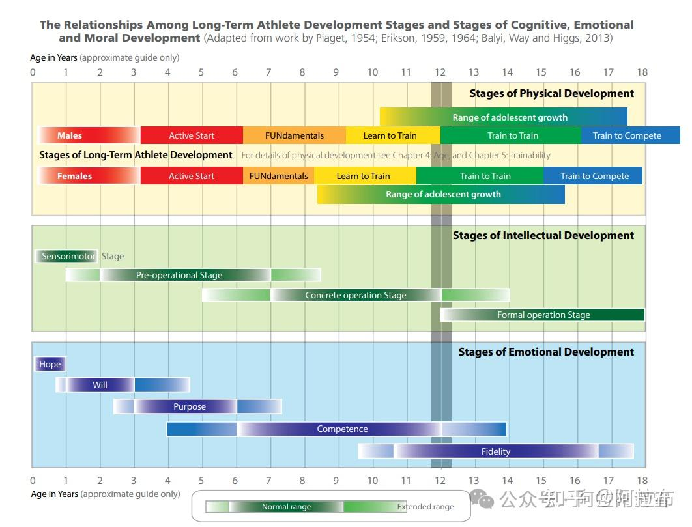

比赛和比赛准备的比重应该比上一阶段略有增加（50%~60%），但重点应该是通过精心挑选的赛事和竞技活动，来诊断个人的优势和劣质，并制定相应发展计划。因此，培训年度计划应该（依据项目）有两个或三个周期。此外，辅助能力应得到完善，使其更具体地满足个人的需求，包括健身计划、恢复计划、营养计划、心理准备等。

在这个阶段，训练还应该侧重于通过使用重量来发展最大力量和爆发力，并与持续的核心力量锻炼和保持柔韧性相结合。

### Train To Win 为赢而训 ——

在高质量的环境中进行训练，为参加重大比赛做准备，比赛和赛前训练占比增至75%。这是运动发展的最后阶段，重点应放在专业化和成绩提升。现在，运动员的身体、技术、战术、心理和辅助能力都应该完全建立起来，关注点转移到运动表现的最大化输出。运动员应当为了达到特定比赛和重大赛事的巅峰状态而进行训练。因此，培训的各个方面都应针对特定比赛进行个性化设置。应该有双重、三重或多重周期，具体取决于正在训练准备的赛事。在这个阶段，训练应继续发展力量，发展核心力量，并保持柔韧。

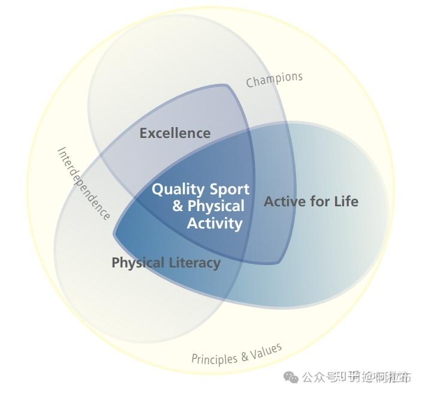

### Active For Life 终生活跃 ——

如果通过LTAD发展但没有成为精英运动员，那么之前的收获应该允许个人以有能力和自信的方式参加各种运动和锻炼，无论是竞技还是娱乐。

而那些曾经走上精英道路的运动员，应该在身体和精神上都能够以合理的方式，在更休闲的水平上继续他们的运动，并具备可以进一步参与各种运动和体育活动的经验。

LTAD最终的成就是 运动伴随终生 。

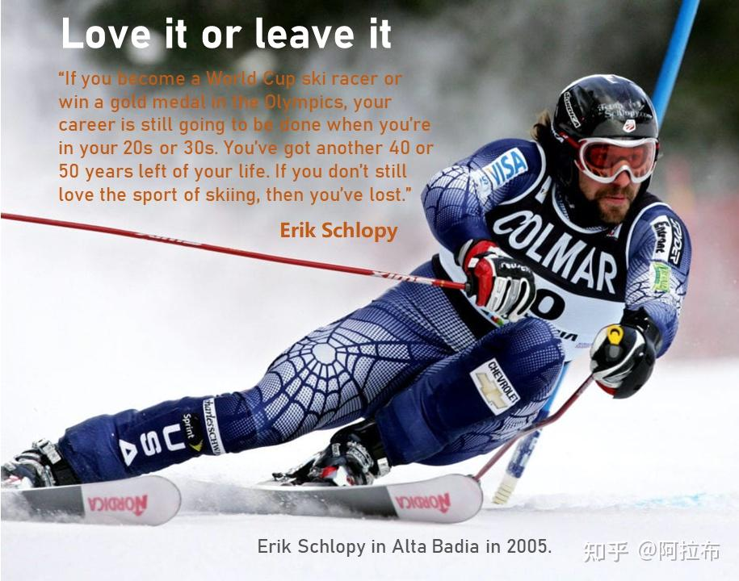

## 06 高山滑雪的青少年发展规划建议

### 一、坚持长期发展

高山滑雪的发展周期很长，要取得真正的成就至少需要5年以上的专业训练。而国内不少家长其实仅仅是希望孩子在青少年比赛中取得暂时优势，从而获得一些机会。比如7、8岁的孩子不上学连续训练几个月，能不能技术过人不好说，但其他方面的发展很容易被耽误，而且青春期过后可能还会被10岁才学滑雪的孩子碾压（北京雪娃有实例）。所以对于真正热爱滑雪、希望能够滑一辈子的孩子们，一定要坚持长期发展的理念，耐心陪伴孩子的成长， 不必为了其他人一些短时间过激行为而焦虑，也不必因暂时的失利而放弃 。

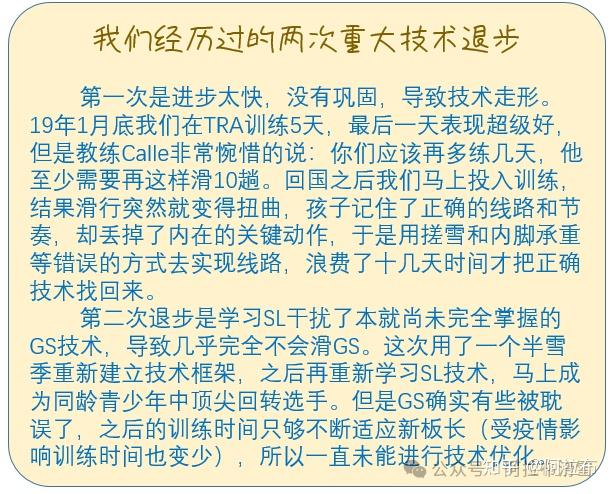

除了对运动项目的热爱，长期发展的基石还有安全和健康这两个重要因素。正确的规划和正规的训练是保障安全健康的唯一手段。尤其是青少年体能发展有限制的情况下，技术才是最根本要素。靠体能抢跑、靠所谓胆大抄近路，也许能取得暂时优势，但是对未来发展毫无意义，甚至可能耽误孩子一生。

### 二、尽量保持训练的一致性、延续性

高山滑雪是相对复杂的综合性运动，需要较长时间来发展运动技能。但是对于如何发展这些技能，比如以哪些动作为基础、采取什么样的发展次序等，不同的教学机构会可能会有不一样的理解，甚至有些体系的基础滑行框架都不样。如果学员在不同的机构之间流动过于频繁，有可能会造成技术体系混乱。

如果希望博采各家之长，那么首先也应该建立相对全面和稳固的基本技术框架，然后去各家学习时才有可能理解和融合各家的特色技术、对自己有所增益。所以，一开始在一个体系下学习是很有意义的：先让主干成长成型，然后可以选择如何处理侧枝；否则没有主干全是侧枝，只能变成一丛灌木而无法成材。

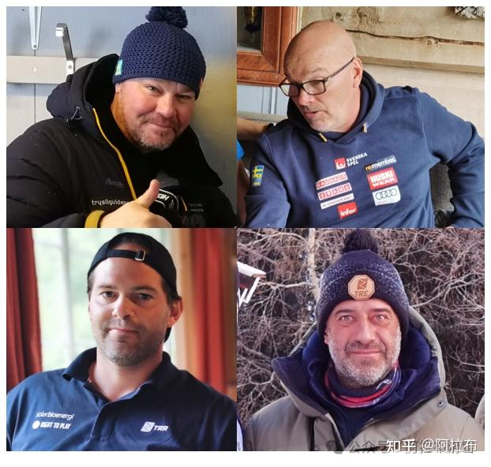

*TRA历任教练们*

根据本人亲身体验，我们学自挪威的基础技术体系，与中国国家队聘请的意大利主教练Adriano先生的理论体系几乎完全一致（ 2023年亚布力国家队主教练公开课 ），属于欧洲传统竞技基础理论。在欧洲训练时遇到过很多教练，他们所讲当然各有侧重，但是也都在这个理论框架之下，这应该是TRA筛选教练的效果。所以在欧洲训练，倒也不太必要担心同一训练机构经常更换教练的问题。

不过，如果有一个人完全把握运动员的技术体系、个人技巧、能力、优缺点，可以针对其个人特点来判断如何接纳新技术、甚至提前开始个性化发展，无疑会极大的提高学习效率。能够保持训练的一致性和延续性，正是 欧洲滑雪世家成材率格外高 的原因之一。

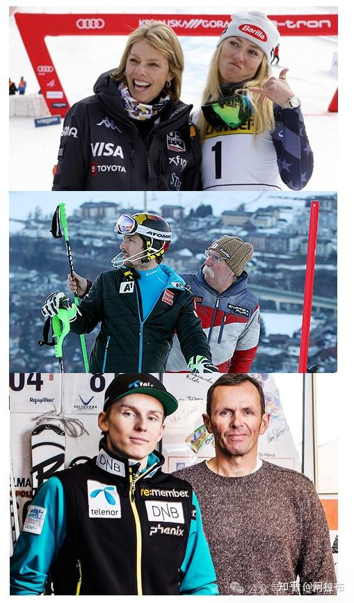

### 三、兼顾滑雪训练与学习

对于希望走向专业训练的孩子，梦想与教育的冲突可能难以避免。 《Mikaela方法》 的作者Dan Leever曾因为美国青年滑雪运动员面临 梦想和教育可不兼得 的局面而发出质问“What's wrong with US Ski Racing?”。中国在职业体育发展上这种情况要更加严重。

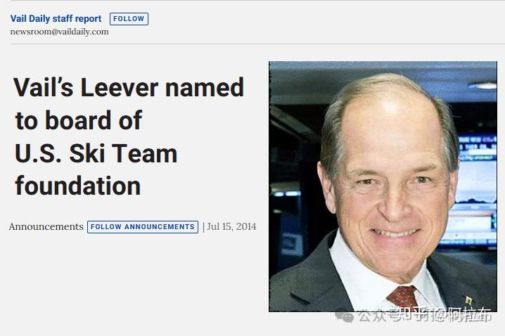

不过在职业化训练之前，高山滑雪仍然是一项比较适合兼顾训练与学习的运动：

- 作为一项季节性运动，高山滑雪不需要全年参与。居住地距离训练场地小于3小时车程的话，利用寒暑假、国庆、雪季周末，可以做到每年70~80天雪时，对于非职业训练基本上是够用的。
- 高山滑雪训练需要注意力高度集中，因此每天训练时长只有3~5小时，以及1~2小时体能，还有较多的时间可以拿出来学习。
- 竞技滑雪是一项高度自律的运动，同时需要主动学习和思考才能持续进步，而一个能够自律和主动学习思考的孩子，只要肯用心没理由学习不行。
- “竞技滑雪没有失败者”，无论训练到什么程度，都会对人生有益，不存在浪费时间的问题。

> Match your child's intensity. If they're super committed, you're super committed. If they're not committed and you're overly committed, there's an imbalance 与孩子的强度相匹配。如果他们超级投入，你就超级投入。如果他们没有投入，而你过度投入，就会出现不平衡 Champions are Raised, Not Born: How My Parents Made Me a Success —— Summer Sanders

按北京的教育路线，小学阶段不会有任何影响；五六年级和初中期间，会有两三次请一周假参加训练营，影响也不大。高中学业压力大，如果孩子水平非常高，可以尝试高一或高二冲一下成绩，否则建议充分利用寒暑假保持适当的训练，以维持当前运动能力，日常重点放在学习和体能训练上。等高考之后，再全力以赴，在18岁后补上欧洲孩子15~18岁的发展，这样只是晚几年出成绩，对未来的成就影响并不大。

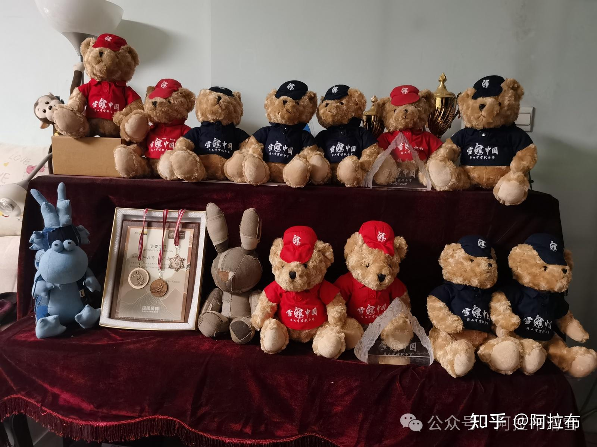

如果希望通过滑雪成绩上大学，目前有三种方式：

—拿到全运会、国家锦标赛、冠军赛最高组别前三，获得运动健将称号，可参加优秀运动员保送录取，通常为体育类本科专业。从2021年至今，国内高山滑雪运动员分别有8/2/1/2人获得保送资格，被北京体育大学（运动训练专业）录取。

—获得一级称号的 非注册运动员 ，可参加高水平运动队招生，通过体育测试并参加高考，体育专业过本科线（或80%等），其他专业可降20分录取（未确认）。2024年仅查到东北师范大学一所开设高山滑雪高水平运动队的大学（仅报了一人且疑似非高山滑雪一级）。

—如果学习成绩一般，可以考虑拿到二级运动员（部分高校要求一级）走体育单招，文化考试比较简单，专业限制为运动训练、武术与民族传统体育。

以上可知，三条路径的学校和专业选择都比较窄，家长和孩子需慎重考虑。

参考文献：略

下载链接：

https:// usskiandsnowboard.org/s ites/default/files/files-resources/files/2017-11/Alpine%20Training%20Systems%2011-16-17.pdf
