<!-- 来源: https://zhuanlan.zhihu.com/p/710695581 | 分类: 04_安全与体能 | 发布: 2024-07-27 | 赞同: 21 -->

# 挪威高山滑雪为什么这么强

“ 众所周知，除去出发台到终点线这段之外， 高山滑雪竞技是一项团队运动 。

We believe that ski racing is a team sport the majority of the time. Except from the point that you cross the starting line until you cross the finish line. —— Trysil Race Academy ”

提到高山滑雪强国，大家一般想到的是高山滑雪发源地——奥地利。但统计近五年GS项目FIS分世界前30/100/300分段的平均人数，我们可以看到挪威男子占据第一/第三/第一，女子排第二/第四/第六。挪威已经是可以比肩奥地利的高山滑雪强国。

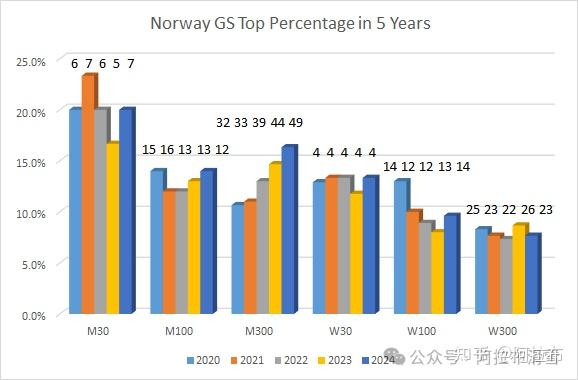

通过数据可以看出，有六个国家占据了三个榜单的头部2/3以上，可称为高山滑雪第一序列强国： 挪威、奥地利、瑞士、意大利、法国、美国 。按照Top300榜单，第二序列的六个高山滑雪大国是： 瑞典、加拿大、德国、俄罗斯、芬兰、日本 。其中日本比较典型，有较多的优秀运动员，但是一直培养不出顶尖高手。一些欧洲小国，如斯洛文尼亚、克罗地亚、斯洛伐克等，虽能够发掘出世界前30的天才，但高水平运动员数量其实并不多，背后的原因也很简单：在欧洲强国笼罩下，非天才难以为继。

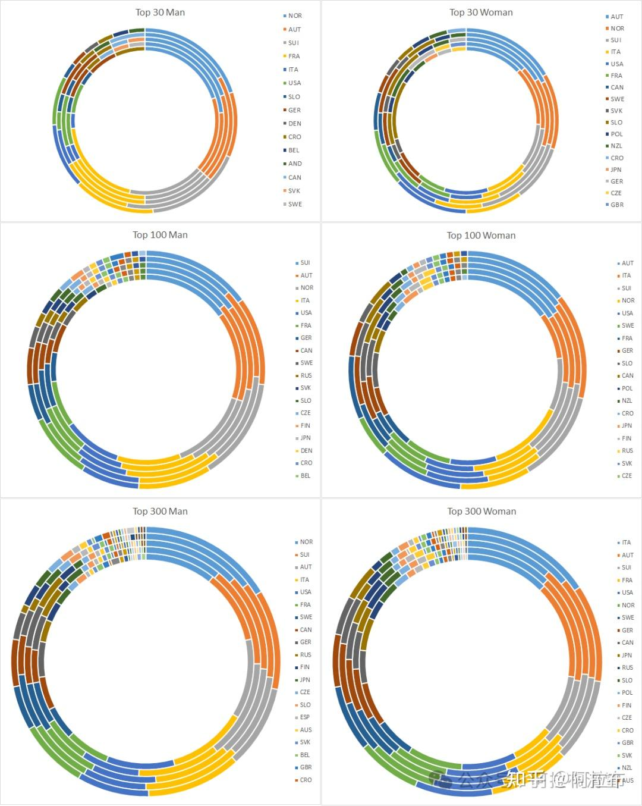

位于北欧的挪威，是现代滑雪运动的发源地，以越野滑雪、跳台滑雪、北欧滑雪等项目为传统。为什么近年来挪威高山滑雪也如此强悍，可以比肩阿尔卑斯山周边的传统高山滑雪强国？奥秘可能就隐藏在下面几条之中。

## 01 支持运动员的长期发展

体育运动是挪威文化的组成部分，许多人将冬季运动和活动作为日常生活的一部分。参加有组织冬季运动的挪威少年儿童比例非常高，13岁以下儿童参与率高达93%。许多父母也作为志愿者贡献自己的力量，他们负责组织工作，并在年幼孩子的体育俱乐部担任教练。

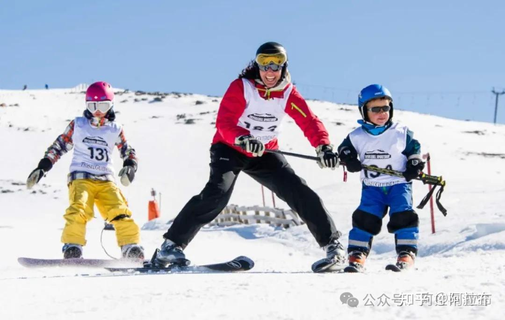

”由于挪威人口稀少，潜在的体育人才数量有限，所以必须珍惜每一名可能成长的“小苗”，耐心地等待他们成熟和绽放。因此，挪威非常注重让少年儿童最大限度地享受体育运动的乐趣，减少退出率，同时夯实运动员早期的体能和技能基础，发展更加全面的运动精神。挪威体育部门认为，童年是一个探索的时期，因此鼓励青少年在15岁之前尝试各种运动，重在参与而非成绩，社区俱乐部则对此提供了非常重要的支持。“

> 1976年挪威首次通过有关儿童体育的指导纲要，在此基础上，1987年通过名为《儿童运动权利》的法规，并于2007、2015和2019年三次修改，对13岁以下儿童体育竞赛进行严格规定：未满13岁不得参加全国锦标赛、欧洲锦标赛和世界杯之类的赛事；11岁起可参加全国性公开赛，但只有情况适当时才可以公布比赛结果排名；9岁起可以参加地区性公开赛和体育活动，6岁起可以参加俱乐部内的比赛和体育活动，这两个年龄阶段都不得记录和公布比赛结果。组织未满13岁的儿童参加比赛，如果有奖杯或奖牌，必须保证人人有份。

这份全球罕有的规定是支撑整个挪威体育体系的基础，目的是让儿童在训练和竞赛时获得积极体验，感到安全而友好，并乐意尝试新事物，不害怕犯错误。教练将重点放在每个孩子的个人发展上，而不是对外比赛的成功。只要为儿童和青少年提供友好和支持的运动环境，优秀运动员的产生就是自然而然的事情：“如果你有一个孩子，他或她选择从事体育运动，同时又具备雄心且懂得苦干，那么你就有了一个顶级运动员。”

（以上转自《光明日报：“冰雪王国”挪威冬季运动的成功之道》）

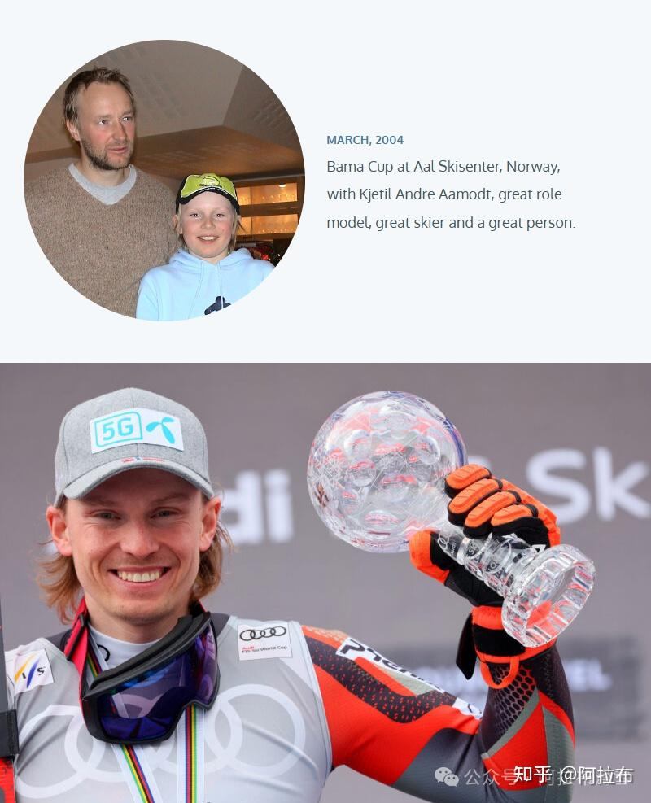

Henrik Kristoffersen在访谈中提到11岁之前他不能参加全国排名赛。正是这种支持运动员长期发展的环境促成了Kristoffersen成为世界顶级选手。当前世界前30名男子运动员中的6名00后有4名是挪威人，其中取得过世界杯金牌的Lucas Braathen（新赛季将代表巴西出赛）、Alexander Olsen、Atle Lie McGrath全部出自挪威。如此优秀的成绩，说明挪威对于运动员长期发展的支持策略在高山滑雪项目非常成功。

## 02 坚持整体发展与团队文化

在整体方面，挪威体育管理部门在各体育门类及各联合会中起到尤为关键的协调作用，把松散和碎片化的网络连接起来成为一个整体，实现了不同体育领域之间思想、信息和经验的交流，并且注重大众体育与精英体育之间的平衡。

在各个体育项目上，运动员的活动都是在拥有稳定训练组的国家队中进行的。在这些小组中，运动员们一起练习，互相学习。良好的团队气氛和精心构筑的 团队文化 极大提升了运动员的表现，尤其是年轻运动员的成长。

挪威高山滑雪国家队的导师制（Mentorship）毫无疑问是其中非常著名的一个“秘诀”。每一名进入国家队的年轻人 敬重前辈 ， 挑战现在、并培育未来 ，然后将火炬传递给等待的下一位领导人。团队始终快速而无情的赢得冠军和奖牌，当一个冠军退役时，另一个冠军快速崛起，一遍又一遍。

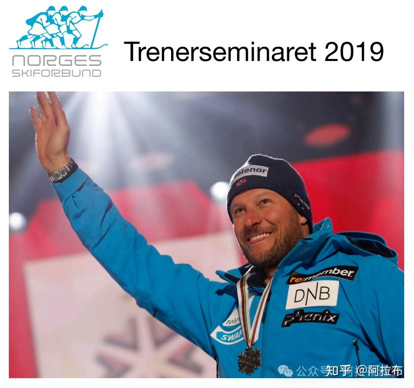

挪威国宝阿克塞尔·隆德·斯文达尔（Aksel Lund Svindal）在2001年19岁时首次进入挪威国家队，随后他加入了拉塞·库斯（Lasse Kjus）和凯蒂尔·安德烈·阿莫特（Kjetil André Aamodt）的行列，这两位滑雪运动员正处于历史性职业生涯的尾声，他们总共获得了160枚世界杯、世锦赛和奥运会奖牌。

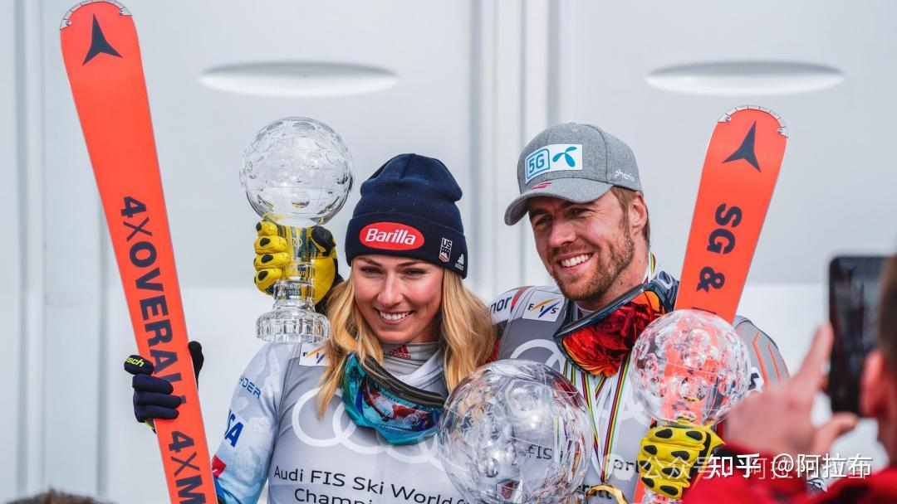

当亚历山大·阿莫德·基尔德（Aleksander Aamodt Kilde）作为青少年首次获得挪威国家队的资格时，斯文达尔将这位才华横溢的少年带到了自己的羽翼下，向他指点窍门并帮助他过渡到世界杯比赛。基尔德在2016年世界杯上大放异彩，赢得了当年的超级大回转总冠军。2020 年他赢得了世界杯总冠军。

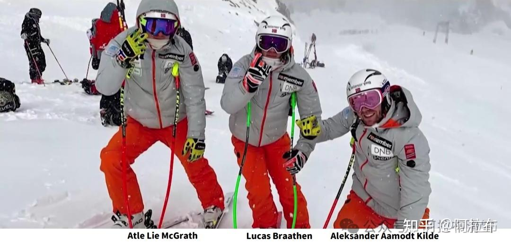

> “团队就像你的第二个家庭。你们有着相同的激情和目标，创造出一种在其他地方找不到的情谊。成为拥有相同心态的团队的一员，可以帮助你在自己所做的事情上成为世界上最好的人。”——亚历山大·阿莫德·基尔德（Aleksander Aamodt Kilde）

“众所周知，高山滑雪竞技大部分时间是一项团队运动”，这是TRA对这项运动的基础认知和行动准则——构筑优秀的团队， 相互促进、共同成长 ，才能培养出优秀的运动。

## 03 科学训练系统进行保障

挪威滑雪国家队每年在夏季会举行“Iron Man”铁人测试，这个2002年开发的体能测试序列已经成为事实上的世界通用高山滑雪体能测试标准，被多个国家，如瑞典加拿大等，直接照搬进自己的体能测试体系中。

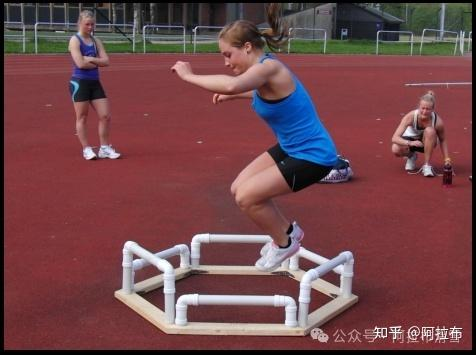

铁人测试目的是评估在高山滑雪中参加顶级比赛所需的一般身体基础，并在测试中打上“更具攻击性、几乎像比赛一样”的印记。铁人测试不仅仅是体能选拔考试，同时它还通过提供目标设定系统和对长期/短期目标的反馈来创造训练的动力，并成为创造“ 进攻性、开创性训练文化” 的系统的一部分。

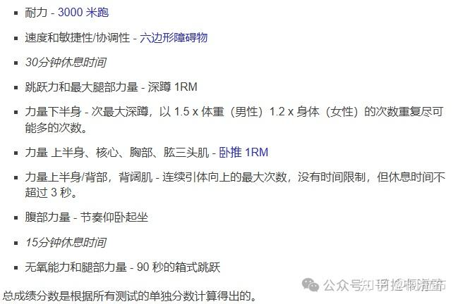

铁人测试内容简单、易于实施，并在全国范围内提供统一参考标准。通常俱乐部在春季完成测试，国家队安排在8月，U16采用青少年铁人测试序列（Iron Man Jr.）从8月底持续到9月，最后是挪威滑雪联合会的秋季关键测试。

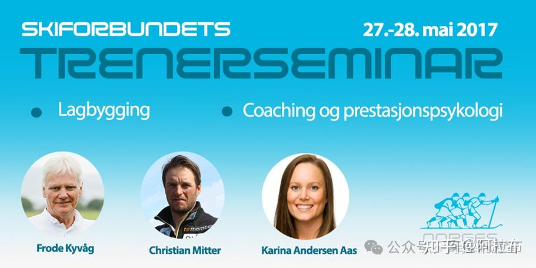

有优秀的运动员，必然就有优秀的教练，而往往教练的优秀需要比运动员略微提前一点。至少从2011年起直到疫情，挪威滑雪联合会NSF每年举办教练研讨会，对高山滑雪运动进行科学、深入的探索，在教练之间分享经验与成就，内容涉及铁人测试的升级和改版，新FIS规则对技术和训练的影响，运用新技术手段对动作进行科学分析，在训练中减少伤病等。我们所熟知的滑雪理论大师Ron LeMaster被邀请参加了2012年的研讨。

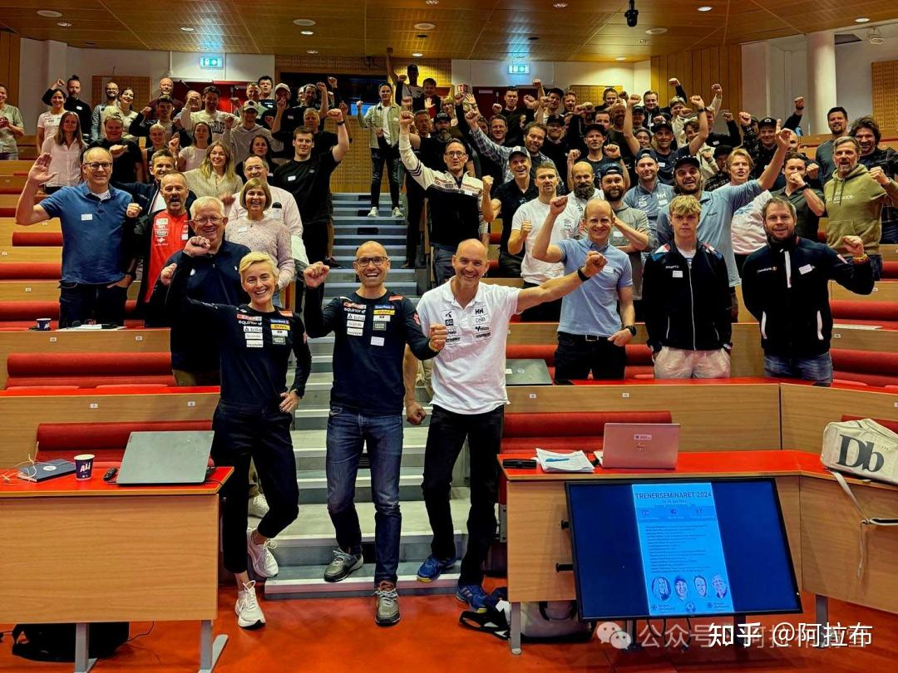

今年，因疫情原因暂停4年的NSF教练研讨会于6月回归，受到教练们的热烈欢迎。用科学分析指导训练，在科学的技术体系、训练方法之下形成先进的技术理念和教学方法，与运动员一样坚持团队精神和整体发展，互相促进共同提高，是挪威和北欧教练们能够出类拔萃的主要原因。

## 04 吃苦耐劳

在挪威的冬季，气候和自然环境都相对比较恶劣，因此当地人普遍锻炼出了坚韧和乐观的性格。这点比较有利于发展竞技体育，要在体育运动中成为最强者，天赋和努力都不可缺少。而努力，其实是挪威人的强项。

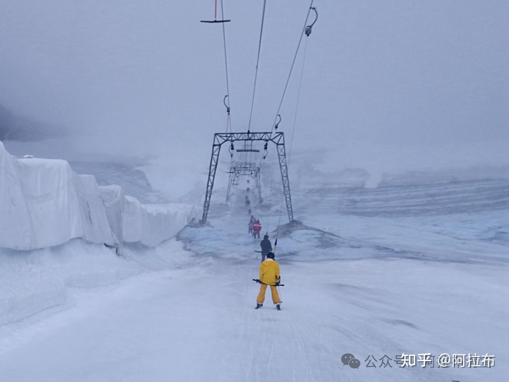

2018年第一次在挪威训练的时候，我们就领教了北欧冰川多变的天气。但是在大雪、大雨、大雾这种状况下，教练和挪威孩子们几乎保持着正常训练，这才是严重冲击中国孩子和家长认知的地方。终于有一天大家都有些退缩，不想在这种恶劣天气下继续训练了，教练指着旁边的挪威女子国家队说，她们那么厉害为什么还在练？就是因为不放弃任何可能的训练才能做到那么厉害。

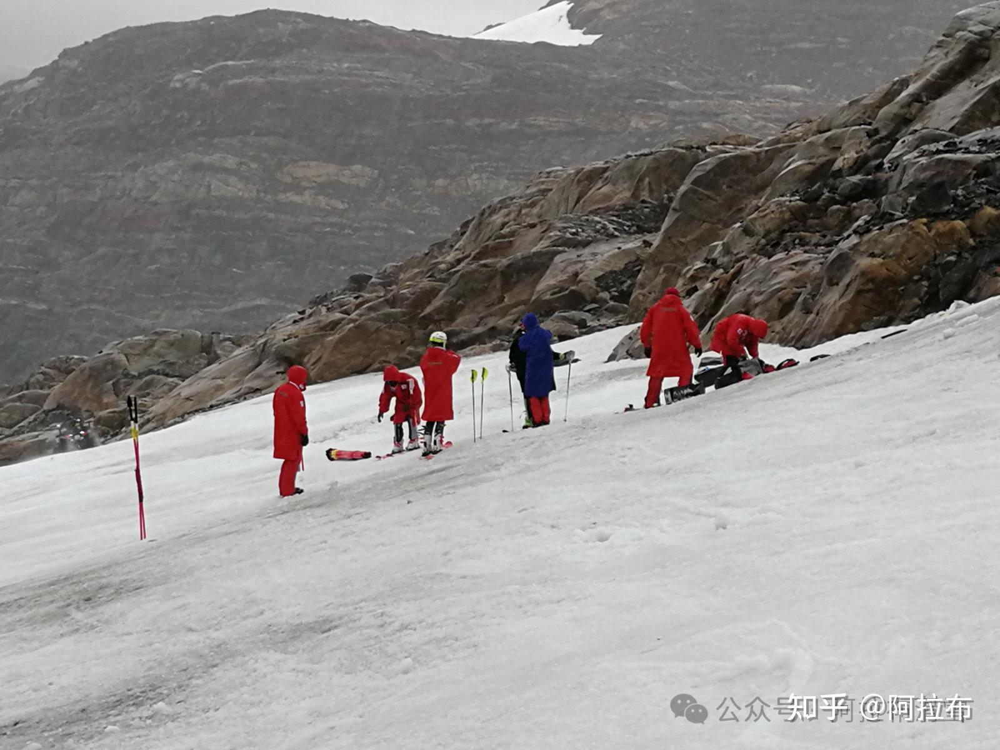

对于北欧教练，只要能见度、雪质等还允许训练安全进行，坏天气只会被说成“Good Weather！”，而且确确实实是锻炼人的好机会，只有完全不能训练的天气才真的“Too Bad”。2023年夏季在Juvass某个大雨天，其他队伍比如英国残奥队、美国BMA，芬兰、瑞典等队等都回了酒店，只剩下挪威残奥队和我们这只小小的队伍在训练，而熟知挪威风格的中国孩子们把这种事当成理所当然，不会有任何抵触。

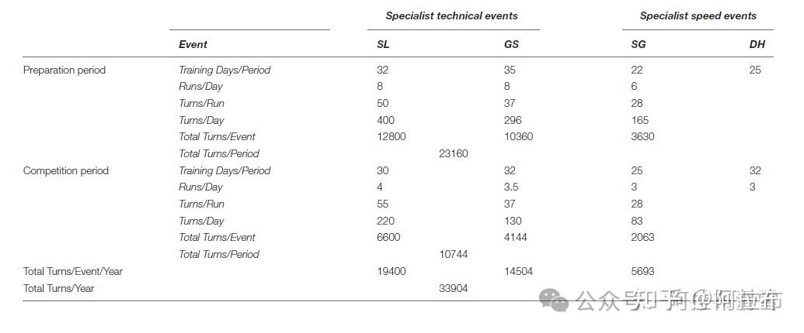

当然努力也要在科学指导下才行，南辕北辙时越努力距离目标越远，所以选择总是比努力更重要。挪威2018年把国家队备战奥运会的训练数据写成论文公开发表，这说明挪威已经对这方面已经进行过长时间深入研究，并有了自信的成果。

## 05 家庭深度参与

挪威有着悠久的滑雪传统，一方面孩子们从小就会接触滑雪，另一方面当孩子进入专业训练后，家长往往可以给予专业指导或者更多的陪伴。Henrik Kristoffersen出身滑雪世家，家里有一座小型滑雪场，父亲本身就是优秀的竞技教练，从开始滑雪一直到他成为世界杯一流运动员，都是在其父亲的指导下。挪威新秀Alexander Olsen的父亲也是竞技教练，2023年夏季他曾与父亲在Juvass训练。在Juvass我们还遇到两大家子过来度周末，孩子们训练，父亲们插旗门和维护雪道，中午时还烤香肠做热狗，其乐融融。

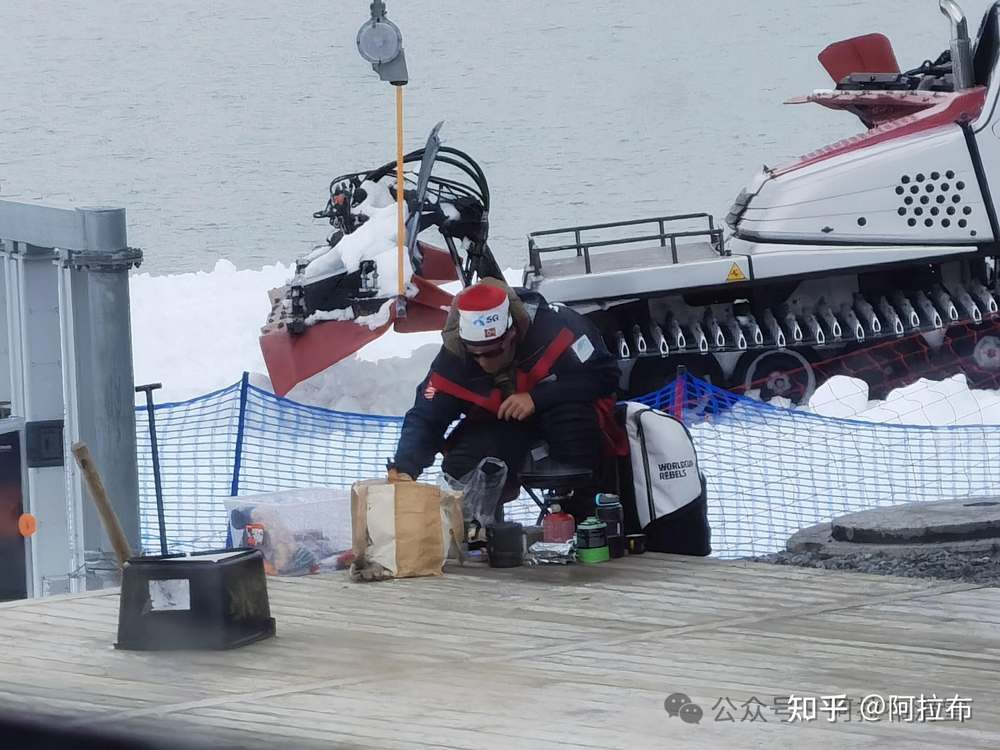

我们的大本营Trysil滑雪场位于挪威与瑞典的边界，还是丹麦青年队的驻训场地，很多瑞典和丹麦孩子也会在这里训练。经过一两周的观察，我发现比较容易分辨这三个国家的家庭。

- 如果孩子在训练，家长只在午饭或下午离场时出现，那么基本上是丹麦孩子们来了。
- 如果孩子训练时，有家长们在雪道底端观看，教练对孩子讲解时会旁听，那很大可能是瑞典的家庭。
- 而训练中如果有爸爸们在雪道上陪伴，帮忙推平雪道、甚至协助插门，但是教练与孩子们沟通的时候大多离的远远的，那么很可能是挪威人。

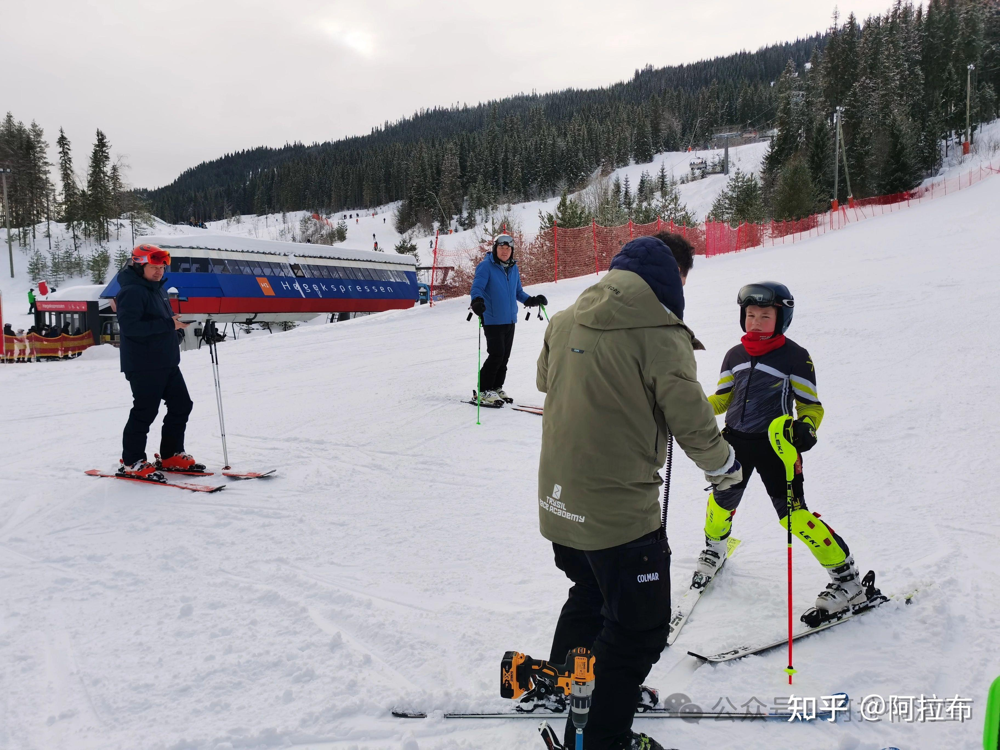

结束语

挪威高山滑雪的崛起中，上面这些内容可能或多或少都起到一部分作用。但我认为最为重要的还是第一条——长期发展，这个理念创造了一个运动中的价值体系，“这实际上是关于人的发展， 体育运动的主要目标是培养人 ”。如果仅仅关注短期成绩，把运动员当做求名谋利的工具，把满怀理想和热情的孩子变成棵棵韭菜，那么无论如何也不可能真正取得成功。

> 我们想让孩子们独自参与。 我们希望他们自己去玩。 我们希望他们得到发展，并专注于社交技能。 他们从体育运动中学到了很多东西。 他们从比赛中学到了很多东西。 他们从不焦虑中学到了很多东西。 他们从不被当做数字中学到了很多东西。 他们从不被评判中学到了很多东西。 他们会感觉更好。 而且他们往往会继续更长时间。

所以，记住这段话吧，更要记住挪威人的做法，这才是体育教育的理想境界。

“We want to leave the kids alone. We want them to play. We want them to develop, and be focused on social skills. They learn a lot from sports. They learn a lot from playing. They learn a lot from not being anxious. They learn a lot from not being counted. They learn a lot from not being judged. And they feel better. And they tend to stay on for longer.”

—— Tore Øvrebø, Director of Elite Sport, Norway
