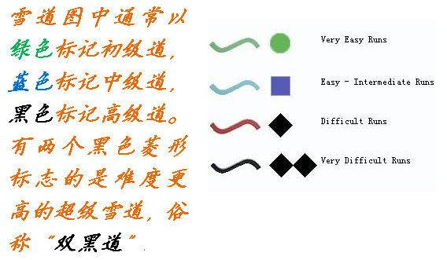
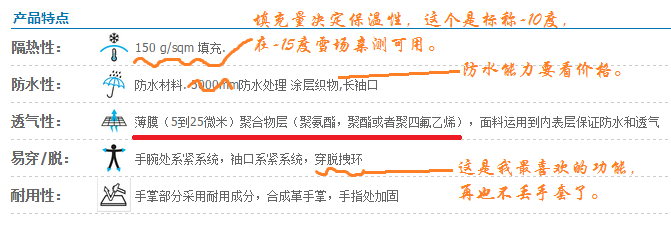

<!-- 来源: https://zhuanlan.zhihu.com/p/23565538 | 分类: 05_滑雪杂谈 | 发布: 2016-11-10 | 赞同: 194 -->

# 初次滑雪之前，需要了解的知识

又是一个雪季，无论是梦幻般的白色世界，还是在雪上风驰电掣的刺激，都吸引着我们投入到滑雪这个越来越热门的运动中。那么，初次接触滑雪运动，需要了解哪些知识呢？

### 去哪儿滑雪

我们所说的滑雪运动一般都是指高山滑雪（其他的还有越野和自由式），也就是利用自重从高处滑到低处。如何到达高处？自然山地比较麻烦，有徒步登山和直升机等形式。而在专门运营的雪场，就会有缆车、拖牵等设备方便的把我们送到山顶。而雪场的收费，也主要是运载（Lifting）设备的费用，俗称缆车费。

题外话：据说在国外，大多数雪场是开放式的，即上缆车验费（刷卡或者看雪票），其他活动不收费。在中国，只有小部分大雪场是开放式的，其他（包括北京周边的所有雪场）一般都是封闭式，即需要买门票入场，但是上缆车和拖牵等不需要验费。

初学滑雪，如果是休闲度假，可以选择一些风景漂亮、设施较好的地方，如长白山的万达，崇礼的云顶。如果仅仅是学习技术，那倒不一定选择大滑雪场，大雪场的缆车票贵是因为它的雪道多，但初学者只能滑一两条雪道，太浪费了。有一些雪场提供初学者票，即仅限在初级区活动，相对来说更合算一些，如吉林北大壶，崇礼的太舞。

崇礼地区，太舞是今年刚开的雪场，号称有亚洲最大的初级区，值得考虑；其次是多乐美地；长城岭只有4条雪道，一条初级一条中级，不好说算多算少。而规模最大的万龙、云顶，十几条雪道中只有两三条初级道，显然是对初学者最不合算的。长白山南区三家，万达适合度假；松花湖价格适中，初级道较多；北大壶落差大雪道爽雪质好，但初中级道很少。

北京周边大小十几个滑雪场，最适合一日往返。其中比较有名也比较可靠的，是军都山、南山、怀北、万龙八易这几家。昌平的军都山是周边服务、教练、雪板最好的，没有之一，雪质和设施也不错，价格第二贵，离北航45公里，相对近一些。密云的南山最贵，管理还可以，雪板类型和特色雪道多，初级道也是周边最多的，离北航70公里。怀北相对来说，各方面都不如前两个，但是价格就便宜多了，管理还算正规，离北航75公里。位于石景山的万龙八易最近，但是比较小，而且因为用地问题每年开张都挺困难。其他的雪场普遍规模较小，价格也就相对便宜很多（周末一天不到100），能推荐的有静之湖、金辉等。不少小滑雪场，要么设施不好，要么管理不善，其实并不值得去。

小朋友们初学滑雪的最好方式，是参加各种滑雪训练营、冬令营，跟小伙伴们做着游戏就学会了滑雪，家长也省心。军都山、怀北、万龙、北大壶等每年都有高质量的冬令营。在小朋友四岁之后脚腕长结实了，就可以学习滑雪，但要参加冬令营最好是六岁有自理能力之后。当然，小不点们也可以参加类似军都山的走读班，或者家长带着住在雪场。

### 单板还是双板，这是一个问题

滑雪活动按器材分，主要是单板（Snowboard）、双板（Skis）、其他板（Telemark、Monoski、Biski等）。单板还是双板？这是一个问题，无论是新手还是高手，总会面对至少一次。单板是年轻人的最爱，又酷又有style，而且单板最大的好处是滑行不需要很高的速度，这点又尤其合女孩的胃口。双板则是最普通最常见的滑雪方式，很多小雪场没有单板，但不可能没有双板。

相对于单板来说，双板更容易上手，几分钟的适应之后，就已经可以上雪道爽（shuai）去了。而单板呢，经常练了个把小时，还没下过一次坡。但是，单板一旦入门就可以去大多数的雪道玩（huo）耍（huo），仅凭推坡和落叶飘两个入门动作，初级高级野雪通吃。而双板呢，犁式半犁式基础平行动态平行大回转小回转，好不容易能滑高级道了，还有雪包猫跳野雪粉雪等等各种适应专门地形的技术，漫漫长路无休止。

再从安全方面考虑，单板起步摔得非常狠，而且容易失控，很容易发生事故。一旦入门之后，因为速度一般不会特别快，相对安全一点。但是高速时一旦失控，因为身体姿态的缘故，撞击程度通常相当的大。双板则好的多，有好的教练指导时，几乎不用摔就能练到平行阶段。后期虽然双板速度更快，但身体比较自由，能够采取较多的保护措施，摔倒受重伤的概率反而没那么大。

所以，如果滑的次数非常少，或者以休闲为主，那就双板吧，只滑平缓的地方，不费什么心力。如果想尽快体验各种雪道雪质，前期花一点功夫把单板学入门，无疑是最快的方式。但上了年纪比较怕摔的话，那只能选双板，请教练护着慢点学，基本没事。而单板即使请教练，也一样要摔，摔的一样狠。

### 滑雪装备

雪板雪鞋雪杖（单板无），是滑雪场提供的标准装备，除此外头盔手套雪镜则一般属于个人必备物品。一些雪场也提供头盔手套的租赁，去之前可以查询。

从安全角度讲，头盔应该是必备的。但是对于单板来说，因为摔倒时头部的甩动非常剧烈，戴着沉重的头盔会加重颈椎负担，所以单板初学者戴头盔的不多。头盔有半盔和全盔两种，相对来说半盔虽然保护面积少一些，但重量和价格都有所减少。近几年的致命滑雪事故，几乎都是头部撞击导致的，因此好的头盔在意外时能够最大可能的保护生命，一定要重视。顶级头盔通常在千元以上，而如果不想花太多钱，迪卡侬也有百元价格的亲民产品。

手套主要是防水，能保点暖就行，不要太厚，否则手出汗就麻烦了。防水又透汗的手套需要特殊的面料或者夹层，以前GoreTex等高级面料价格不菲，现在迪卡侬百元级的产品也应用了防水透气薄膜，亲测有效。滑雪手套有分指和不分指两种，前者灵活，后者暖和。

雪镜对于初学者主要是预防雪盲症，以及大面积反光对眼睛的刺激。墨镜虽然有同样的功效，但是（除了软架运动墨镜）普通墨镜的棱角在摔倒时会导致危险，并不建议佩戴。从功能上讲，普通的国产是够用的。好的雪镜不仅能够滤除紫外线和高光，还有一些别的功能，比如偏振镜可以滤除反光。Okley最新的Prizm雪镜还能够增大对比度，使得视野更清晰。对于比较好的雪镜，购买时要注意几点，一是镜片通常分为晴天、多云、阴天和夜间四种透光率，选择时要注意；二是造型上，有小视野、大视野、球面、柱面等类型，如果戴眼镜的话首选OTG（Over The Glasses）类型，否则尽量选择大一些的，或者配蝴蝶镜架放在雪镜内使用；三是要防雾的话必须是双层，因为内层通常有防雾涂层，千万不可随意擦拭清洗；四是海淘雪镜时，最好选择亚洲版，因为欧洲人面部狭窄但前后突出，亚洲人则扁平一些，有些欧版雪镜的鼻梁部分无法贴和。

除此之外，不少人会准备护膝、护臀、护腕、护甲。单板护膝的作用是跪地时减震缓冲，因此最好选海绵的，就是普通的排球护膝；双板护膝则是通过束紧膝盖周边韧带，尽量减少减轻扭伤的发生，建议专业的运动护膝，如迈克达威425、LP788等；护臀有滑雪专用的，也有与轮滑、滑冰通用的，单板必备，是防止尾椎骨折的必要措施；护腕也建议滑单板时尽量带上，轮滑的就可以。护甲主要是用来保护脊柱免于被人从背后冲撞，同时也会兼顾肋、胸、肩、肘的保护（单独的背甲则没有这些功能）。目前最好的护甲材料是D3O，可以在受到冲击时瞬间变硬，较好兼容了舒适性和保护性。其他的低价护甲，通常采用内部软衬和外部硬甲的方式来实现这一点，所以会有体积、重量、透气等方面的不便。初学单板，除了护甲最好都带上，否则太容易受伤，而且护臀最好准备双份，其中一定要有海绵；双板初学者可以暂不考虑这些护具。

### 安全

滑雪算一种危险性略大的运动，有些意外险甚至不包括滑雪运动。但是只要注意几个方面，还是能规避绝大多数的风险。

首先是绝不冒进。根据自己的能力选择适宜的坡度，不要冒险。其次是避免高速区域，如陡坡的下沿、高级道出口到缆车站的通道等高速滑行者经常出现的地方，也尽量不要在雪道中央停留。还有一点是，尽量选择正规的滑雪场，正规的教练。对教练的管理也是滑雪场管理水平的重要体现，差的教练不但可能教授错误动作，更可怕的是有时会置客人于危险的境地（有这样的案例）。

从技术上讲，学习滑雪首先要学保命的技巧，即 遇到无法控制的情况时立刻倒地 。单板的倒地技巧是前趴用膝盖和手肘缓冲，后倒用团身摔，臀背肩部依次着地。因为摔的时候根本没时间反应，所以必须提前练习形成条件反射，比如在家里床上站好马步，让人推倒，练到不出手、摔不疼。双板的技巧是 向侧后方倾倒 ，这个记住就能用上，不用特别练，通常有足够的反应时间。双板如果失控倒向正后方，会导致雪板卡住方向、一直向前而无法停止，这时候记得用一侧手肘使劲戳地，这样就会转向一侧，通过安全网等设施停止，不至于持续下滑而导致速度过快，致使自身或他人受伤。

最后一个需要避免的风险，是滑雪活动的组织者。在国内，但凡在雪场内有组织的滑雪活动中发生的事故，组织者或多或少都要判连带责任，绝无幸免。如果一定要组织滑雪活动，除非像旅行社一样买保险，否则组织工作最好到雪场外为止（如只负责交通、雪票、餐饮）。

以上，介绍了滑雪运动的大部份准备知识，衷心祝愿所有与滑雪第一次接触的朋友们能留下一个愉快的记忆！
