<!-- 来源: https://zhuanlan.zhihu.com/p/59739858 | 分类: 05_滑雪杂谈 | 发布: 2020-07-18 | 赞同: 50 -->

# 双板旗门规则简易指南

本文对双板高山滑雪比赛的旗门规则做一个简单的说明，以便于竞技爱好者、青少年竞技运动员、以及家长等更好的理解和观看比赛。

在国际雪联FIS的规定中，双板高山滑雪比赛主要有速降（DH），超级大回转（SG），大回转（GS），回转（SL），平行回转（PSL/PAR）这几种形式，以及他们的组合。DH/SG称为速度项目（Speed Discipline），而GS和SL称为技巧项目（Skill Discipline）。

GS和SL也是最基础的比赛形式，这里主要是对GS和SL的旗门规则进行说明。

## 大回转（Giant Slalom）

GS旗门是由两根杆和一块旗门布组成，基本形式为水平布置的一对旗门，称为“ 水平门 / 开口门 ”，两个旗门内侧杆（在雪面上）之间的 最短连线 称为“ 虚拟线 ”，比赛者必须两个板尖和双脚都穿过虚拟线。一对开放门中，内侧的为“ 转弯门 ”，外侧为“ 外门 ”。转弯门靠近“ 自然线路 ”的旗杆为“ 转弯杆 ”，远离线路的为“ 外杆 ”。

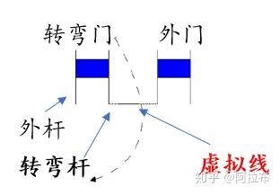

GS赛道由一系列开放门构成。相邻两个开放门的转弯杆（雪面接触点）之间的直线距离，称为 门距 （Distance）；相邻两个开放门沿滚落线方向的距离，称为 横距 （Offset）。赛道的难度通常由坡度、门距、横距、地形起伏、雪面质量五个因素构成，其中前三个可数据化表示，为最常用的赛道参数。国际雪联规定的必要赛道参数为：落差，门距，回转数等。

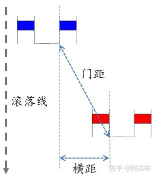

GS比赛中允许存一种特殊门，必须通过但不需要改变方向，称为“ 延迟门 ”，也叫“ 一脚门 ”“Banana Gate”“Under Gate”等。延迟门的设置目的是：1）缓坡时加长门距以加速；2）增加转弯难度。

延迟门不一定水平布置，也可以斜向、甚至垂直布置。垂直布置的门也称为“ 闭口门 ”。下图中，第四个门为延迟门。实际比赛中，可以通过颜色、线路、门的位置等来识别延迟门。

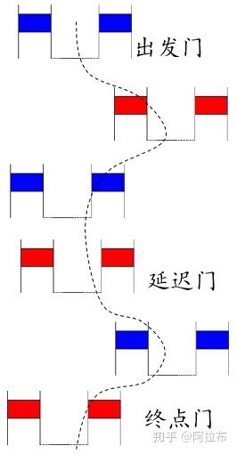

GS比赛也可以采用单门设置，即去掉开口门的外门。但是出发门、终点门、延时门必须保留外门。单门GS赛道的虚拟线为相邻两个转弯杆（与雪面接触点）的最短连线。

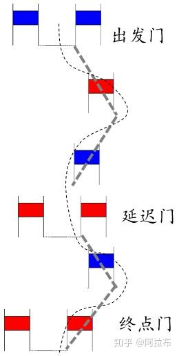

## 平行回转（Parallel Event / PSL/PAR）

平行回转是一种双人对抗性项目，采用大回转旗门单门布置，门距和技术接近回转（SL）比赛，两名选手同时出发，分别计时。平行回转比赛时间通常为20s左右。

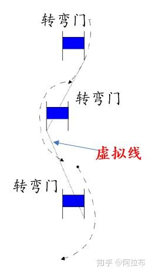

## 回转（Slalom）

SL过去称“小回转”，现在正式的翻译已经改为“回转”比赛。

SL门只有一根旗杆，没有旗门布，基本形式为水平布置的一对杆，称为“ 水平门/开口门 ”，内侧为“ 转弯杆 ”，外侧为“ 外杆 ”。

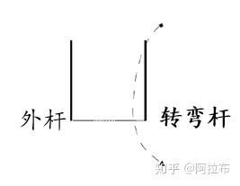

SL赛道由开口门、 垂直门/闭口门 、延迟门布置而成，这三种门因布置的位置和数量不同而形成了各种组合。

SL垂直门组合

1）延迟门组合

将垂直门或者延迟门置于两个异侧开口门之间，即为延迟门组合，延迟门位于自然线路上，通过时不需要改变方向。下图的垂直门也可以反向通过，这样就比自然线路多了两次转向。

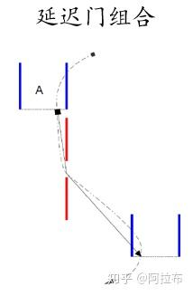

2）H门组合

将垂直门或者延迟门置于两个同侧开口门之间，即为H门组合。H门中的垂直门在通过时必须转向。

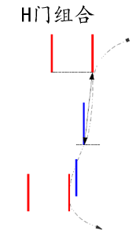

3）螺旋门组合（Hairpin）

将两组垂直门置于两个水平门之间，构成了螺旋门组合。

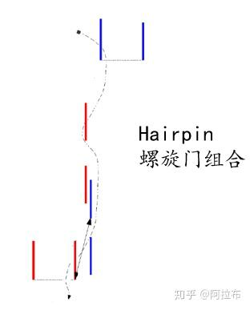

4）蛇形门组合（Flush）

将三组及以上的垂直门置于两个水平门之间，构成了蛇形门组合。

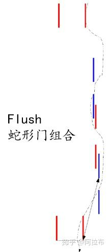

回转比赛通过线路

回转比赛的旗门可以从任何方向通过。

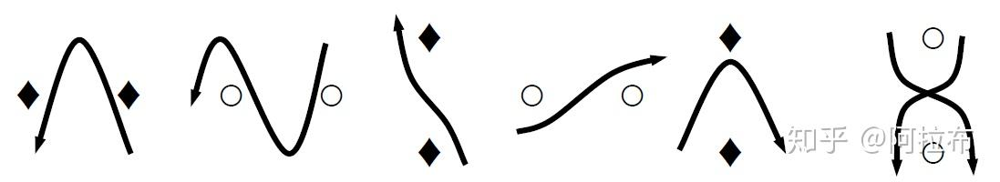

因此，当垂直门组合的最后一个外杆与下一个转弯杆之间的距离足够时，可以采用另外一种线路进行比赛。

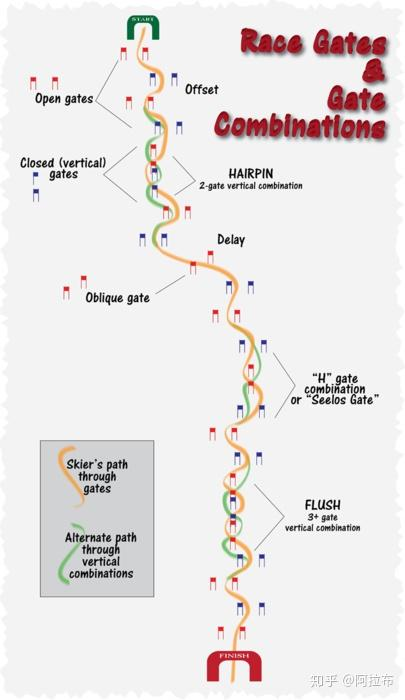

失误与恢复

回转比赛一般允许运动员在失误后从比赛中断的位置继续比赛，而GS比赛则需要依据具体比赛规则，比如FIS比赛规则中规定GS比赛一旦开始、运动员停止即犯规，而国内很多GS比赛则规定失误后可以回到中断位置继续比赛。

这里的中断位置，是指滑行线路上第一个被错过（应该穿越）的虚拟线。

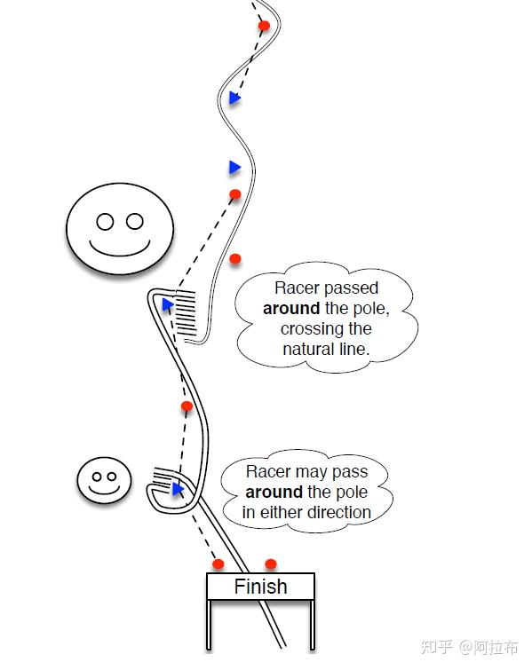

上图的示例中，运动员应从蓝色杆的左侧绕行，但是因为失误，都是从蓝色杆右侧滑出去了，所以运动员必须回到中断比赛的位置，如第一个失误点，直接从右侧爬坡到蓝色杆上方，再按照正常线路从左侧绕行蓝色杆；在第二个失误点，运动员直接滑行到了蓝色杆左下方，此时可以向上爬坡到蓝色杆左上方，然后直接滑向下一个杆，他的轨迹相当于绕了蓝色杆一个圈，这样也是有效的。因此，比赛时，可依据失误后的位置来选择具体采用那种路线。

以上为本文全部内容。
