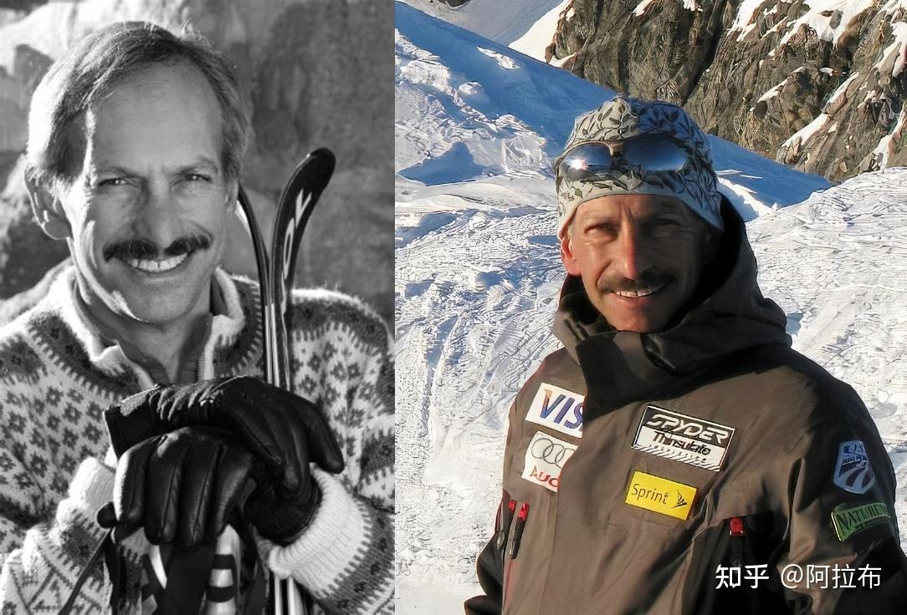
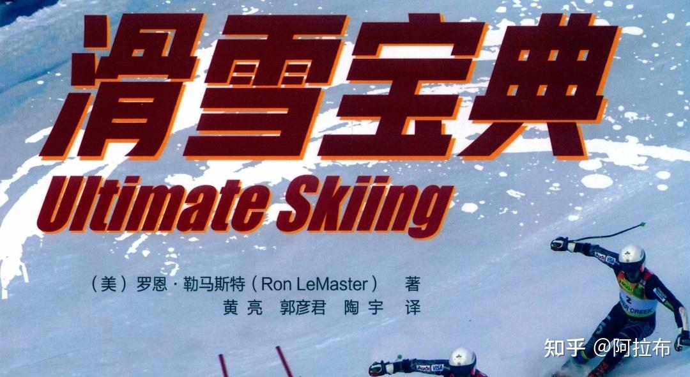
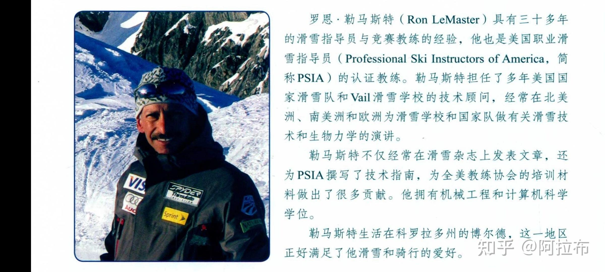
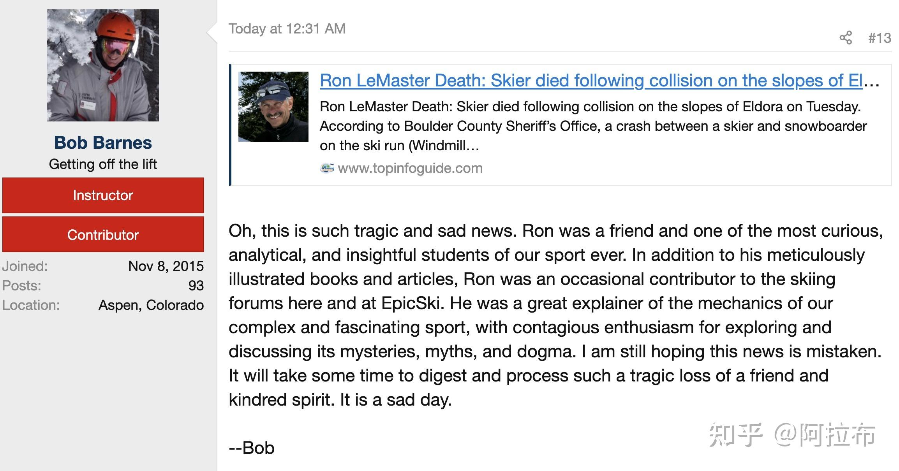

<!-- 来源: https://zhuanlan.zhihu.com/p/440150276 | 分类: 05_滑雪杂谈 | 发布: 2021-12-01 | 赞同: 69 -->

# 沉痛哀悼！《滑雪宝典》作者RonLeMaster今天在滑雪时不幸去世

今天中午突然从朋友圈中获知噩耗，RonLeMaster在家乡的Eldora Mountain滑雪时，在当地时间上午11点与单板滑雪者发生碰撞事故，不幸去世。

当时我简直不敢相信，特地向《滑雪宝典》中文版译者黄亮求证。后来陆续有新闻证实了这个悲伤的消息，Ron的朋友们也纷纷表示哀悼。我们失去了一位伟大的滑雪理论大师，胸口的悲愤无以复加。

《滑雪宝典》是对我影响最大的滑雪著作。我阅读的滑雪资料很多，包括加南大CSIA的技术手册、美国PSIA的教学手册、丹麦人写的《LearnToSki》（其实作者也是PSIA教练）、英国BASI技术资料，新西兰NZSIA技术资料、美国EpicSki论坛的大量讨论等，其中对双板滑雪讲述最清晰明白的，就只有《滑雪宝典》。作者曾接受过机械工程与计算机科学的专业教育，让他能够以“更科学、更严谨”的方式来描述滑雪这种体育运动，也更容易引起我的共鸣——因为我也拥有机械制造工程硕士学位，后来成为电子系统专家和软件工程专家。

在拿到《滑雪宝典》中文版之前，我已经在很多文章和讨论（主要是美国EpicSki论坛）中见过对原版《Ultimate Skiing》中内容的大量引用，以至于我第一遍阅读本书只用了大概5天——这本书并不容易看进去，我也不是什么天才，真正原因是：本书的主要内容（大约40%），我已经通过别人的引用学习过了。我个人认为这本书的重要性还远远没有达到它的顶峰，目前很多的滑雪体系还存在大量落后的、不科学的内容，早晚会被这本书所阐述的理念、以及所延伸出来的新思想所取代。拥有这本书的雪友们应该认真学习，经常思考，我相信在学习滑雪的不同阶段翻阅此书，都会有不同的理解和感受。

最后引用Bob Barnes（PSIA和EpicSki大佬，《The Complete Encyclopedia of Skiing》作者，国内诸多大师/以及“大师”的资料来源）的哀悼，祝老人家安息！
