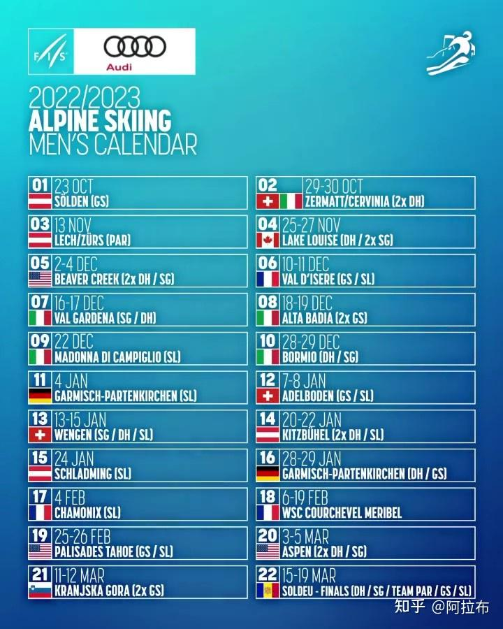
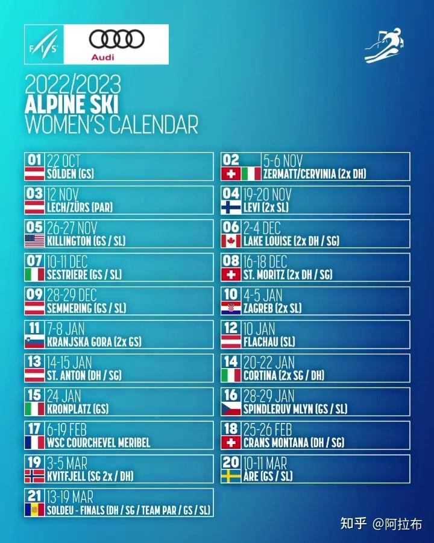
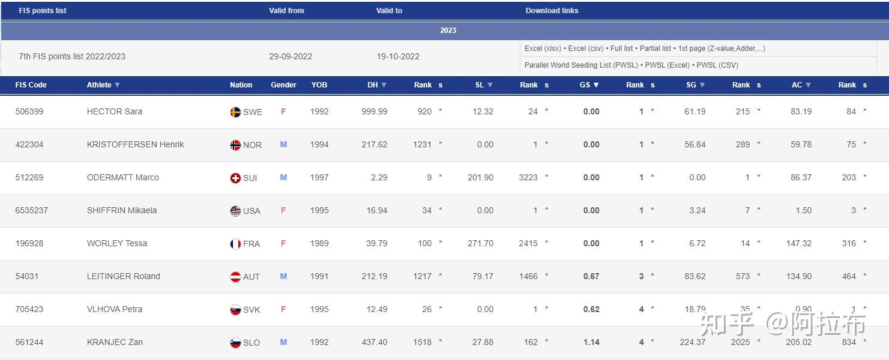
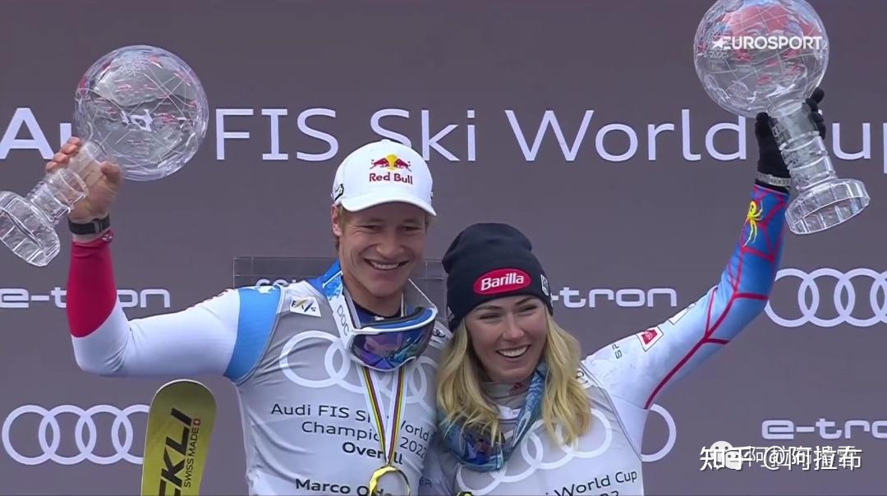
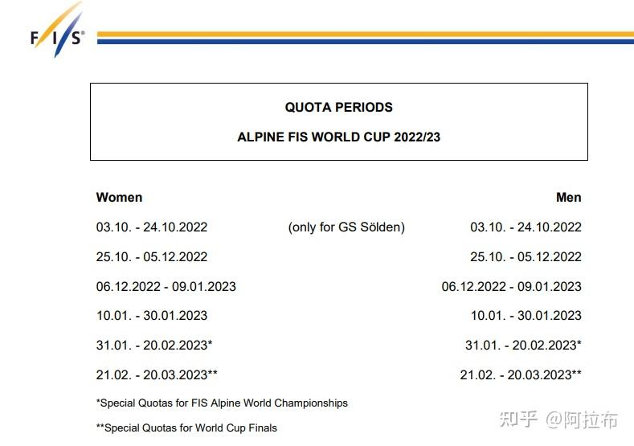
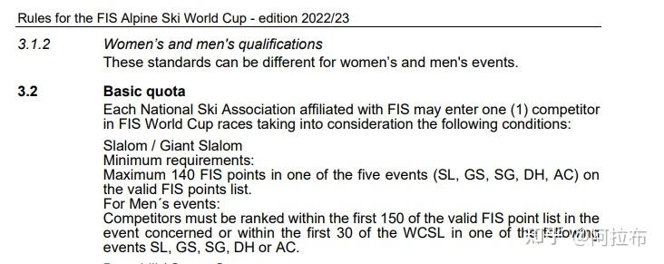
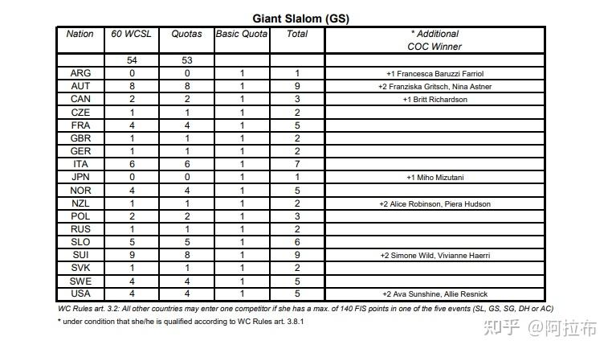
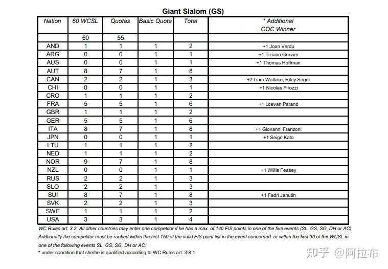

<!-- 来源: https://zhuanlan.zhihu.com/p/567693048 | 分类: 05_滑雪杂谈 | 发布: 2022-10-17 | 赞同: 5 -->

# 怎样才能参加高山滑雪世界杯比赛？

> 原文：[知乎 · 阿拉布](https://zhuanlan.zhihu.com/p/567693048)　·　发布于 2022-10-17　·　本文仅供学习交流，版权归原作者所有

世界杯巡回赛（FIS Ski World Cup）、世界锦标赛（World Championship）、冬季奥运会（Winter Olympic Games）是高山滑雪三大顶级赛事，相对最稀缺、影响力最大的奥运会，世界杯巡回赛是最常规，但最专业的比赛。通过几十场在世界各地举办的分站赛，能力最强悍的运动员才能凭借最高积分取得年度总冠军和全项总冠军。

那么如何才能获得高山滑雪世界杯巡回赛的参赛资格呢？按照最新的世界杯官方手册（RULES FOR THE FIS ALPINE SKI WORLD CUP 2022.09.14），主要有基本名额、国家名额、洲际杯名额三种方式。

### 前置概念

在介绍具体内容之前，首先需要了解这几个概念：

FIS Points： FIS分 ，或者FIS积分，代表了运动员在该项目的实力，数值越小代表实力越高。FIS分的计算规则比较复杂，可以简单理解为每场比赛以第一名为基准，按照最终成绩的时间计算差值，然后按比例给予FIS分，与第一名差的时间越多，FIS分就会越高。

World Cup Points： 世界杯积分 ，每场世界杯比赛第一名（Winner）为100分，第二名80，后面依次降低。赛季结束时，各项目世界杯积分最高者获得年度总冠军称号，所有项目的世界杯积分之和最高者获得全项总冠军称号。所有的总冠军将获得水晶球。

WCSL ：World Cup Start List，用于决定世界杯比赛资格和出发次序的列表。在每次世界杯比赛之后计算更新，应该是累计最近若干次比赛的世界杯积分，成绩越好数值越高。

Quota Periods： 名额周期 ，FIS委员会按照时间表定期更新各国参赛名额。

COC： 洲际杯 Continental Cups，五大洲各有自己的杯赛，级别低于世界杯，高于国家锦标赛。

### 基本名额：每个国家男女各一个

根据手册3.2条，每个国家的滑雪协会可以为每个项目（男/女 SL/GS/SG/DH/AC）提交一位满足以下条件（以SL/GS为例）的参赛者：

1）在五个项目中至少一个FIS分低于140；

2）男子项目参赛者必须在FIS分列表中排名150以内（当前男子GS排名150的FIS分为27.87），或者在5个项目的WCSL中位（至少一个）列前30。

这就是通常所说的国家锦标赛冠军可以获得世界杯参赛资格。不过对于中国来说，仅限女子冠军可以报名世界杯，中国男选手距离FIS分前150名非常遥远（据说历史最高为35分，去年最高88分，排名2600以后），更不可能出现在WCSL中。

### 国家名额：滑雪强国最高可达8人

在名额周期内，各个国家根据在WCSL中前60名的人数，会获得相应的国家名额，女子项目最多8人，男子项目最多7人。下面是最新FIS世界杯名额表的女子GS项目名额，可以看到奥地利和瑞士都获得了8个额外的国家名额。

### 洲际杯名额：洲际杯胜利者直接获得世界杯资格

洲际杯的获胜者可以直接获得世界杯相应项目的参赛资格，并可以免费参赛。

根据洲际杯的水平不同，名额也不一样。欧洲杯（EC）水平比较高，男女各有3个名额，北美杯（NAC）有2个名额，远东杯（FEC）、南美杯（SAC）和澳大利亚新西兰杯（ANC）各只有1个获胜者可以得到世界杯参赛名额。

下表是最新FIS世界杯名额表的男子GS项目名额，可以看到最右侧的洲际杯名额。

当然手册里还有很多其他细则，就不一一介绍了。22-23雪季的世界杯开幕赛将于本周末在奥地利Soelden举办，今年Soelden的雪况非常好，让我们一同等待盛宴开场！
