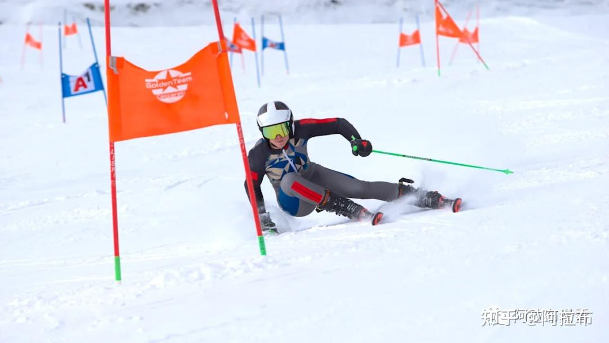
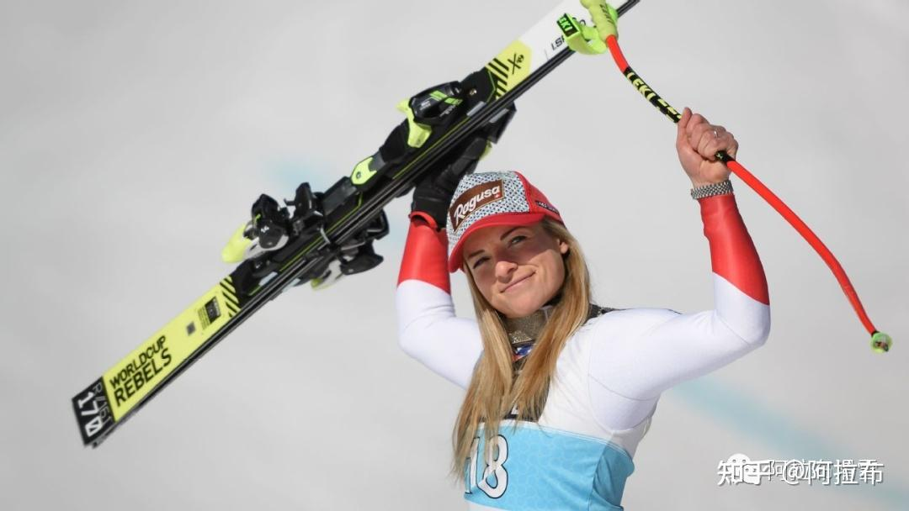
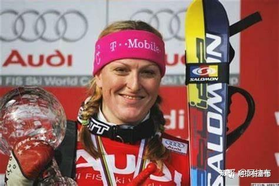
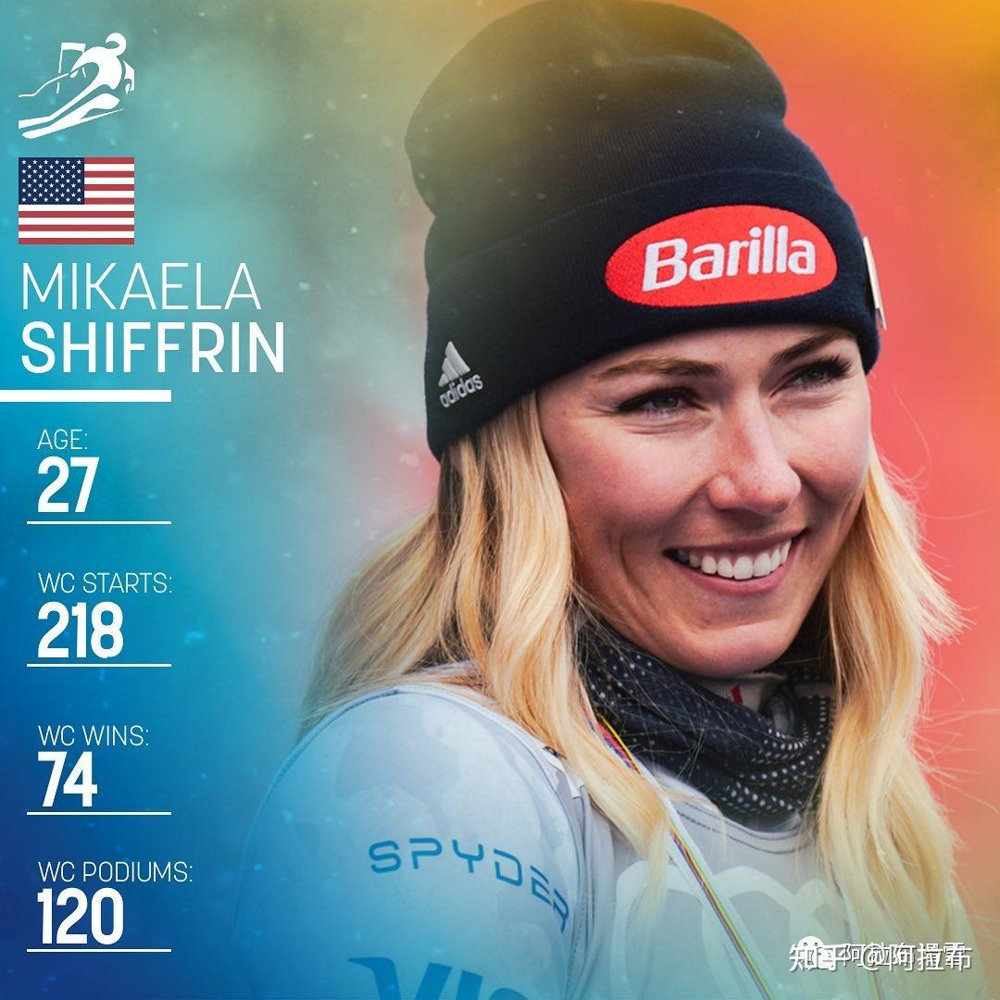
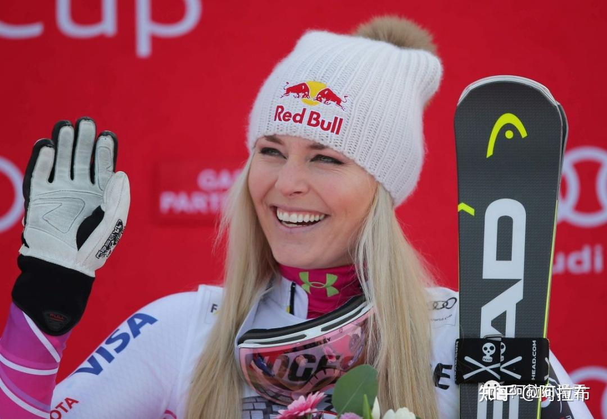
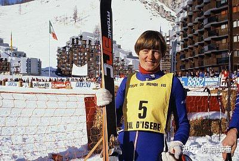
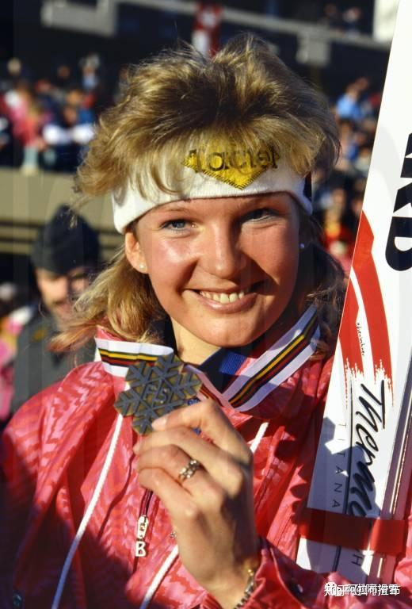

<!-- 来源: https://zhuanlan.zhihu.com/p/583005953 | 分类: 05_滑雪杂谈 | 发布: 2022-11-13 | 赞同: 2 -->

# 最年轻的高山滑雪世界杯参赛者是谁？

公众号的Soelden开幕赛简讯里提到，如果女子GS比赛正常举行，代表阿尔巴尼亚参赛的意大利小姑娘Lara Cultori将以15岁11个月9天的年龄完成世界杯首秀，超过 Mikaela Shiffrin 当年的纪录20天，成为47年来最年轻的高山滑雪世界杯运动员。然而随着Sölden女子GS以及11月5/6日的Zermatt DH比赛的取消，她的首秀恐怕要推迟到11月19日Levi的SL比赛，届时她将已过16岁生日。

更早登上世界杯舞台，意味着可能会有更好的未来、更多的成就。多位在16岁就完成世界杯首秀的运动员成功拿到了水晶球。比如瑞士的Lara Gut-Behrami第一次参加世界杯是2007年她16岁8个月1天时在奥地利Lienz的GS比赛，没能进入第二轮。但她在23岁时获得SG年度总冠军，25岁时拿下世界杯总冠军。

克罗地亚人Janica Kostelić的世界杯首秀是1998年1月23日在意大利Cortina d'Ampezzo举行的SG比赛，获得34名，此时她刚刚过了16岁生日18天。这位天才少女在19岁、21岁、24岁时，三次夺得世界杯总冠军水晶球，并于2002年犹他州盐湖城冬季奥运会上，成为第一位获得四枚奥运奖牌的女子滑雪运动员，年仅20岁。2007年，25岁的Kostelić宣布因伤退役。

当前最瞩目的冰雪女王无疑是Mikaela Shiffrin，她的世界杯首秀是2011年3月11号在捷克Spindleruv Mlyn举行的女子GS比赛，距16岁生日还有2天的Mikaela未能进入第二轮。从18岁起Mikaela开始统治女子SL项目，拿下6次SL年度总冠军和3次SL年度亚军，并于22岁、23岁、以及去年27岁时夺取世界杯总冠军。Mikaela还保持着世界杯最多单项冠军的纪录，她目前已经赢得47场世界杯回转比赛。

而Mikaela之前的冰雪女王，同样来自美国的Lindsey Vonn，2000年11月18日世界杯首秀时刚好16岁1个月整，是美国Park City的SL比赛，第二轮失误。Linsey Vonn在四年后20岁时才拿到第一块世界杯奖牌，但是从24岁开始统治了SG和DH项目，并获得四次世界杯总冠军。在2019年退役时，她获得了82个世界杯金牌，是女子纪录保持者。

Lindsey Vonn之前的纪录是70年代才华横溢的奥地利天才女选手Annemarie Moser-Pröll 的62枚世界杯金牌。Moser-Pröll 在1968年1月17日奥地利Badgastein世界杯首秀时只有14岁9个月21天，那时候FIS的规则允许14岁就参加比赛，而不是现在的16岁。从1971年开始她连续5年夺得世界杯总冠军，然后归隐家乡开了一个酒吧，但仅仅缺席一个赛季后她又回到赛场，并在1979年又拿下一次世界杯总冠军，创造了这一奖项的女子纪录。Moser-Pröll 技术全面，共获13个单项水晶球，有7个DH（1971-75，1978-79），三个GS（1971-72，1975），一个SL（1979），两个全能/Alpine Combined（1975，1979）。

不过以上都不是最年轻的高山滑雪世界杯参赛者，这项纪录属于47年前的德国人Regine Mösenlechner，1975年1月4日她第一次在家乡Garmisch-Partenkirchen参加世界杯回转比赛时，仅仅才14岁9个月零3天。

至于男运动员，因为男性的发育要比女性晚2~3年，因此男运动员很难在18岁之前取得夺目的成绩。不过，世界杯冠军纪录和世界杯总冠军纪录都是男运动员，分别是86次冠军的瑞典人Ingemar Stenmark， 和我们熟知的奥地利冰雪王者，8个总冠军的Marcel Hirscher。
