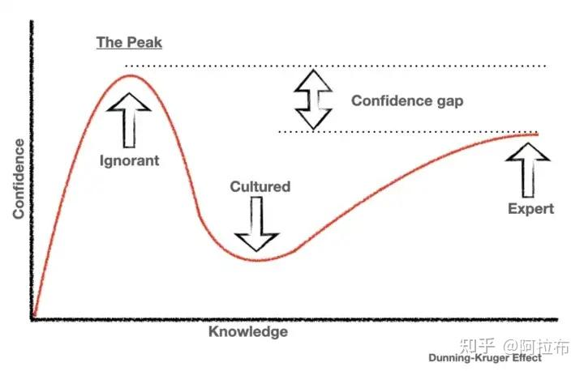
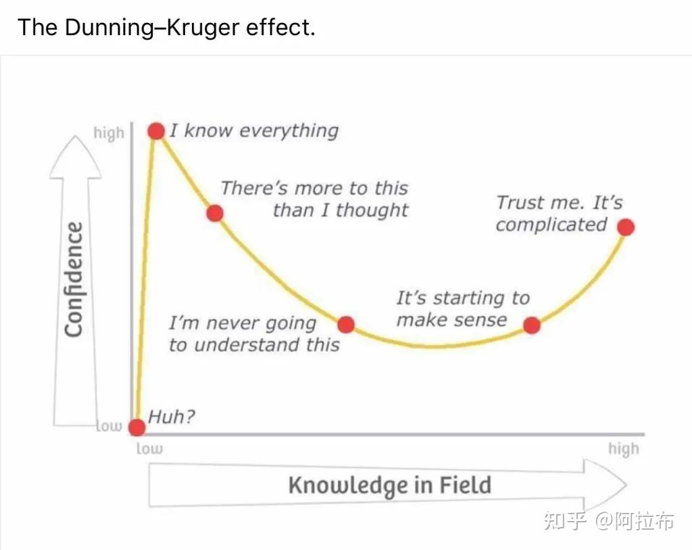
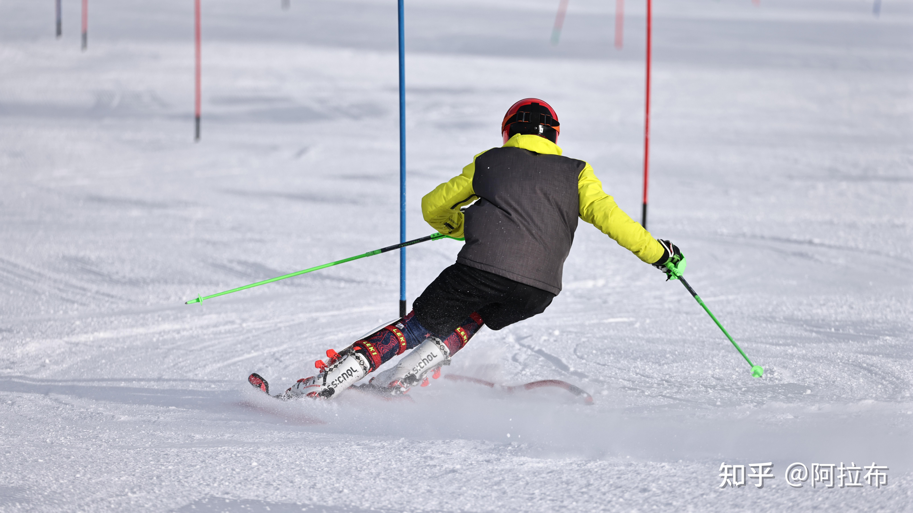
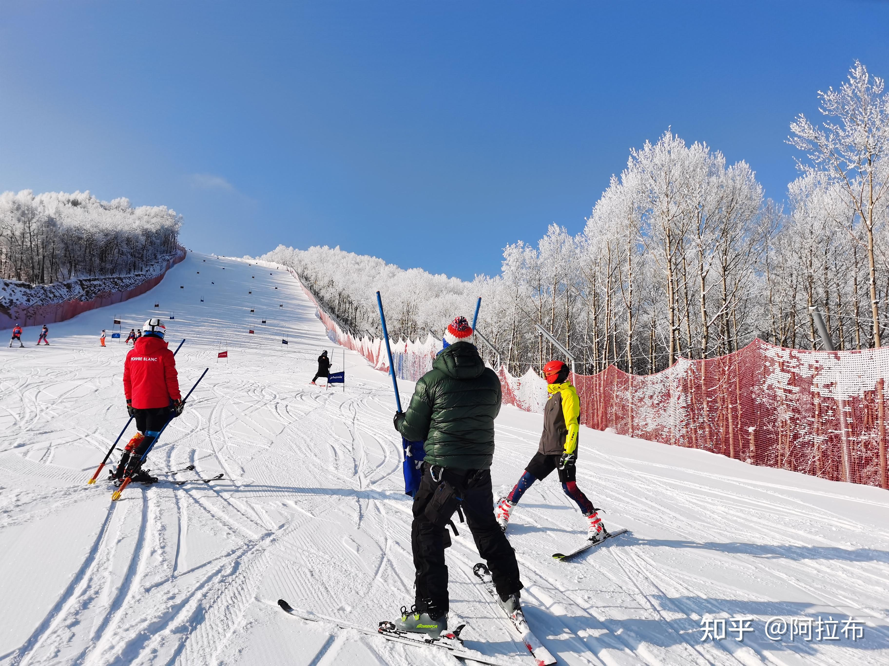

<!-- 来源: https://zhuanlan.zhihu.com/p/589970254 | 分类: 05_滑雪杂谈 | 发布: 2022-12-09 | 赞同: 110 -->

# 滑雪中的Dunning-Kruger（邓克）效应

邓宁-克鲁格效应 （Dunning-Kruger effect），或简称邓克效应（DK effect），是一种 认知偏差 ，即对某种类型的任务或知识领域 的能力、专业知识 或经验较低的人往往会高估自己的能力或知识。一些研究人员还在他们的定义中包含了对高绩效者的相反影响：他们倾向于低估自己的技能。

## 认识邓克效应

最初的研究由 David Dunning 和 Justin Kruger 于1999年发表。研究人员认为，不称职的人不仅表现不佳，而且无法准确评估和识别他们的工作质量。这也许就是为什么考试成绩不及格的学生有时会觉得他们应该得到更高的分数。他们高估了自己的知识和能力，无法准确评估自己的表现。

> 低绩效者无法识别其他人的技能和能力水平，这也是他们始终认为自己比其他人更好、更有能力、更有知识的部分原因。

日常生活中很容易找到这样的现象：比如俗语“半瓶水”，就是说晃动装满水的瓶子没有什么动静，半瓶水晃起来则很吵。再比如查尔斯·达尔文在他的《人类的起源》一书中所写，“无知比知识更能激发自信。”

> 还有一个偏门小知识，大学二年级学生的英文叫法是Sophomore：Sophos=智慧，Moros=愚笨，Sophomore=智慧的蠢蛋，意为一知半解但是过于自信的入门学生。

从认知过程来理解邓克效应会相对容易一些。刚接触一个新知识的时候，入门知识总是相对比较容易的，特别是成熟的领域总会有大量的普及性或者综述类文章，对于学习能力比较强的人，哪怕完全没有接触过这个领域的，也可以在打开搜索引擎十分钟后，对这个领域开始侃侃而谈。这在自媒体和网红时代很常见，很多“意见领袖”总是无所不知，甚至敢于跟领域内的专业人士开杠。

而此时，学习者很容易出现一种倾向：这个领域不过如此，大牛的见解似乎跟我也没差多少。（从某种意义上，大牛对于入门知识的见解，可能确实跟他差不多。）然而缺乏对整个领域纵深的认知，导致这些人不能正确的识别整个领域的难度，如同在一座建筑物的低楼层时，明明头上是万丈高楼，却认为跟旁边几层的普通楼没什么区别。

邓宁-克鲁格效应也与元认知困难有关。元认知 ( metacognition ) 是指退后一步，从自身外部审视自己的行为和能力。这与前面建筑的例子很契合，从万丈高楼内部很难对其建立正确的认知，但如果从外面看一眼，马上就能获得清晰的整体印象。另外一种方式是在足够高的地方向窗户外看一眼：这就是为什么在一个领域内有足够高度的人，往往有更准确的认知。

## 滑雪学习中的邓克效应

很早就注意到，在滑雪论坛和滑雪群中有一个有趣的现象：愿意给予初学者热心和详细指导的，往往是中级滑雪者，甚至是刚刚摆脱初学者困境的人。一方面是刚刚经历过同样的困境的人正处于感触最深、最愿意分享的阶段，另一方面也是因为他们 最敢说 ，最容易把当前的成功当成终极真理。

近几年，中国雪友在滑行外观方面进步非常快，滑的好看的、能贴地的大神比比皆是，但是对滑行理论的认识依旧迟滞不前，因此很多人会把对当前成就的理解当做真理，向外传播。（更可怕的是有些人接触到国外滑雪视频后，马上把各种理论各种教学当成宝贝，纷纷搬运回来，也不管内容对不对，体系之间是不是有冲突，这种情况在抖音、B站等平台特别多。甚至还有更离谱的，给国外教学视频强加个人错误理解。有个朋友连续在群里转了五六个号称不迷路的视频，竟然没一个讲对了，最后气的他取关了。）

所以在滑雪群等场合，大家需要留心：说的最自信、最斩钉截铁的，往往不是真高手。虚假自信的人通常还会对别人经常的、轻易的、武断的批判（或者评价），他们在高估个人能力的同时，无法识别其他人的真正技能和专业知识，也就愈加不能认识到自己的缺陷和错误。

谨慎、客观、能从更高层次进行分析的人，可能比特别能说、并言之凿凿的人更值得相信。

再给大家一个小的提示。滑雪的姿态、动作要求等，很多是阶段性的，初级的要求在中级或者高级就不再适用，甚至变得相反。而没有到达那个层次，就很难正确理解那个层次的内容。所以能够认识到所讨论内容的阶段性、局限性的人，虽然不一定是高手，但起码具备一定的元认知，可以更多关注。

## 滑雪教学中的邓克效应

在教滑雪的时候，也经常会遭遇邓克效应。比如学员在掌握新的能力之后往往会自信爆棚，这时候如果马上布置挑战性的任务，学员很可能会在失败后陷入自信低谷，甚至开始怀疑之前所取得的成绩。

因此在教学进展顺利的时候，识别学员的自信心类型是很有必要的。扶持正常的自信，在出现虚假自信时适当的调整教学内容进行平滑压制（而不是直接滑落到下一个阶段），这样能够尽可能的将学员保持在自信高效的教学环境中。一旦出现难度过大导致的虚假挫败感，教练应该马上回溯之前的成功，让学员尽快找回自信。如果此时教练转而投入到解决新问题中，学员很可能会收获更多挫败而更加沮丧。

现实中也能够观察到，同样是当前流行的鼓励式教学，好的教练既会打气，也会适时调节难度；而差的教练只会吹捧，学员往往因为过度自信而进入危险境地。

## 克服邓克效应

任何一种理论，都是来自于实践，并指导实践。了解邓克效应可以让我们正确的识别、克服、或者摆脱邓克效应。

客服邓克效应的最直接方式是继续学习，进行更多、更广泛的学习。根据理论曲线，更多的知识会自然而然的脱离虚假自信和虚假挫败。

另外一种方式是增加元认知，能够跳出当前环境来审视自己，经常性的用批判眼光 自省 。

最后一个方式，就是了解邓克效应本身，尽可能的减少它的影响。方法很简单——认真阅读本文，并经常检视自我：是否自视过高或过低。

## 参考

Dunning–Kruger effect —— Wiki

Dunning-Kruger effect and journey of a Software engineer —— Addy Bhardwaj
