<!-- 来源: https://zhuanlan.zhihu.com/p/657521791 | 分类: 05_滑雪杂谈 | 发布: 2023-09-24 | 赞同: 20 -->

# 滑雪运动简史——起源与发展

> 原文：[知乎 · 阿拉布](https://zhuanlan.zhihu.com/p/657521791)　·　发布于 2023-09-24　·　本文仅供学习交流，版权归原作者所有

滑雪运动简史将包含一系列滑雪历史文章，这是第一篇，在简单科普后将以滑雪史中的伟大人物以及他们所引领的变革为主。

## 滑雪活动：从远古到现在

滑雪产生于万年之前远古人类利用工具征服自然的过程。随着冰川退缩，石器时代的猎人使用覆盖着毛皮的滑雪板，跟随来自中亚阿尔泰地区的驯鹿和麋鹿群，迁移到西北部和东北部，将滑雪传播到了整个大陆北方。

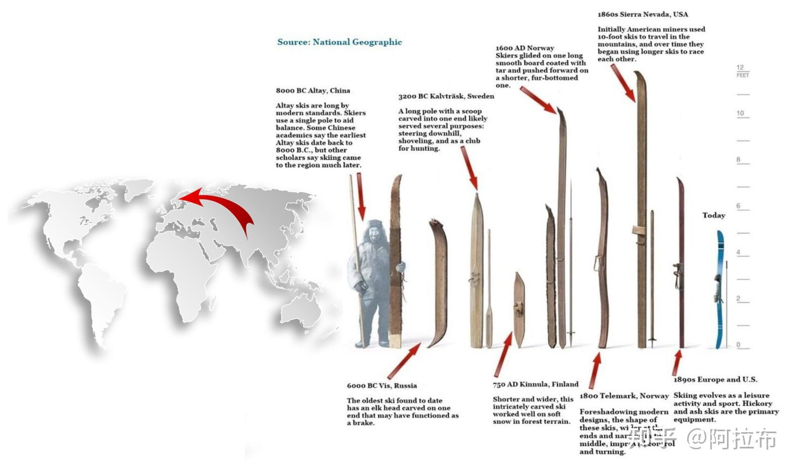

现存最早的滑雪发现来自新疆阿勒泰地区大约在公元前1万年的敦德布拉克洞穴彩绘岩画，这里还发现了公元前8000年的滑雪板。在俄罗斯乌拉尔山脉的泥炭沼中发现过公元前6000年制作的滑雪板残片。而北欧最早的滑雪遗迹是挪威北部一幅公元前2500的岩画，画中绘制着一个脚踩巨大滑雪板的人。

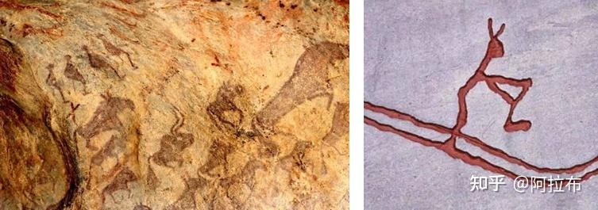

在北欧的斯堪迪纳维亚地区，中国的阿勒泰地区以及东北极寒地区，滑雪是人们日常生活的一部分。根据挪威历史上的纪录，1206 年，两岁的挪威未来国王Håkon Håkonsson被两位勇敢的滑雪者 Torstein Skevla 和 Skjervald Skrukka从利勒哈默尔 (Lillehammer) 带到厄斯特达伦 (Østerdalen)保护起来。这幅绘于1869年的油画再现了这一场景。

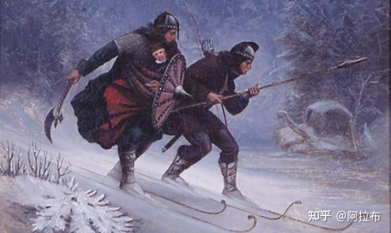

在阿勒泰地区，人们至今仍然保留着使用松木和马腿毛皮手工制作古老“毛皮滑雪板”的传统，以及独具特色的滑行方式。

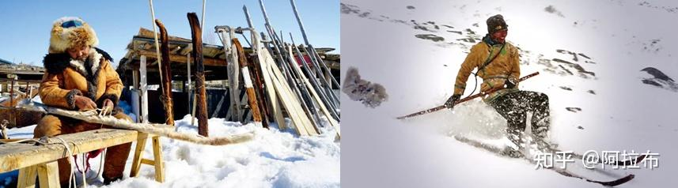

## 现代滑雪运动的诞生

在18世纪，在战争的驱使下，挪威和瑞典的军队开始滑雪训练，以便取得更多的对战优势。军事训练的日益增多加速了对滑雪这一活动的认识和开发，并从中产生了多种比赛项目。

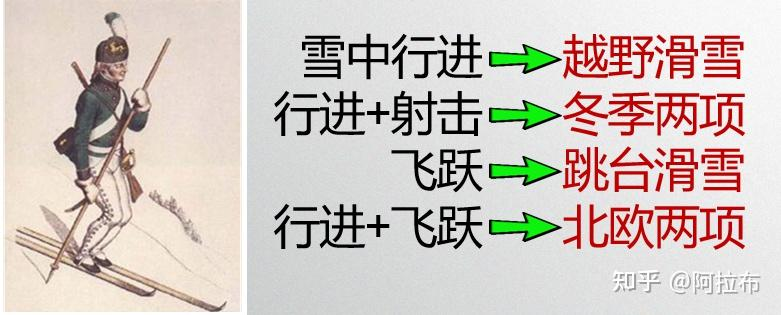

同时，军事训练中的滑雪比赛也开始向民间普及，随之产生的非军事性比赛又极大的激发了当地人民参与滑雪的热情，并促使更多的人开始研究滑雪，改进装备和技术。在1840年代，现代滑雪运动诞生了。1868年，挪威举办了第一场全国滑雪比赛。

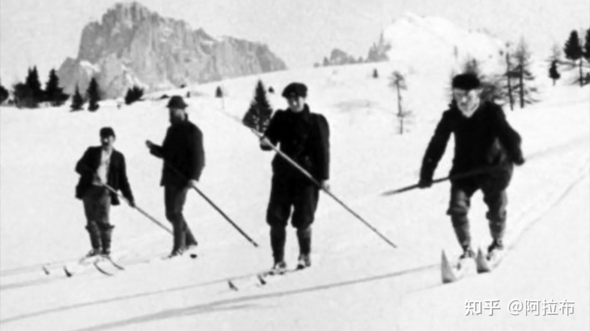

## 高山滑雪的演化

挪威人 Sondre Nordheim 在1950s开发了第一种平行转弯的滑雪方式 the Christiania ，后来他改进了固定器并在1868年设计出第一个带有侧切的滑雪板，这种滑雪板有更宽的头部和更窄的腰部，更有利于转弯滑行。他称这种雪板为Telemark Ski。

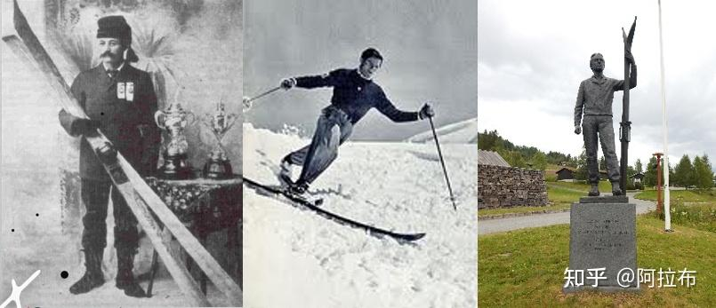

随后滑雪传入阿尔卑斯地区，奥地利教师和艺术家 Mathias Zdarsky 发现来自斯堪迪纳维亚平坦雪原、长达2~3米的Telemark Ski不适合阿尔卑斯山脉崎岖的地形，1890年他将雪板截短至1.8米，重新设计了更加可靠的钢制固定器，然后将之称为Alpine Ski。1897年他出版了《高山滑雪技术》，介绍了他的 Stem Christiania 滑法（1912年被Hannes Schneider改进为 Stem Christie），这种 如今被称为半犁式的滑行方式仍旧是大部分滑雪教学体系的标准滑行技术之一。至此高山滑雪诞生，Zdarsky也被称为高山滑雪之父，南极洲的茨达尔斯基山就是以他命名的。

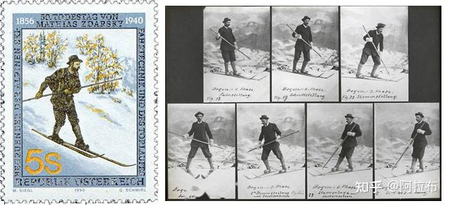

随着滑雪者的增加，专门用于运送滑雪者的机械装置被开发出来，滑雪逐渐演化为两个方向：专注于Downhill下坡滑行的普通高山滑雪，以及兼顾Uphill攀登功能的登山滑雪 Alpine Touring（AT） 。

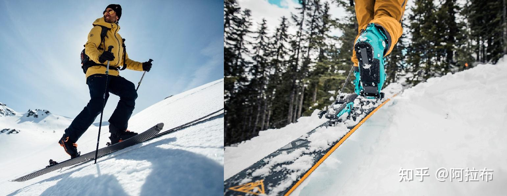

早在滑雪运动诞生之初，登山家们就开始尝试与滑雪的结合。1884年两名挪威人和两名英国人首次有记录地滑雪攀登欧洲山峰：德国的布罗肯山。1897年威廉·保尔克（Wilhelm Paulke）在瑞士伯尔尼高地首次实现真正的高山滑雪穿越，开创了现代滑雪登山 Ski Mountaineering 。滑雪登山诞生时曾尝试从登山运动中分离，但最终这项运动还是由登山协会进行管理。

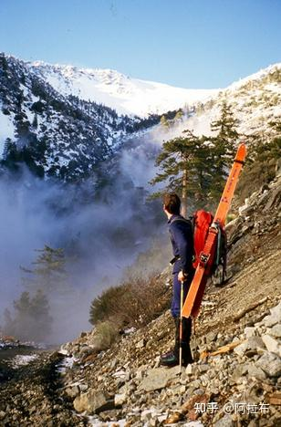

## 单板滑雪的出现

最早的单板在1929年就被制造出来，但是单板滑雪直到1965年才做为一种儿童娱乐方式出现在美国。单板滑雪的创意来自于冲浪(Surfer)，因此第一块商业单板被叫做Snurfer。

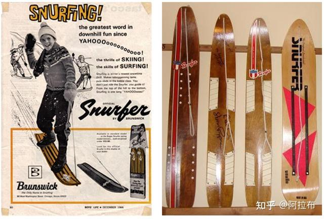

经过酝酿和发展，单板滑雪运动Snowboarding从1970s开始出现和传播。因为保险、滑行规则等原因，一开始滑雪场不接受单板滑雪，而主要由叛逆年轻人组成的单板玩家也经常会有捣乱行为，甚至引发了不少双板和单板的对立。

从1990s年代开始，在各自滑雪协会的大量协调与努力下，美国的度假区和滑雪场逐渐开始接纳单板滑雪，这项运动的参与者迅速占据半数滑雪者，并开始风靡全球。1994年单板滑雪运动正式被国际雪联FIS认可成为官方比赛项目。

单板后来还发展出与双板卡宾类似的种类，称为 Alpine Snownoarding 。

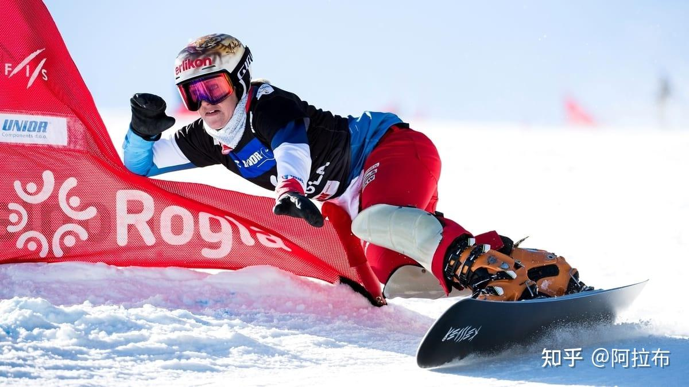

## 自由式滑雪

自由式滑雪之父Stein Eriksen曾经是高山滑雪世界锦标赛和奥运会冠军。他定居美国后致力于传播滑雪技术。在1956年担任滑雪学校主任期间，他经常展示自己的体操技巧，表演空翻、空中技巧等，以促进滑雪和滑雪场的发展。这些表演发展成为自由式滑雪。

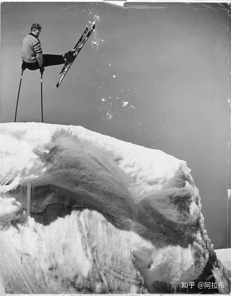

最早的自由式滑雪包含雪上技巧Mogul Skiing、空中技巧Aerial Skiing、雪上芭蕾Acroski 。1979年国际雪联接纳了自由式滑雪，并重新制定国际比赛规则，雪上技巧率先成为1988年冬奥会示范项目和1992冬奥会正式项目；空中技巧也于1994年加入奥运会；但是雪上芭蕾在1988和1992两次作为示范项目登上奥运会后反响不佳，不再作为竞赛项目。

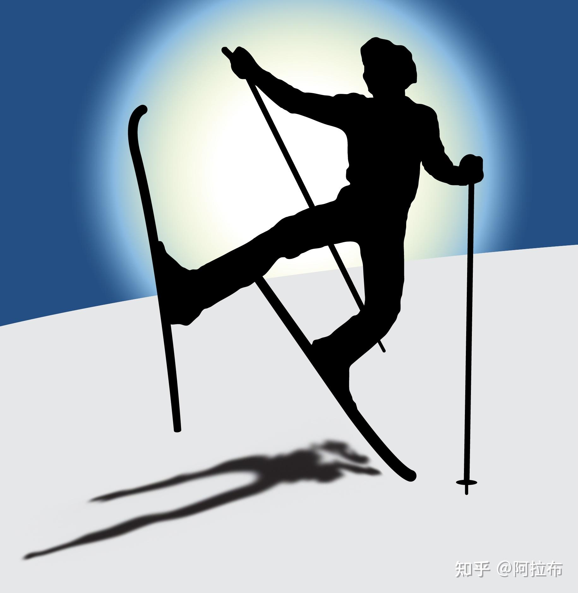

后来自由式滑雪还增加了U型场地技巧Halfpipe Skiing、坡面障碍技巧Slopestyle Skiing、障碍追逐Ski Cross、大跳台Big Air。

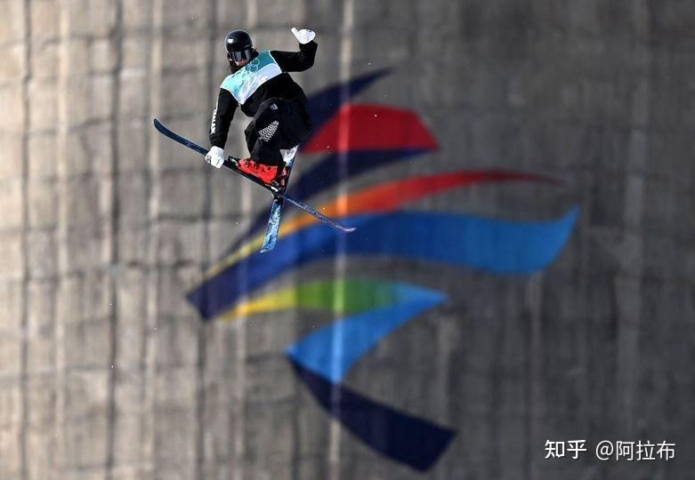
