<!-- 来源: https://zhuanlan.zhihu.com/p/664235843 | 分类: 05_滑雪杂谈 | 发布: 2023-11-09 | 赞同: 6 -->

# 滑雪运动简史——奥运会中的滑雪项目

奥运会是体育运动最高级别赛事，具有无以伦比的影响力，只有发展成熟、并拥有足够受众的竞技项目才有资格列入奥运会。

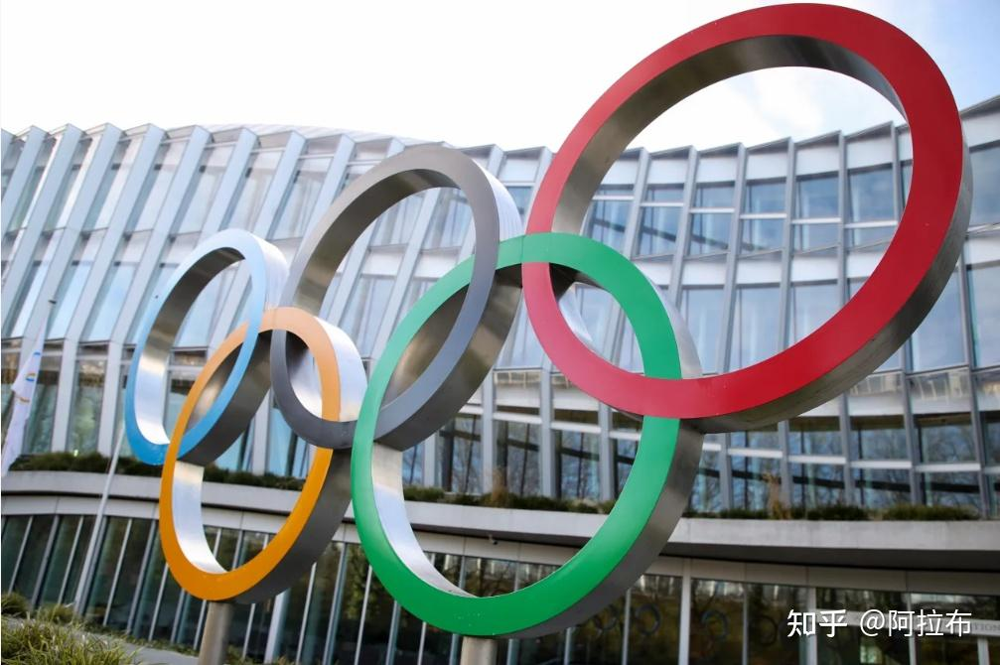

1924年巴黎奥运会后，同年法国在夏慕尼举行了一次“冬季运动周”活动，来自16个国家的约250名运动员参加了16个项目的比赛，包括雪橇、越野滑雪、冰壶、冰球、冬季两项、北欧两项、跳台滑雪、速度滑冰和花样滑冰。这次活动取得巨大成功，国际奥委会于1926年将其重新命名为“冬季奥运会”，并决定每4年与夏季奥运会同步举办，直到1994年的挪威Lillehammer冬奥会才开始比夏季奥运会推迟两年举行。

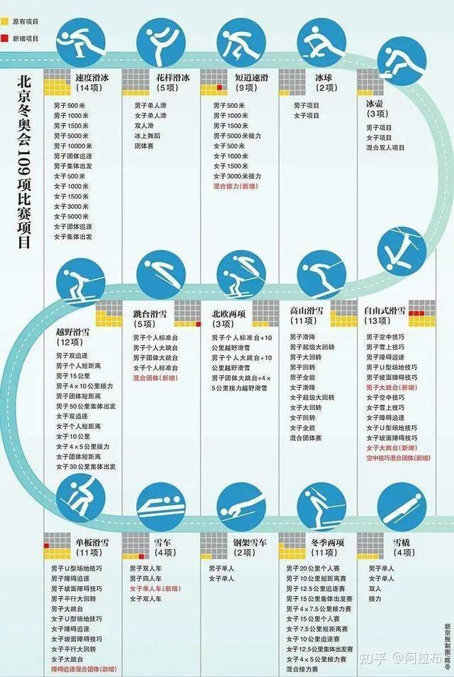

经过百年发展，到2022年北京冬奥会，比赛项目已有7个大项，15个分项，109个小项。其中滑雪作为比赛数量最多的大项，拥有高山滑雪、越野滑雪、自由式滑雪、单板滑雪、跳台滑雪、北欧两项6个分项，共计55个小项。再加上拥有11枚金牌、单独作为一个大项的冬季两项，滑雪相关项目的金牌数超过了冬奥会金牌总数的60%。

2026年米兰-科蒂纳冬奥会将新增滑雪登山大项，包含3枚金牌。同时还会调整部分小项，预计最终将包含8个大项116个小项。

## 越野滑雪 Cross-Contry Skiing

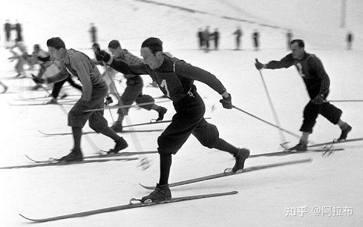

越野滑雪是最早的滑雪运动项目之一，1843 年第一次在报纸上提到挪威特罗姆瑟举办的有组织的越野滑雪比赛。此后在斯堪迪纳维亚半岛逐渐开始周期性的举办滑雪比赛。

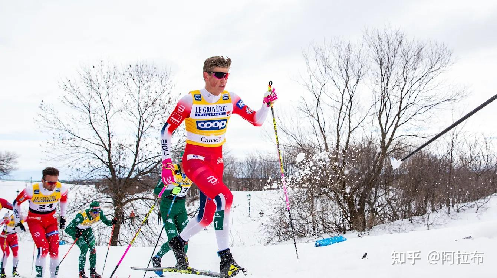

在1924年第一届冬季奥运会上就出现了越野滑雪，只有男子18公里和50公里两个项目。在2022北京冬奥会上，越野滑雪共设12个竞赛项目，男女各6个。

越野滑雪由国际雪联FIS管理。

## 冬季两项 Biathlon

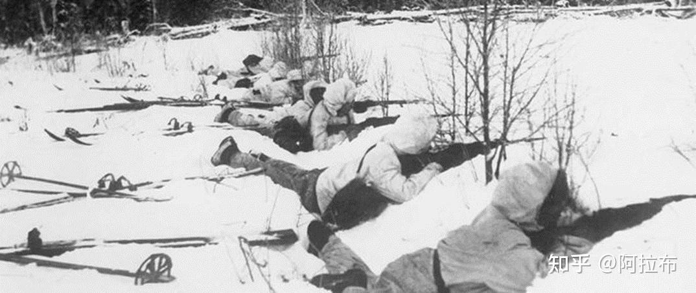

冬季两项 Biathlon，将越野滑雪与步枪射击相结合。

这项运动植根于斯堪的纳维亚半岛的滑雪传统，滑雪和步枪射击的综合技能最初是由该地区的军队开发。1767 年，第一次有记录的冬季两项比赛在挪威和瑞典边境巡逻部队之间举行。 1924 年在法国霞慕尼举行的第一届冬季奥运会上，冬季两项是示范项目，当时被称为“军事巡逻” 。

冬季两项于1960年作为正式的男子项目被添加到冬季奥运会项目中。女子冬季两项在1992年法国阿尔贝维尔冬季奥运会上首次亮相奥运会。2022年北京冬奥会上冬季两项共有11个竞赛项目。

自1993年以来，这项运动一直由国际冬季两项联盟（IBU）管理。

## 跳台滑雪 Ski Jumping

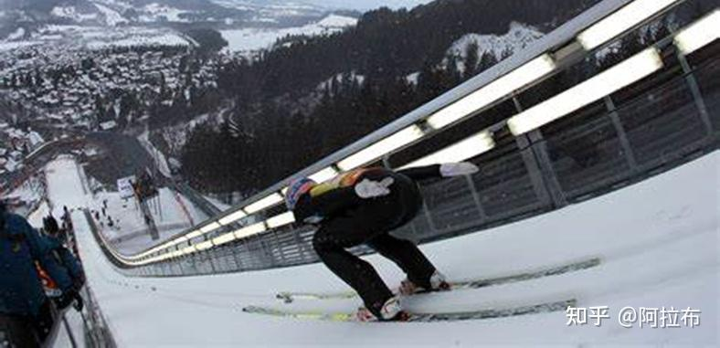

跳台滑雪也是最早的滑雪运动项目之一。第一个有记录的跳台滑雪者的是挪威人Olaf Rye ，他在1809年的当众表演中跳出9.5米并且生还。1862年在挪威举行了第一场正式的跳台滑雪比赛。

1924年在法国霞慕尼举行的首届冬季奥林匹克运动会上，跳台滑雪被列入正式项目。2022年北京冬奥会上跳台滑雪共有4个竞赛项目。

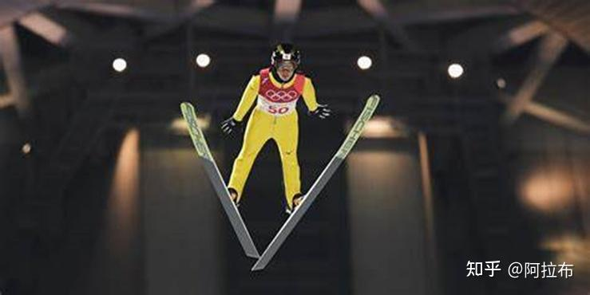

目前最长的跳台滑雪世界纪录是253.5米，由挪威跳台滑雪运动员Johan Remen Evensen于2017年在斯洛文尼亚Planica创造。

## 北欧两项 Nordic Combined

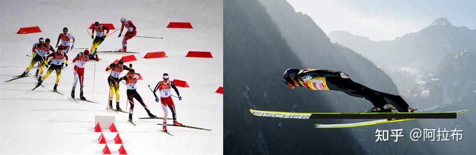

北欧两项是越野滑雪与跳台滑雪的组合，最早出现在1892年挪威Oslo的Holmenkollen滑雪节。

1924年在首届冬季奥林匹克运动会上，北欧两项就成为正式项目。早期北欧两项只有男子个人项目，由两次跳台和15公里越野（后来减为10公里）的成绩计算积分。2008年之后越野接力加入其中，但是直到2022冬奥会，北欧两项仍旧是唯一没有女子项目的运动。

2022年北京冬奥会上北欧两项共有3个竞赛项目。

## 高山滑雪 Alpine Skiing

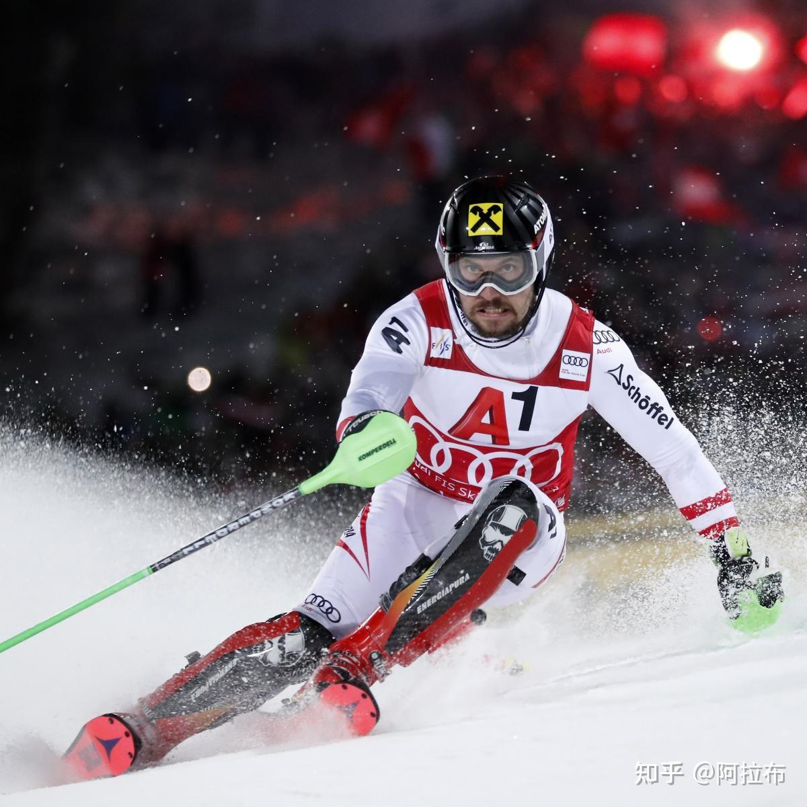

尽管Zdarsky在1905就举办了一场设置有86个门的高山滑雪比赛，但并没有产生什么影响。直到1922年英国人Arnold Lunn在瑞士举办了第一场回转障碍赛(Slalom)，这种激烈而有趣的比赛形式才引发大家纷纷模仿。

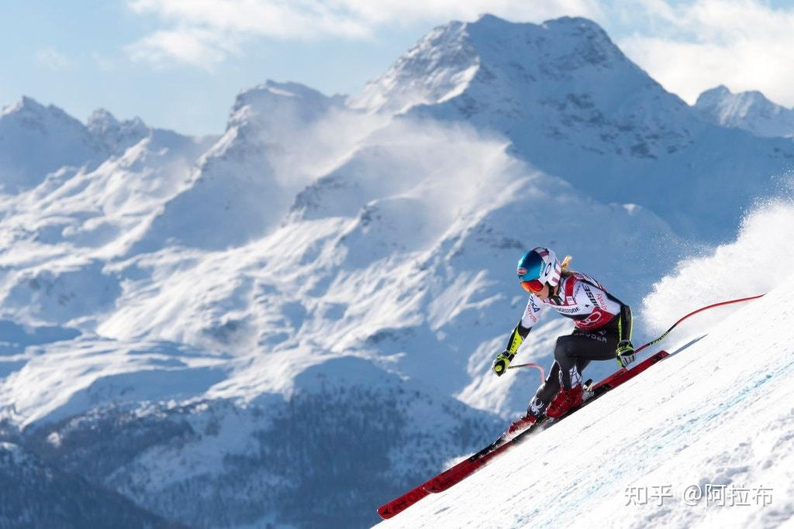

国际雪联FIS在1930年承认了 回转Slalom 和 速降Downhill 两种比赛形式，并于1931年举办了首届男子速降和回转世界锦标赛。1936年高山滑雪全能赛（回转SL和速降DH组合）列入德国Garmisch-Partenkirchen冬奥会观察项目，在中断2届后，1948年St. Moritz冬奥会上高山滑雪正式设置了男女回转、速降、全能共6个项目。

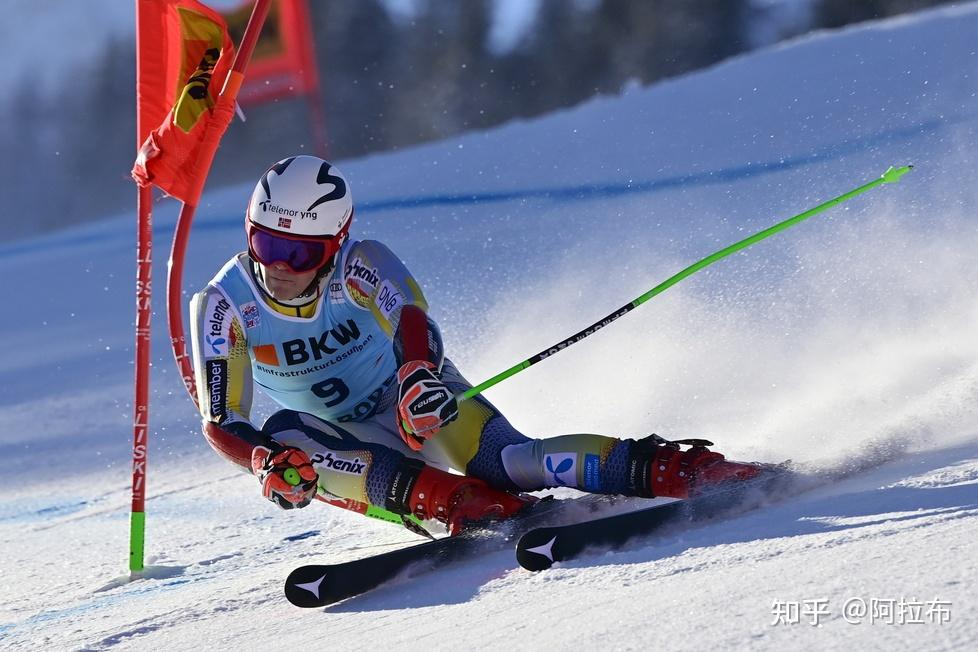

大回转Giant Slalom 是由回转Slalom项目发展而来，旗门更宽，相距更远，赛道更长。该赛事于1950年首次被列入世界锦标赛，并于1952年首次被列入奥运会。

超级大回转Super GS 比赛主要是一项速度项目，介于大回转GS和速降DH之间。该赛道比回转/大回转项目更陡峭、更直，并以更高的速度进行更长、更全面的转弯。超级大回转加入了1987年的世界锦标赛和1988年的奥运会。

2022年北京冬奥会的高山滑雪共有11个竞赛项目，除去以上男女各5个项目，还设置了团体平行回转比赛。

## 自由式滑雪 Freestyle

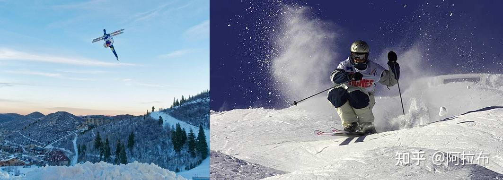

一般认为自由式滑雪空中技巧Aerial Skiing诞生于1960年代的美国并开始风靡世界，同期在法国则产生了雪包滑行Bump Skiing，并于1990年代演化成为雪上技巧Mogul Skiing。

1979年国际雪联接纳了自由式滑雪，并重新制定了国际比赛规则，雪上技巧Mogul Skiing率先成为1988年冬奥会示范项目和1992冬奥会正式项目；空中技巧也于1994年加入奥运会。而诞生于欧洲30年代的雪上芭蕾Acroski在1988和1992两次作为示范项目登上奥运会后反响不佳，不再作为竞赛项目，如今已经消失在人们的视野中。

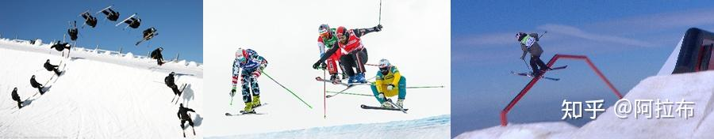

后来自由式滑雪还增加了障碍追逐Ski Cross(2010)、U型场地技巧Halfpipe Skiing(2014)、坡面障碍技巧Slopestyle Skiing(2014)、大跳台Big Air(2022)，在2022北京冬奥会上总共设置了13个竞赛项目，是金牌最多的滑雪分项。

到这里，奥运滑雪项目中已经出现了三个独立大型跳台（另外坡面障碍会有一连串的中型跳台），分别是跳台滑雪、自由式空中技巧、自由式大跳台。可以通过运动员的动作来分辨三种比赛：

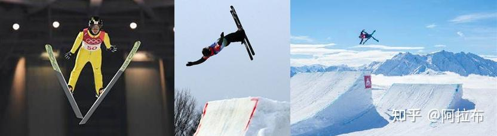

- 呈大字型在空中滑翔的是跳台滑雪
- 在空中做出体操动作的是自由式空中技巧
- 摆出造型转很多圈的是自由式大跳台

## 单板滑雪 Snowboarding

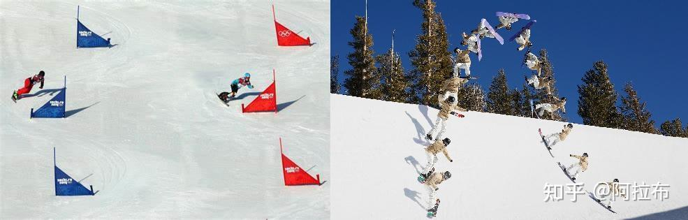

单板滑雪最早加入奥运会的项目是1998年日本长野奥运会的平行大回转Parallel Giant Slalom和U型场地技巧Snowboarding Halfpipe。

2006年，都灵冬奥会增加了障碍追逐Snowboard Cross，2014年索契冬奥会增加了坡面障碍Slopestyle，2018年平昌冬奥会增加了大跳台Big Air。

2022北京冬奥会上单板滑雪共设置了11项比赛。

## 滑雪登山 Ski Mountaineering

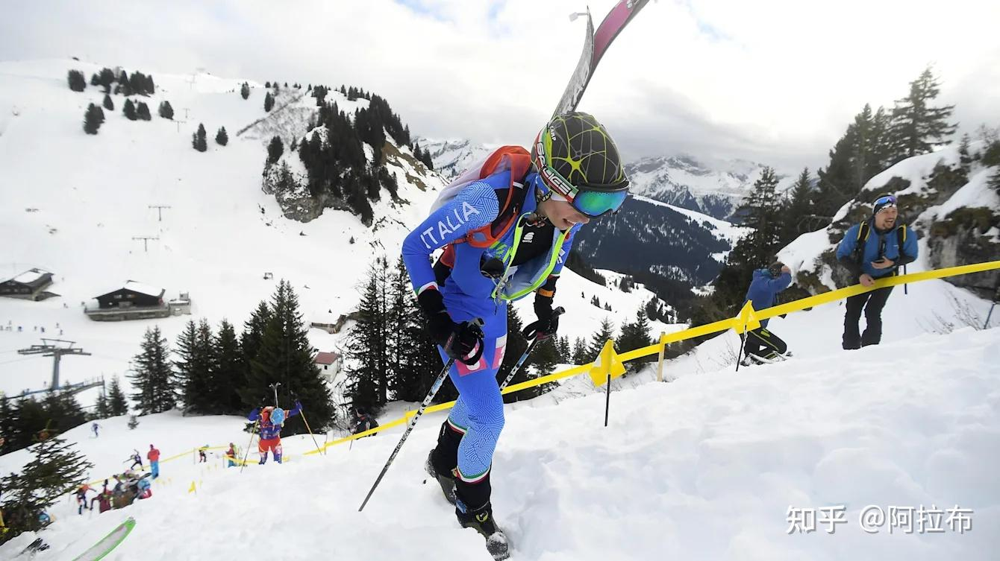

滑雪登山 Ski Mountaineering，又被称为“Skimo”，已有上百年的发展史，但直到最近几年才逐渐形成规范性的比赛。国际奥委会已经批准将滑雪登山项目纳入2026米兰-科蒂纳冬奥会，将有36名运动员参与三个项目的角逐：男女短距离冲刺和团体接力赛。

滑雪登山项目由成立于2007年的国际滑雪登山联合会(ISMF)进行管理。
