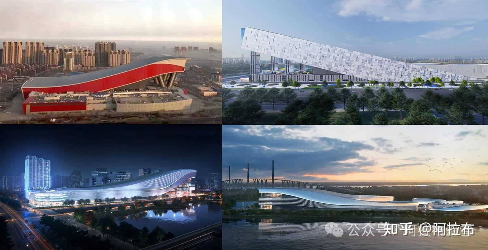
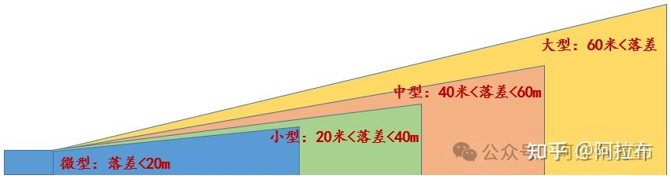
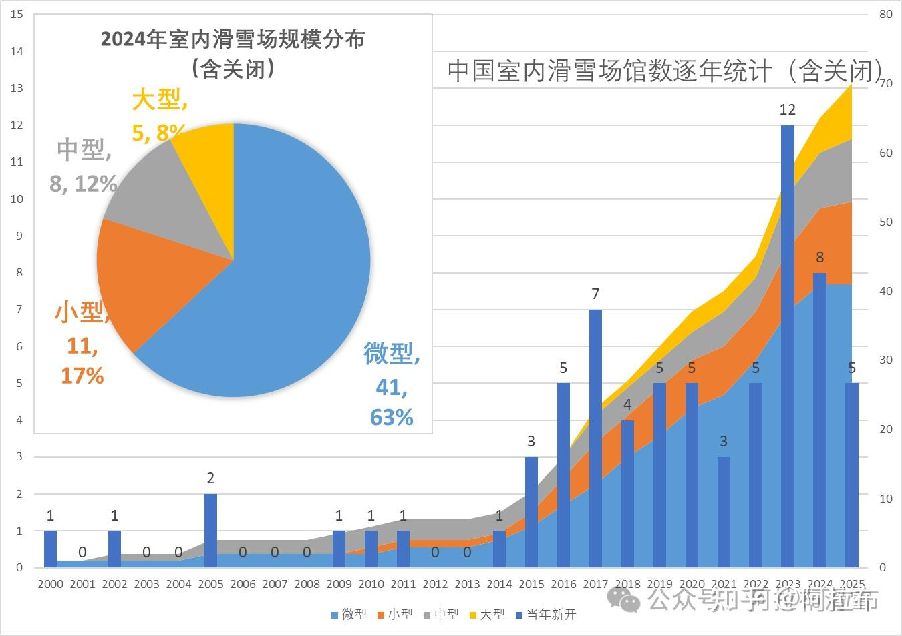
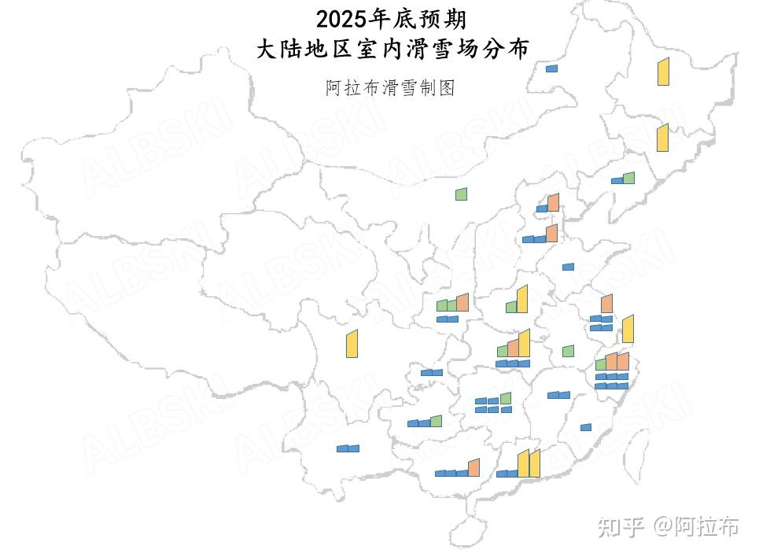

<!-- 来源: https://zhuanlan.zhihu.com/p/713970976 | 分类: 05_滑雪杂谈 | 发布: 2024-08-12 | 赞同: 75 -->

# 中国室内滑雪场最权威统计（2024八月修正版）

截止到2024年国庆，中国大陆地区共开设室内滑雪场65座，停业6座。另有10座室内滑雪场开工在建，以及7座已签约。

01 室内滑雪场规模分级

对于滑雪运动而言，雪道是最核心的资源。雪道数据由长度、坡度、宽度三个参数构成，以此延伸出常用的三个雪场规模评价指标：

- 雪道总长度 ，或者可滑行距离，欧洲大型雪场最常用的指标，但只代表量，不代表质，所以通常会与其他指标组合使用。
- 最大落差 ，在雪道坡度存在上下限的情况下，通常落差越大，可滑行距离也会越长。另外，落差越大，越可能存在更难的雪道。因此落差经常也会用来表示雪场难度或者雪道质量。
- 可滑行面积 ，即雪道长度乘以宽度，通常会用来表达雪场容量。但是这个数据同样需要与落差配合，否则很容易被低质量雪道注水。尤其需要注意，中国的室内滑雪场所宣传的雪区面积/冷区面积，不仅有可滑行面积，还包含大量的娱雪面积，所以对滑雪者没有参考意义。

室内滑雪场的雪道坡度和宽度必然设计为合理的范围，因此上面三个指标中的落差成为 最能衡量室内滑雪场规模 的参数。室内滑雪场的落差以20/40/60米为界，可分为微型、小型、中型、大型四种规模。

- 微型：落差小于20米，雪道长度小于200米，适合入门到初级水平。
- 小型：落差在20米与40米之间，适合入门和初级水平。
- 中型：落差在40米和60米之间，适合初级和中级水平。
- 大型：落差在60米以上，适合初、中、高级水平滑雪者。

目前国内建成的65座室内滑雪场中（含已关闭停业的6座），80%都是微小型雪场，主要服务于本地旅游娱乐和冰雪运动普及。近两年大型室内滑雪场建设呈现爆发趋势，24年9月以前仅有3座，预计25年底可增至7座。

02 室内滑雪场地域分布

预计到2025年底，全国将有64座室内雪场，其中半数在浙江、湖北、湖南、陕西和江苏五省：

- 浙江建有6座微型、1座小型和2座中型室内雪场；
- 湖北建有3座微型、1座小型、1座中型和1座大型室内雪场；
- 湖南建有5座微型和1座小型室内雪场。

陕西和江苏各以5座室内雪场进入前五，并各建有一座中型室内雪场。前五省将拥有全国7座中型室内雪场中的5座，但大型室内雪场仅有1座。

全国大中型雪场分布相对比较均匀，目前仅有湖北一省建有两座大中型雪场。但是2025年后，广东将以两座大型室内雪场成为中国四季滑雪条件最好的地区。

03 大型室内滑雪场列表

截止2024年底，国内将建成5座大型室内滑雪场，其中哈尔滨热雪奇迹以80米落差成为当前国内最大规模、世界第四（并列）大落差室内滑雪场。但是这个记录将于2025年被83米落差的深圳前海华发超雪中心和85落差的长春万达茂冰雪中心依次超过。

04 中型室内滑雪场列表

从实际滑行的感受而言，中型室内滑雪场才具备滑雪运动的入门级“可玩性”。然而，小微和大型室内雪场分别对应“休闲/体验者”和“爱好者”这两大截然不同的客户群体，中型室内雪场则两头不讨好，地位略有尴尬。很可能由于这个原因，预计2025年国内大型室内滑雪场数量将超过中型。

05 小微型室内滑雪场列表

国内最小的室内滑雪场在哪里？目前有三个候选项：

- 江西宜春靖安三爪仑四季滑雪场，雪道长90米
- 山东德州德百奥莱广场冰雪王国
- 北京五棵松第五极国际滑雪成长中心

希望知情的雪友们提供准确信息，咱们评选出中国最袖珍的室内滑雪场。

2024.8.20 —— 修正武汉冰雪中心、河北正定热雪奇迹、广西梧州启迪冰雪世界级别

2024.8.12 —— 2024八月修正版发布
