<!-- 来源: https://zhuanlan.zhihu.com/p/6700544455 | 分类: 05_滑雪杂谈 | 发布: 2024-11-13 | 赞同: 17 -->

# 世界滑雪体系介绍--国际滑雪技术大会室内讲座

> 原文：[知乎 · 阿拉布](https://zhuanlan.zhihu.com/p/6700544455)　·　发布于 2024-11-13　·　本文仅供学习交流，版权归原作者所有

Guy Dale, Chris Oldaker

翻译：赵乾

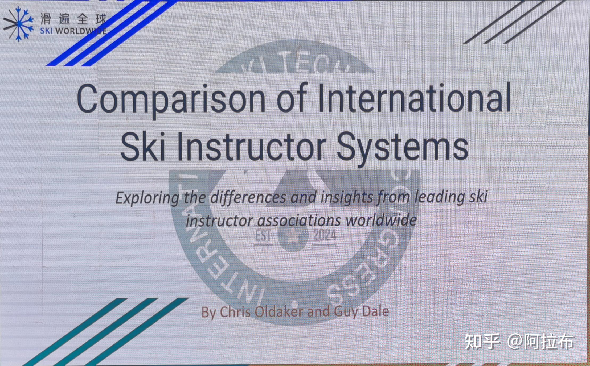

各国滑雪体系的不同主要是因为历史传承、地形、雪质雪况，文化等。

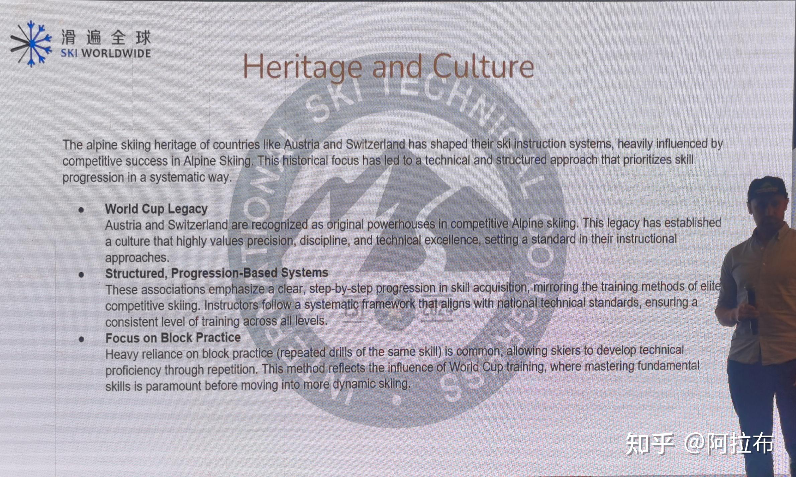

比如瑞士，因为竞技非常强，就在国内形成很好的氛围，参与人很多。而在奥地利，滑雪是国民运动，日常生活和电视等经常能看到，竞技非常成功并成为大家的骄傲，所以大家也非常渴望大众滑雪的成功。

可以看到瑞士和奥地利的滑雪学校是模块化的，非常细致，在模块中经常重复某些内容，而且是在封闭环境，这就是来自于竞技训练的方法。他们非常依赖这种模式，对应新的技能会有固定的练习。

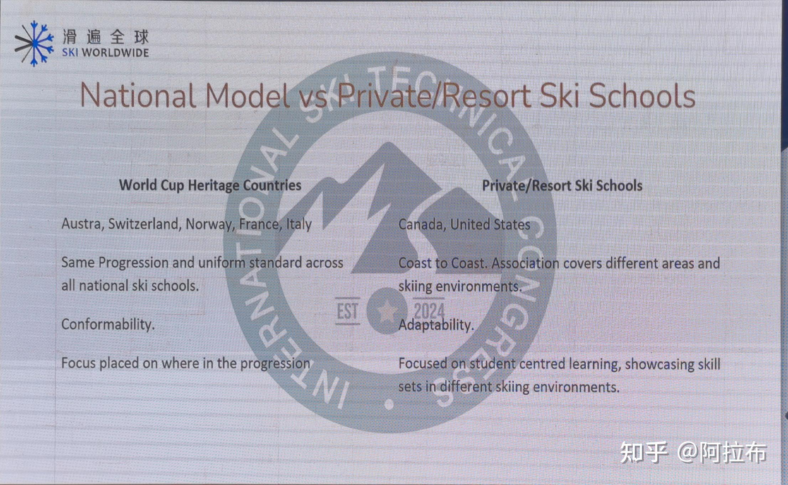

像美国和加拿大等没有这种深厚的历史，所以他们更希望客人把滑雪当作娱乐，特点是鼓励式、循序渐进式教学、更开放的环境等。而左边的这些国家非常严格，一致性很好，可以在不同滑雪学校无缝衔接。美国和加拿大这种从东海岸到西海岸跨度非常大，就需要因地制宜，教授符合当地特点的技术，因此差别会很大。

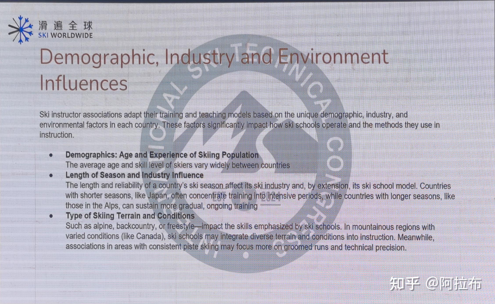

还有生活习惯的不同，比如欧洲的小孩从小就滑雪，长大了就自然成为滑雪高手。还有滑雪行业在国家中的地位，比如澳大利亚雪季非常短，所以他们哪怕四级也要讲渐进式教学，因为他们必须在很短的时间内安排学习。澳大利亚的教练课最短是2个小时 而在加拿大的惠斯勒，只有半天和全天课。

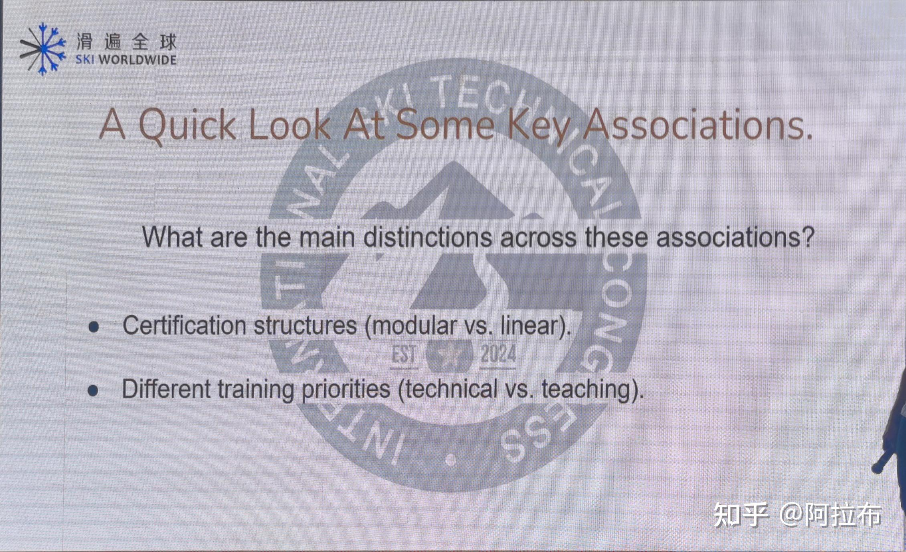

有一些国家的体系是模块化的，还有一些是线性的，必须一步一步上升。

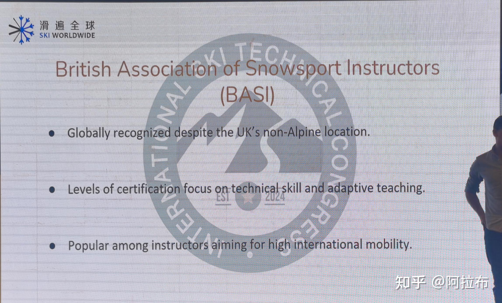

英国虽然没有雪，但是吸收了很多欧洲的特色。

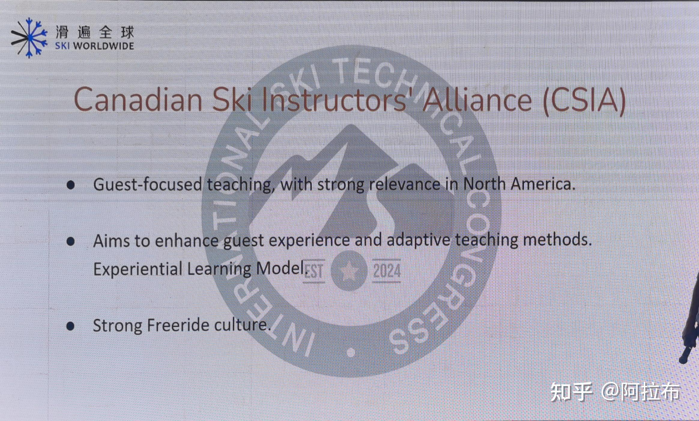

加拿大喜欢大山。

瑞士非常偏爱高表现滑行。

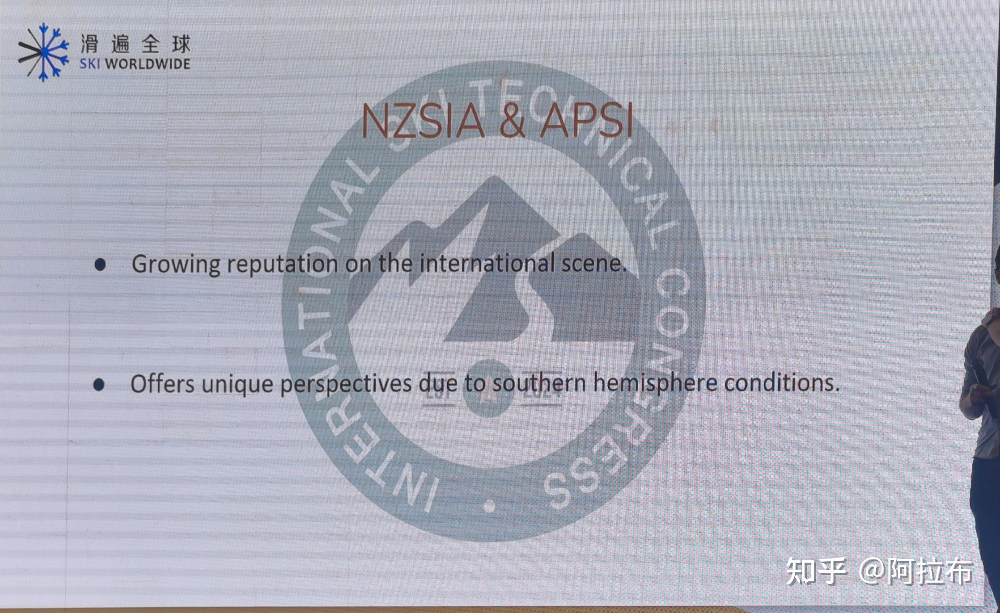

新西兰和澳大利亚因为国际交流环境而获得很好的发展。但是雪况会影响他们滑行。

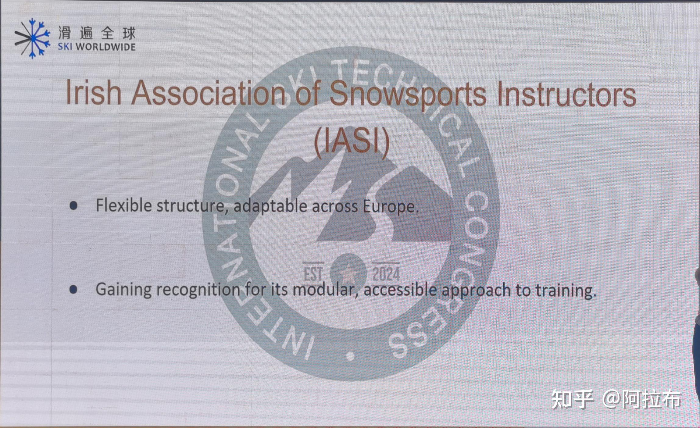

爱尔兰体系结构灵活，滑行表现也不错。

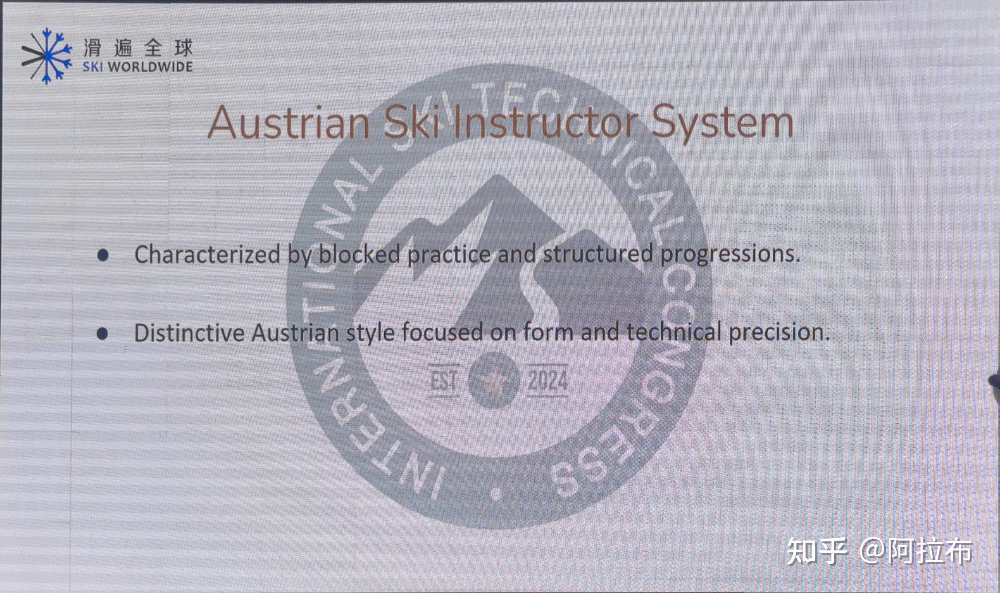

奥地利是非常模块化的体系。

谈一下教学方面的不同。

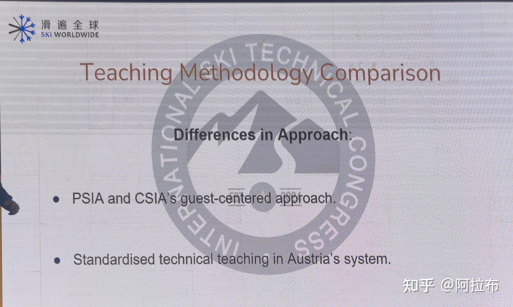

PSIA和CSIA为客户导向，关注个人成长。奥地利关注动作标准化。但很多欧洲滑雪强国也在越来越注重客户沟通。

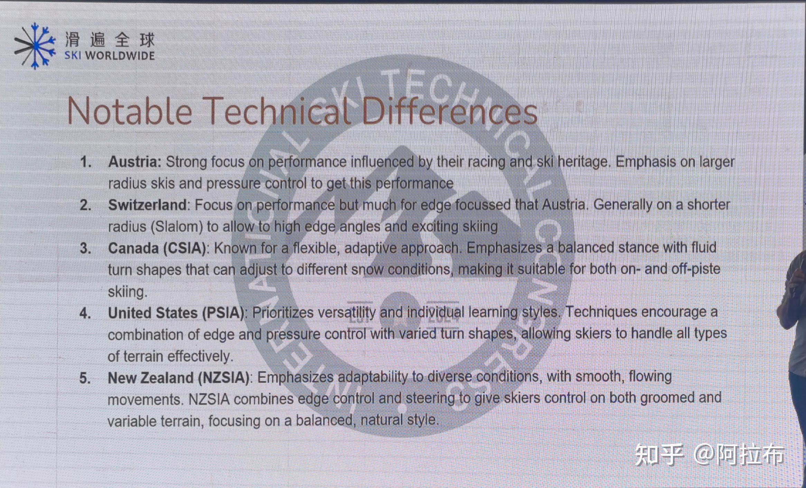

滑行区别：

奥地利强调高表现，压力，用大半径板控制压力实现高表现。

瑞士与奥地利相似但特别关注立刃角度，会用回转板做特别高立刃的滑行。

美国和加拿大更关注灵活性和通过性，在开放的大山环境下享受滑行。

新西兰关注旋转运动，因为雪场太小了。更多旋转能避免撞人。

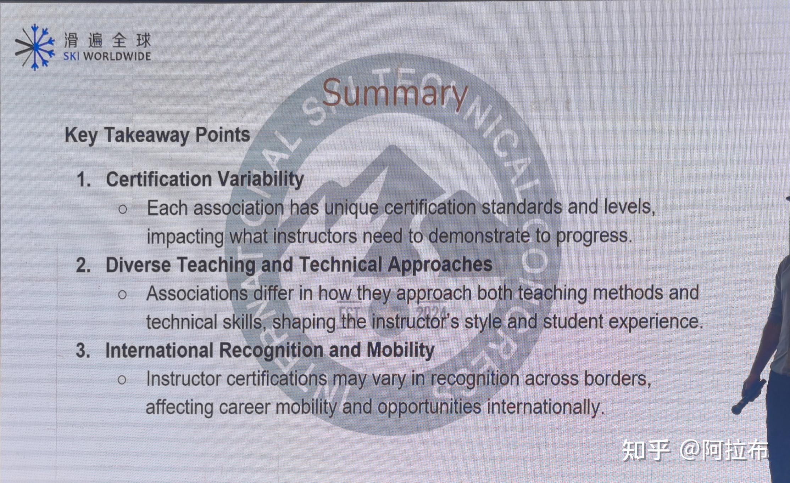

总结：

1、协会的级别划分不同，会影响考证时需要做的滑行。

2、教学风格不同是各种客观条件决定的。

3、认证的国际认可是另一个话题。

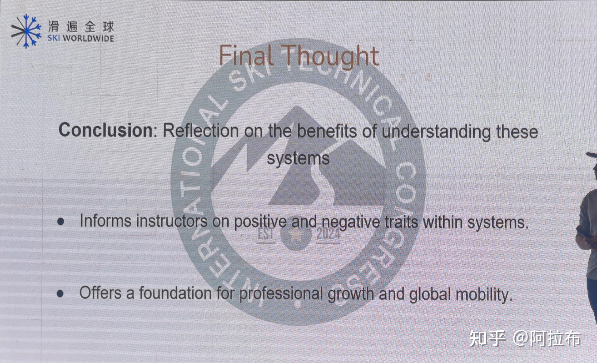

有了这些知识，想学哪些东西就去相应的体系，学完回到原来的体系就可以。
