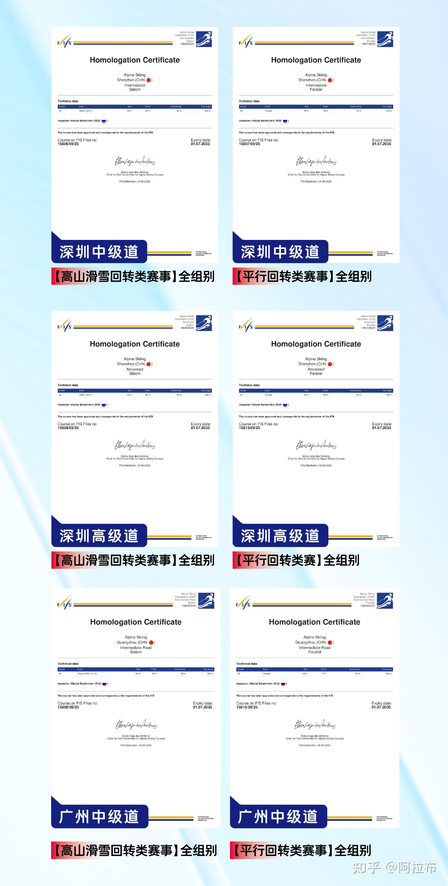
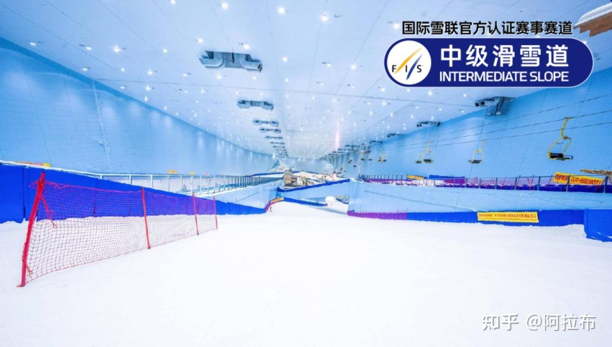
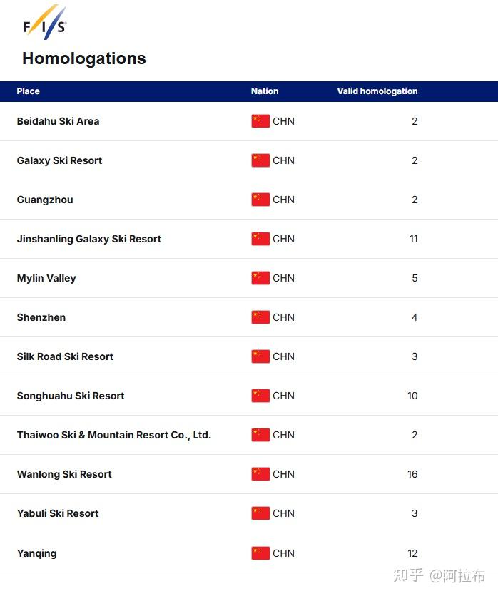
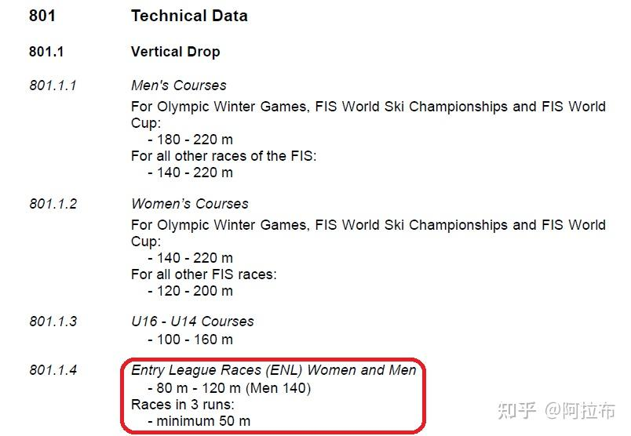
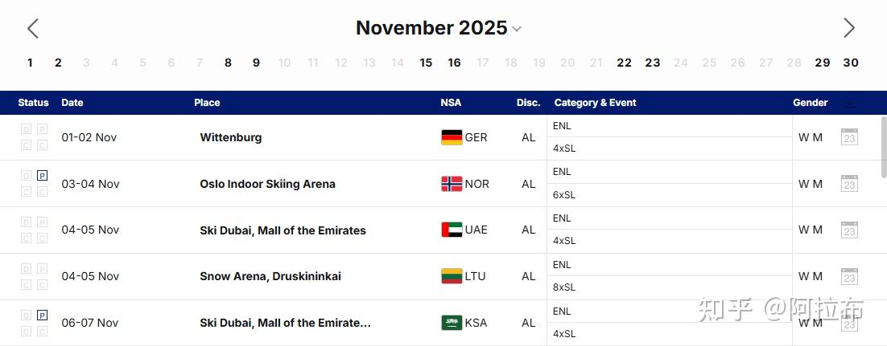
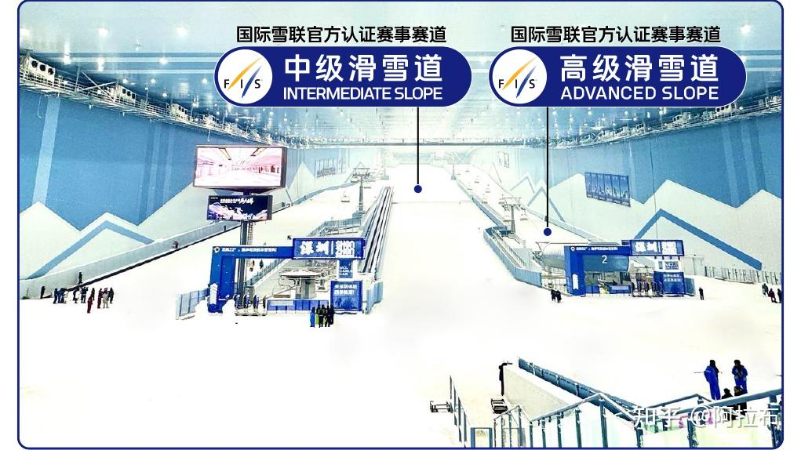

<!-- 来源: https://zhuanlan.zhihu.com/p/1958998023234364455 | 分类: 05_滑雪杂谈 | 发布: 2025-10-07 | 赞同: 6 -->

# 中国室内滑雪场首次完成FIS雪道认证

> 原文：[知乎 · 阿拉布](https://zhuanlan.zhihu.com/p/1958998023234364455)　·　发布于 2025-10-07　·　本文仅供学习交流，版权归原作者所有

近日，广州热血奇迹麋鹿道（中级）和深圳华发冰雪热雪奇迹中级道、高级道通过国际雪联FIS雪道认证，是中国室内滑雪场第一次获得FIS雪道认证。

FIS雪道认证是申办FIS比赛的重要准入条件，意味着雪道硬件和运营标准达到FIS比赛要求，可以按照国际雪联标准举办国际赛事。FIS雪道认证要求包括落差、坡度、转弯盲区、雪道宽度、防护网安装，以及其他运营要求。

目前国内通过FIS高山滑雪认证的雪道共有29条，内含72个比赛项目认证。这些数据不包括自由式滑雪和单板滑雪场地，如云顶、首钢大跳台等。

从表格中可以看到室内滑雪场的落差与室外雪场相差悬殊，这么小的落差真的可以举办FIS比赛吗？答案是可以的。

FIS规则中对普通回转比赛的落差要求是140~220米，但是有两种比赛例外，分别是入门级比赛ENL的最小80米，和三轮回转比赛的最小50米落差。

从今年的FIS高山滑雪赛历中可以看到，十一月初的五场ENL比赛都是在室内雪场进行的，赛道落差分别是56/83/55/59/55米（不是雪场最大落差）。

所以，当未来中国能够举办更多FIS比赛，华南这三条FIS认证雪道一定会有机会大放光彩。
