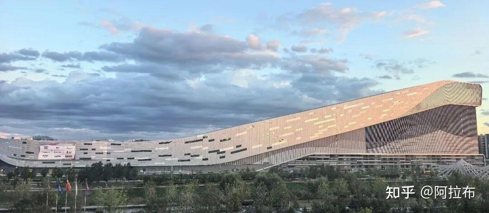
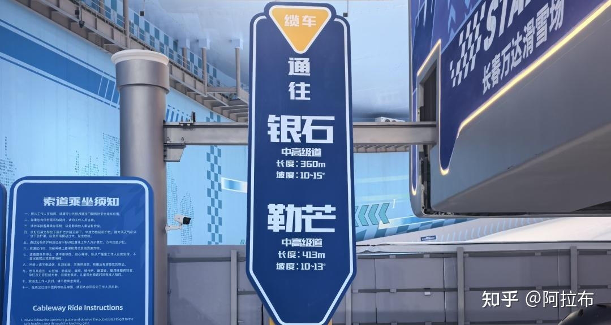
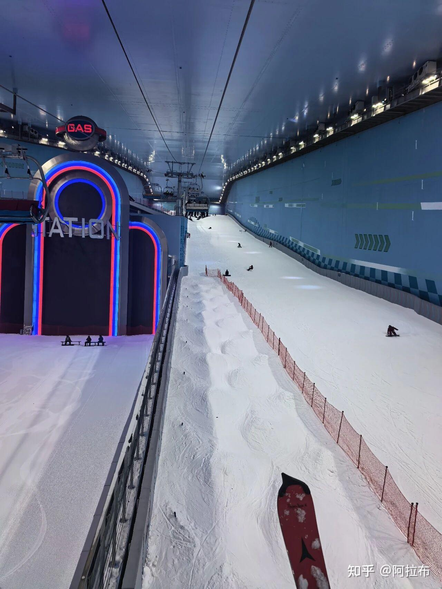
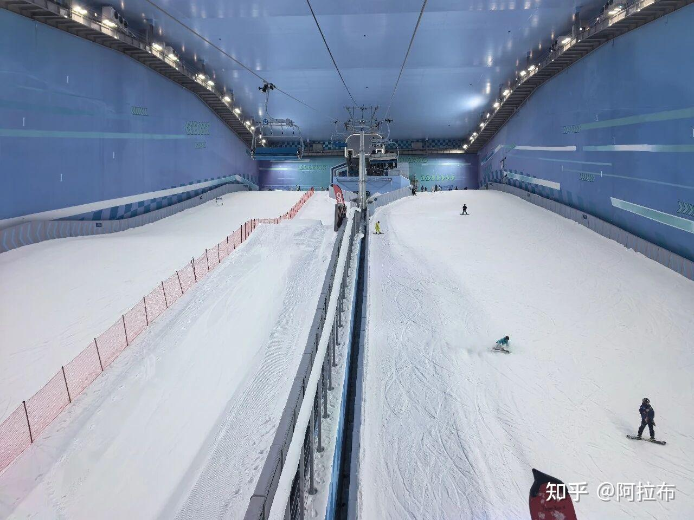
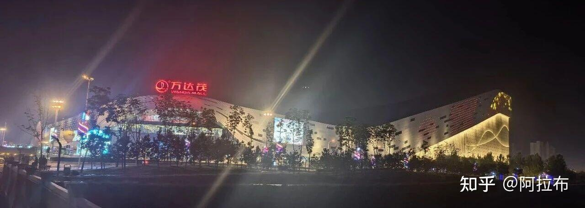

<!-- 来源: https://zhuanlan.zhihu.com/p/2083304543853585981 | 分类: 05_滑雪杂谈 | 发布: 2026-09-23 | 赞同: 3 -->

# 长春万达滑雪场体验——中国最大落差室内滑雪场

> 原文：[知乎 · 阿拉布](https://zhuanlan.zhihu.com/p/2083304543853585981)　·　发布于 2026-09-23　·　本文仅供学习交流，版权归原作者所有

最近终于有机会体验了几天中国最大落差室内滑雪场——长春万达滑雪场，意外发现勒芒这条中级道竟然非常惊艳。

长春万达滑雪场落差为85米，超过深圳前海室内滑雪场的83米，是当前国内落差最大的室内滑雪场。但雪场面积并不很大，只有5万平米。雪场设有四条雪道，两条60米的初级道和两条中高级道，分别是360米的银石和413米的勒芒。

银石是雪场最陡雪道，采用长直道设计，落差85米长度360米最大坡度15°，数据上与83米落差长度392米（含缓冲区）最大坡度18°的深圳前海高级道相仿，但银石略缓、可滑行距离更长，坡度变化非常均匀几乎没有起伏，滑行感受优于前海。这种几乎没有起伏的长直道只有武汉城建热雪奇迹（甘露山）的中级道与之接近，但甘露山的中级道坡度坡度太缓，感受不明显。因为对于较陡的雪道，需要更长的距离来稳定滑行，因此起伏间隔不够充分的话才会感受不佳。

> 相似雪道对比： - 哈尔滨热血奇迹黑龙道，更陡，三段有起伏，中间被出入口打断 - 深圳前海冰雪世界高级道，更陡一点，略短，三段有起伏 - 武汉甘露山高级道，坡度类似但略短 - 武汉甘露山中级道，略缓但更长，可惜下段出入口影响滑行 - 成都热雪奇迹中级道，更缓更短，中有起伏和出入口 - 上海耀雪高级道，非常陡，但有效滑行距离仅120米

勒芒道则是一条弯曲的中级雪道，先向右偏转再缓缓左转，最终转向90°，没有突兀的变向。雪道坡度中等，难度适宜，由6段坡面组成。在这种适中的坡度下，连续的起伏和偏转赋予滑雪者丰富活泼的滑行感受，尤其适合卡宾，可称得上国内最佳室内卡宾雪道。

> 相似雪道对比： - 广州热雪奇迹中级道230米太短 - 上海耀雪中级道可滑行长度仅235米 - 哈尔滨热雪奇迹麋鹿道400米，但坡度差异大，变向突兀，且有出入口无法连续滑行

长春万达滑雪场的另一个惊喜是雪质。尽管已经开业9个月，但是雪质非常好，许多区域甚至接近新造雪。银石的雪质最差，可能是滑得最多的区域。

尽管长春万达滑雪场配备了东北地区唯一的一条室内脱挂式抱索器四人吊椅缆车，但是现场运力非常差，仅百来人就得排队5分钟以上。原因有两个，一是吊椅间距太大，二是缆车太慢。尽管有数据显示缆车运行速度可达5m/s，但实际速度只有大约2.35秒，不足一半，而且上下座椅速度奇慢，简直难以忍受。如果能改善缆车运力太低的问题，长春万达滑雪场将实现雪道、雪质、运力三方面的全面领先。

> 室内脱挂式缆车速度对比： - 长春万达滑雪场85米落差：2分40秒，含上下座椅3分20秒 - 深圳前海冰雪世界83米落差：1分50秒 - 武汉甘露山73米落差：2分05秒 - 上海耀雪60米落差：3分15秒

